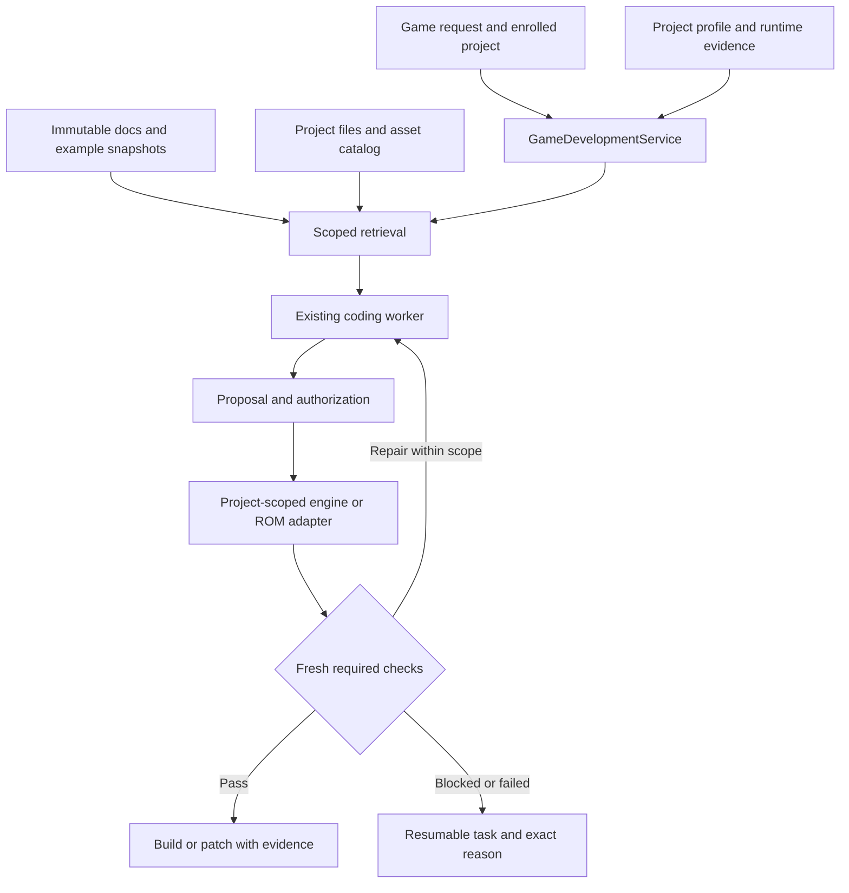

# Chatbot Game Development and ROM Engineering Implementation Plan

**Repository:** [DocDamage/chatbot](https://github.com/DocDamage/chatbot)  
**Reviewed baseline:** `c26d767345bd65e5192ed99e1213f8a1a0a7b110` on `main`, checked against the remote on 2026-11-03.  
**Primary environment:** local Windows application, existing TypeScript server and React client, existing model providers, SQLite first.  
**Targets:** Godot first; RPG Maker MZ, Unity, Unreal, and a game-specific SNES ROM workflow next.  
**Deliverable status:** implementation specification plus executable reference modules and tests. The application repository has not been modified. Reference modules are not a claim that a complete integration or native editor certification already exists.

## Contents

- [Read this first](#read-this-first)
- [1. Outcome and boundaries](#1-outcome-and-boundaries)
- [2. Verified baseline and exact integration points](#2-verified-baseline-and-exact-integration-points)
- [3. Target architecture](#3-target-architecture)
- [4. Project profiles, version resolution, and file policies](#4-project-profiles-version-resolution-and-file-policies)
- [5. Implementation phases and dependency order](#5-implementation-phases-and-dependency-order)
- [6. Coding-service integration contract](#6-coding-service-integration-contract)
- [7. Persistence, concurrency, recovery and runtime boundaries](#7-persistence-concurrency-recovery-and-runtime-boundaries)
- [8. API and UI implementation specification](#8-api-and-ui-implementation-specification)
- [9. Acceptance program and edge-case matrix](#9-acceptance-program-and-edge-case-matrix)
- [10. Definition of done and coding-agent operating rules](#10-definition-of-done-and-coding-agent-operating-rules)
- [11. Specialized implementation details](#11-specialized-implementation-details)
- [12. Reference implementations and validation](#12-reference-implementations-and-validation)
- [13. Primary external references](#13-primary-external-references)

## Read this first

The engineering objective is to make a request produce a correct, reviewable, verifiable project change. Loading more text into chat is only one part of that objective. The existing app has persistent storage, retrieval, source-editing workflows, real engine wrappers, and a reverse-engineering integration. Extend those components and connect them through a project-aware service.

The first product milestone is deliberately concrete:

> In an enrolled Godot project, add a checkpoint, respawn the player at the most recently activated checkpoint after death, update the existing UI, execute an input-and-state scenario, and return the changed files plus the actual verification result.

Use the user's supplied assets. A missing required asset produces a specific asset request and a blocked task with resumable state. Synthetic nodes and generated tiny fixtures are acceptable for automated tests; they are not finished product assets. Do not restart an existing game to make the task easier.

The companion code kit contains complete implementations of the pure contracts and guards described here. It also contains reference SQLite DDL, executable SQL checks, a Godot observation probe, and a coding-agent handoff. External services and editors are represented by explicit integration contracts and implementation tasks. No fake crawler, fake embedding provider, fake BPS codec, or fake gameplay success is supplied.

### How the coding agent should use the deliverables

1. Read this plan's baseline, architecture, decisions, and phase gates before editing the app.
2. Read `START_HERE.md`, `AGENT_HANDOFF.md`, and `VALIDATION.md` in the code kit.
3. Inspect the current repository and compare it with the pinned baseline. Preserve improvements made after this review.
4. Integrate the smallest phase into the existing architecture, porting the reference modules to the app's names and dependency injection conventions.
5. Port the meaningful reference tests into the app's Jest suite. The standalone Node test runner is provided so the reference code can be checked independently.
6. Finish the phase's executable gate before advertising the capability or moving to a broader target.

Do not copy every new file into production indiscriminately. The reference kit separates concerns to make behavior inspectable; the application should retain one authoritative implementation of each concern.

## 1. Outcome and boundaries

### 1.1 Required outcomes

- A server-owned project profile identifies the real project, owner, engine or platform, version, installed runtime, dependencies, and relevant file capabilities.
- A corpus is an immutable, identified snapshot of actual documentation or source contents. A repository overview is labelled as an overview.
- Retrieval selects eligible snapshots and versions before ranking. It preserves source citations and exact project context.
- Code drafting receives that retrieved context, not only generic chat history or optional remote documentation.
- The coding workflow can inspect, draft, apply under the current authorization policy, run the appropriate tools, collect evidence, and perform bounded repairs.
- The result distinguishes import/compile, editor inspection, smoke tests, gameplay behavior, export, and visual review.
- ROM work binds edits and patches to an exact original, with explicit address spaces and independently checked output.
- A crash, cancellation, stale file, exhausted budget, unsupported operation, missing tool, or missing asset has a recoverable and truthful outcome.

### 1.2 Architectural decisions

| Decision | Choice | Reason and consequence |
|---|---|---|
| Primary local store | Existing SQLite database and FTS integration | Lowest integration cost; existing durability and bundle work are reusable. |
| Larger vector deployment | Validate the existing PostgreSQL/pgvector path when needed | The code already implements it. Migration, transaction, and retrieval correctness come before scale tuning. |
| New vector service | Deferred pending measured need | A second backend would not fix corpus acquisition, version matching, or editor orchestration. |
| Model training | Deferred | First produce a corpus of verified tasks, edits, and outcomes. Documentation changes should normally be handled by versioned retrieval. |
| Primary generation worker | Existing Aider/CodingToolsService for the first game workflow | Reuse isolated drafts, existing source checks, model configuration, and review/apply behavior. |
| Other coding entry point | Adapt generic CodingAgent through the same context and verification services | Avoid a second game implementation with different facts and success semantics. |
| Engine operations | Existing GameEngineBridge and native adapters, corrected and scoped per project | Preserve working native execution and rollback machinery. |
| Binary assets | Engine-native or format-aware tools | Binary project files never pass through a generic UTF-8 file replacement path. |
| Unknown compatibility | Explicit unresolved/blocked state | No silent latest-version selection or invented compatibility. |
| Automatic repairs | Small, authorized scope with deadlines and attempt budgets | Existing authorization can cover work; a model cannot create its own authority or broaden that scope. |

### 1.3 Completion means observed behavior

A successful import is not a successful game change. A successful process exit is not proof of a gameplay requirement. A statement containing the word “test” is not verification. An empty assertion list is not success. A headless result says nothing about rendering unless a separate relevant rendering check ran.

The system must return the strongest claim supported by the collected evidence, and retain the weaker or missing checks explicitly. A task can be `blocked` because the correct editor is unavailable without being described as an implementation failure. It can also produce a valid draft while gameplay remains unverified; the UI must show that distinction.

## 2. Verified baseline and exact integration points

All source links in this section are pinned to the reviewed commit. Local database contents, installed editors, proprietary project assets, and the user's runtime configuration were not inspected.

| Existing area | Observed behavior | Required change |
|---|---|---|
| `src/core/initialization/ServiceInitializer.ts` | Constructs persistent store, DocumentManager, RAGService, GitHub importer, and coding services. | Add shared project registry, corpus snapshot services, retrieval adapter, and game service through dependency injection. |
| `src/core/database/Database.ts` | SQLite/PostgreSQL support, pgvector schema, SQLite FTS. | Add migrations through existing migration machinery; validate PostgreSQL separately before using it for the new workflow. |
| `src/core/rag/DocumentManager.ts` and `RAGDocumentStore.ts` | Real document ingestion and persistence. | Add staged immutable source snapshots and transactional activation; do not replace already visible source content in multiple independent batches. |
| `src/core/governance/KnowledgeBundleOperations.ts` | Real transactional SQLite bundle installer; one supplied document becomes one chunk; no embeddings; updates replace old dataset content. | Reuse the command surface, extend snapshot/version ownership and indexing lifecycle. |
| `src/core/importers/GitHubRepoKnowledgeImporter.ts` | Imports metadata and at most 3,000 characters of README text; not source contents; embeddings disabled. | Keep overview behavior named explicitly; add a separate bounded snapshot import mode. |
| `OfficialDocumentationPack` and `SourceCodePack` | In-memory component implementations without production callers found in the reviewed source. | Connect useful policies/chunkers to persistent ingestion; do not count these classes as installed corpora. |
| `src/core/embeddings/EmbeddingService.ts` | Local Transformers pipeline is opt-in; otherwise token-hash fallback. | Surface embedding mode, verify model identity, and exclude fallback vectors from semantic success claims. |
| `src/core/rag/HybridRetriever.ts` | Live filters do not carry engine/toolchain/snapshot constraints. | Add server-derived scope and enforce it before candidate selection/top-K. |
| `src/core/coding/integrations/CodingToolsService.ts` | Aider receives selected files and optional Context7 text, but no local game pack retrieval. | Inject a GameKnowledgeContextProvider and project-aware context selection. |
| `src/core/coding/integrations/AiderAdapter.ts` | Context is truncated to 8,000 characters; source budgets and checks are tuned to current coding use. | Budget complete evidence units, expose omitted context, and separate language checks from native game verification. |
| `ToolWorkspace.ts` and `AutomaticContext.ts` | Scene/assembly formats are excluded; `data` is excluded; import following is primarily JS/TS; captured source is bounded to 12 files/16 KB. | Add project-aware roles, dependency providers, and explicit budgeted context. Keep protections for sensitive/runtime paths. |
| `GameDevGeniusAgent.ts` | Balance/guidance path; keyword-based verification. | Delegate implementation intent to the real game service; use evidence-derived verification only. |
| `GamePrototypeGenerator.ts` | Returns a plan with `files: []`. | Produce a real proposal through the same workflow or report planning-only capability. |
| `gameStudioRoutes.ts` and `GameEngineBridge.ts` | Actual engine adapters, but mutable connections are keyed by engine rather than project session. | Introduce owner/project/runtime-scoped sessions and per-project exclusive mutation control. |
| `GodotTransactionManager.ts` | Action digest uses a JSON array-key replacer; nested action properties can be lost. | Replace with validated canonical JSON and regression tests before broad automatic editing. |
| `GodotSceneMutator.ts` | Some unsupported actions are silently ignored. | Advertise only implemented actions and reject unsupported ones before any mutation. |
| `ProjectMutationStore.ts` | Generic UTF-8 file replacement; `remove_node` can mean file deletion. | Separate file operations from semantic node/asset operations. |
| `NativeGameEditorBackends.ts` and instrumentation | Real editor processes; current probes have limited semantics. | Label editor inspection, smoke, behavior and export accurately; attach fresh evidence to each attempt. |
| `ReaProtocol.ts` | Static artifact/function analysis and evidence export. | Reuse analysis where the provider supports the target; implement a separate ROM modification/patch/test pipeline. |

Baseline sources: [initialization](https://github.com/DocDamage/chatbot/blob/c26d767345bd65e5192ed99e1213f8a1a0a7b110/src/core/initialization/ServiceInitializer.ts), [database](https://github.com/DocDamage/chatbot/blob/c26d767345bd65e5192ed99e1213f8a1a0a7b110/src/core/database/Database.ts), [RAG store](https://github.com/DocDamage/chatbot/blob/c26d767345bd65e5192ed99e1213f8a1a0a7b110/src/core/rag/RAGDocumentStore.ts), [bundle installer](https://github.com/DocDamage/chatbot/blob/c26d767345bd65e5192ed99e1213f8a1a0a7b110/src/core/governance/KnowledgeBundleOperations.ts), [GitHub importer](https://github.com/DocDamage/chatbot/blob/c26d767345bd65e5192ed99e1213f8a1a0a7b110/src/core/importers/GitHubRepoKnowledgeImporter.ts), [coding service](https://github.com/DocDamage/chatbot/blob/c26d767345bd65e5192ed99e1213f8a1a0a7b110/src/core/coding/integrations/CodingToolsService.ts), [Aider adapter](https://github.com/DocDamage/chatbot/blob/c26d767345bd65e5192ed99e1213f8a1a0a7b110/src/core/coding/integrations/AiderAdapter.ts), [game bridge](https://github.com/DocDamage/chatbot/blob/c26d767345bd65e5192ed99e1213f8a1a0a7b110/src/core/gaming/engine/GameEngineBridge.ts), [Godot transaction manager](https://github.com/DocDamage/chatbot/blob/c26d767345bd65e5192ed99e1213f8a1a0a7b110/src/core/gaming/godot/GodotTransactionManager.ts), [generic mutation store](https://github.com/DocDamage/chatbot/blob/c26d767345bd65e5192ed99e1213f8a1a0a7b110/src/core/gaming/engine/ProjectMutationStore.ts).

The repository records previous native editor certifications. Preserve that evidence as historical evidence; do not treat it as verification of a newly generated game or the present machine. Source: [recorded native editor checks](https://github.com/DocDamage/chatbot/blob/c26d767345bd65e5192ed99e1213f8a1a0a7b110/docs/implementation/evidence/profile-expansion/PRODUCTION_LIKE_EDITORS_CUDA_CERTIFICATION_2026-08-27.md).

### 2.1 Initial knowledge-pack catalog

Keep a small reviewed catalog in version control. Each entry points to a source acquisition adapter and an immutable import manifest; it is not itself proof that the source has been imported. Start with the Godot documentation and selected examples needed for the first feature. Add further sources only when their corresponding target phase starts.

| Proposed pack | Source and material | Version/selection rule | Initial extraction adapter |
|---|---|---|---|
| `godot-reference` | [Official Godot documentation source](https://github.com/godotengine/godot-docs): relevant class references, GDScript, scenes/resources, signals, input, physics, UI and persistence chapters. | Resolve the documented version branch once, pin the commit, and record its declared API coverage. Never silently ingest the development branch for a released project. | RST with heading/signature/code preservation; bounded supported includes. |
| `godot-examples` | [Official Godot demo projects](https://github.com/godotengine/godot-demo-projects): a selected small set of relevant examples, their scripts, scene/resource references and license evidence. | Use the matching version branch/commit and keep each example's project dependencies together. Build/import qualification belongs to that exact example snapshot. | GDScript plus explicit text scene/resource/config readers. |
| `unity-reference` | [Versioned offline documentation](https://docs.unity.com/en-us/engine/6000.0/manual/offline-documentation), installed package documentation and authorized local sample projects. | Bind the selected editor release, package lock and API/package versions. The linked 6000.0 page is an entry point, not a rule that the user's project must use 6000.0. | HTML/manual extraction plus C# and package-manifest readers. |
| `unreal-reference` | [Epic's C++ API documentation](https://dev.epicgames.com/documentation/en-us/unreal-engine/API), selected engine-version guides, local authorized engine/plugin headers and project samples. | Bind the actual engine build and enabled plugin versions. Source access and local visibility remain explicit; a reference-pack import must not republish local licensed content. | HTML, C++ headers/source and metadata; binary assets receive native summaries, not text embeddings. |
| `rpg-maker-mz-reference` | [Official MZ API](https://developer.rpgmakerweb.com/rpg-maker-mz/), the installed runtime's local API definitions, plugin headers and editor-generated event/data fixtures. | Distinguish MZ from MV and bind the installed core-script/runtime version. Derive event-command shapes from matching local fixtures. | HTML/JavaScript plus schema-aware JSON/event extraction. |
| `smw-snes-reference` | The selected `DocDamage/SMWDisX` source project, its include/symbol files, declared build documentation and the pinned [Asar manual](https://rpghacker.github.io/asar/asar_19/manual/). | Bind the user's inspected fork commit, assembler version, ROM revision and explicit address-space profile. Keep raw ROM identity separate from searchable source. | Assembly/include graph, symbol/address records and textual tool documentation. |
| `project-context` | The enrolled project's current scripts, scenes/data, package/plugin manifests, build configuration and user notes. | Owner-scoped project snapshot with current byte hashes; update independently of reference-pack snapshots. A user's authorized private source does not need a public open-source license to serve as their own project context. | Engine-specific file roles and dependency graph; no indiscriminate whole-directory ingestion. |

Do not label a documentation snapshot as an exact patch/build merely because the current project uses that build. Preserve the source's actual declared coverage, then attach an explicit, evidence-backed compatibility mapping to the exact requested target. This avoids forcing the retriever to choose between fabricated version metadata and no useful documentation.

Asset catalogs remain separate from prose/code retrieval. Record roles, paths, hashes, import settings, dimensions/animation names and references where relevant; retain binary assets for the native tool workflow. Additional console systems require their own CPU/address/disc/toolchain profiles and source catalog entries before ROM actions are enabled.

## 3. Target architecture



### 3.1 One service owns the workflow

Add `src/core/gaming/workflows/GameDevelopmentService.ts` as a coordinator, with small collaborators. It should not become a large class containing SQL, scraping, path parsing, editor commands, and prompt construction. Keep implementations approximately 300–500 lines or smaller where practical; split by responsibility rather than splitting a coherent function just to hit a number.

Proposed collaborators:

| Component | Responsibility | Existing component to reuse |
|---|---|---|
| ProjectRegistry / ProjectProfileResolver | Enroll approved roots; bind owner; detect project and exact runtime; persist profile revision. | ProjectPathGuard, runtime discovery, native backend inventory. |
| CorpusSnapshotService | Stage, validate, activate and retire immutable docs/source collections. | DocumentManager, RAGDocumentStore, existing bundle commands. |
| GameKnowledgeContextProvider | Resolve eligible snapshots, retrieve, rerank and render complete cited evidence units. | HybridRetriever, RAGService, local documentation policies. |
| ProjectContextProvider | Return scripts plus relevant scene/resource/plugin/symbol dependencies. | RepositoryIntelligence, existing source gateway, AutomaticContext. |
| GameDraftService | Produce a patch or engine mutation proposal without applying it. | CodingToolsService/Aider; later generic CodingAgent adapter. |
| ProjectSessionManager | Hold engine instances by project/runtime/session; manage cleanup. | GameEngineBridge and adapter implementations. |
| GameRunStore / RunWorker | Persist state, events, deadlines, resource reservations and recovery. | Existing jobs/history patterns; additive tables. |
| VerificationEvidenceService | Evaluate trusted expectations against fresh observations and process evidence. | Existing native runners and instrumentation, corrected. |
| AssetCatalogService | Index supplied assets and references; identify missing dependencies. | Sprite handoff manifests and existing asset inspectors. |
| RomProjectService | Enforce target identity, build/patch toolchain, fresh reapplication and emulator checks. | REA evidence where supported; project locks and run store. |

### 3.2 No duplicate authority paths

`GameDevGeniusAgent` should call this service for implementation intent. Game Studio routes should expose the same service or adapters behind it. Generic coding should obtain game context and verification through shared providers. A chat path must not bypass checks that the studio path enforces.

Only the authenticated server resolves an owner, tenant, project, installed executable, approval record, or tool capability. Request bodies may select an enrolled project or request an operation; they may not assert a different owner, supply an arbitrary executable, or manufacture an approval digest. Context snippets are reference data and cannot grant tool privileges.

An approval digest is an integrity identifier, not an authentication credential. Store authorization separately. Bind a proposal to its owner/project, profile digest, base file hashes, operations with every nested value, relevant tool capabilities, and required verification plan. Invalidate old proposals when the binding changes.

### 3.3 Staging, publishing, and repair scope

Prefer generating and running changes in an isolated project snapshot. Expensive assets may be copied through a verified content cache, but do not hardlink writable source or mutable native assets back to the original project. Do not use symlinks that let a worker mutate files outside the staging root. A read-only cache is a separate capability with its own path boundary.

Publication into the live project is an explicit checked operation under the application's existing authorization policy. A user-authorized bounded task can permit multiple repair attempts inside staging without asking the user on every iteration. Any promotion to a different file set, dependency installation, engine migration, new external operation, or destructive operation must match an existing scope or pause with the exact unmet requirement.

If staging cannot faithfully represent a project—for example, a native editor workflow requires registered external dependencies—report that constraint and use an explicitly supported in-place workflow with a journal and tested rollback. Never claim a multi-file filesystem operation is one atomic database transaction.

### 3.4 Scope services correctly

The chatbot checkout is not automatically the user's game project. `CodingToolsService.workspaceRoot` is fixed per instance, and Game Studio currently approves the application workspace root. Enrollment must explicitly register the selected game root, including an approved external drive location when requested, without opening the whole drive to tools.

Use a project-scoped coding service/session or an immutable per-request workspace context; never mutate a shared service's root while another request is running. Keep the model execution queue global to the local model resource even when coding services are project-scoped: the existing instance-local `aiderBusy` flag alone would permit concurrent model jobs across newly created service instances. Editor/process reservations, source mutation locks and model reservations are separate resources, with a consistent acquisition order to prevent deadlock.

## 4. Project profiles, version resolution, and file policies

### 4.1 Enrollment and identity

Enrollment records an approved canonical root, owner/tenant, project kind, and stable project key. Resolve the real path before comparing boundaries, and retain the observed filesystem identity where available. On Windows, handle drive-letter casing, junctions, UNC paths, case-insensitive collisions, and paths that resolve differently after a move. Reject alternate data streams and ambiguous trailing dots/spaces.

The `ProjectFilePolicy` reference is lexical classification only. Production still requires realpath confinement, sensitive-file policy, symlink/junction protection, byte limits, decoding validation, and apply-time hashes. It must never be used as a standalone authorization mechanism.

Two paths referring to the same physical project must share a mutation lock. Two users with access to the same root must not accidentally create independent writers. Project movement requires re-enrollment or an explicit verified relocation; a root string change is not automatically the same project.

### 4.2 Required profile facts

Record engine/platform, exact version observations, selected executable identity, project descriptor hashes, relevant packages/plugins, build target, renderer where relevant, language/toolchain, and a profile digest. Include the confidence/source of every inferred fact. A profile that needs a decision is not a resolved profile.

Keep three concepts separate: `projectId` identifies the enrolled physical project; `profileDigest` binds its complete observed configuration; `targetId` identifies the exact reusable knowledge compatibility facets. The knowledge target excludes owner IDs, project roots and mutable project snapshot hashes, so two projects with the same relevant API requirements can share documentation. An Unreal display version such as `5.8.3` is not a complete source-build identity: preserve build metadata/changelist/branch and require the correct build binding or an explicitly selected verified runtime.

| Target | Version evidence | Edge cases |
|---|---|---|
| Godot | Output of the selected executable's `--version`; project feature requirements; C#/.NET requirements where present. | `config_version` is a file-format version. Custom builds, release candidates, mono builds, and missing exports are distinct. Do not guess an exact release from a project feature label. |
| Unity | `ProjectSettings/ProjectVersion.txt`; matching installed editor; `Packages/manifest.json` and lock data. | Preserve `f`, `p`, `a`, `b` suffixes; multiple installed editors; unavailable platform modules; render-pipeline/input-system package mismatch. |
| Unreal | `.uproject` EngineAssociation; resolved installed/source build's Build.version and executable; enabled plugins/modules. | Association may be a GUID; source builds and changelists matter; plugin compatibility can differ even within the same engine release. |
| RPG Maker MZ | Enrolled project marker, runtime version evidence, core script hashes, plugin list/order/parameters. | Read metadata statically; do not evaluate `plugins.js` in the chatbot server. Patched runtime scripts can differ at the same advertised version. |
| ROM | Raw original hash/size, exact title/revision/region mapping, platform, representation, toolchain and manifest provenance. | Same extension does not establish the same ROM. Headered/unheadered files and disc tracks require distinct representation identities. |

Unknown runtime selection should result in a small actionable choice, not an automatic project migration. A missing editor can still permit read-only inspection and a labelled draft if the user wants that; it cannot support a verified gameplay result.

### 4.3 File roles and dependency graphs

Use roles rather than one universal extension whitelist:

- `editable-text`: code and text scene/resource content with an appropriate parser/validator.
- `structured-data`: schema-aware game database/event/plugin changes.
- `engine-native`: serialized scene/prefab/Blueprint/asset operations.
- `binary-tool`: format-aware ROM and patch operations.
- `read-only`: dependency metadata, symbols, engine core, asset metadata, and documentation.
- `excluded`: credentials, generated caches, unsupported formats, or paths outside the project scope.

RPG Maker's `data/*.json` and ROM source under `data/` are legitimate project files. Fix the overbroad directory exclusion with a project-aware policy, while preserving independent secret and runtime-directory checks. Generated code or engine-owned files should have explicit reasons for being read-only; never treat every file under `Assets` or `Content` as freely editable.

Build context through engine-specific relationships:

- Godot: `res://` and UID references, scene inheritance, external/subresources, script attachments, node paths, signals, autoloads, input actions, and GDScript `load`/`preload` relationships. Dynamic paths stay unresolved rather than guessed.
- Unity: GUID-to-asset references, `.meta` identity, assemblies, scripts/components, prefab relationships, scene hierarchy, packages and scripting defines. Editor inspection is authoritative for native asset semantics.
- Unreal: module includes, `.Build.cs`/`.Target.cs`, reflected types, plugin dependencies, Asset Registry references and editor-produced Blueprint descriptions.
- MZ: database IDs and null sentinel entries, map IDs, event pages, switches/variables, plugin order and command definitions, image/audio references.
- ROM: include/incbin relationships, linker/assembler files, exported symbols, memory ranges, tables, and build-specific generated listings.

Retrieval and context budgets are explicit. The first integration can retain conservative caps; it must tell the user which necessary context was omitted. Do not simply increase every limit. Prefer a small editable working set plus relevant read-only spans and staged follow-up tasks. Maintain exact original bytes for eventual hashes and patches even when a normalized text representation is used for search.

Change every relevant layer of the read path together. Updating `ToolWorkspace` alone will not make a file discoverable: `ApprovedRepositoryGateway` has its own ignored directories and search text extensions. Its shared `WorkspacePathPolicy` also excludes directories named `private`, which would hide legitimate Unreal `Source/<Module>/Private` implementations. Introduce a project-aware policy injection shared by discovery, reads, search and write preflight, retaining credential rules while recognizing specific enrolled game-source locations. Test through the real route, not just the extension classifier. Sources: [workspace policy](https://github.com/DocDamage/chatbot/blob/c26d767345bd65e5192ed99e1213f8a1a0a7b110/src/core/coding/security/WorkspacePathPolicy.ts), [repository gateway](https://github.com/DocDamage/chatbot/blob/c26d767345bd65e5192ed99e1213f8a1a0a7b110/src/core/coding/security/ApprovedRepositoryGateway.ts).

Versioned public example packs and the user's active project source have different provenance requirements. Preserve the curated-pack license policy, but do not require a user's private game project to declare an open-source license just to provide authorized local coding context. Record unknown provenance honestly rather than inventing a license or silently omitting the implementation the task must edit.

### 4.4 Assets and templates

Create an asset catalog that records path, hash, type, dimensions/duration/mesh metadata, source attribution where known, import settings, dependencies, and project references. Reuse existing manifests rather than inventing an unrelated storage system. File bytes remain in file storage; searchable metadata belongs in the existing database.

For sprites, preserve pixel filtering, frame bounds, origin, atlas margins and animation names. For 3D assets, inspect units, skeleton identity, material dependencies and import scale. For audio, inspect codec and sample information without silently re-encoding the user's originals. For paid local assets, record the local source and known provenance; do not fabricate a license.

Template creation should instantiate a version-qualified template into a new target only when the task requests a new project. Record template commit, source assets and modifications. An existing project must be edited in place or through an isolated staging copy of itself. A failed integration is not permission to replace it with a simpler template.

## 5. Implementation phases and dependency order

The following order is intentional. Framework scaffolding without a functioning phase gate does not count as completion.

| Phase | Depends on | Deliverable | Required gate |
|---|---|---|---|
| G00 — Baseline and truthful boundaries | Existing checkout | Baseline report, regression fixtures, corrected integrity/capability/success checks. | Nested action change alters digest; unsupported operation has zero writes; empty evidence cannot pass. |
| G01 — Project identity and context | G00 | Enrolled profiles, exact runtime resolution, project-aware file roles and dependency context. | Two projects cannot share a mutable engine session; missing/wrong versions block execution; scenes/data/assembly have correct roles. |
| G02 — Corpus acquisition and lifecycle | G01 | Actual docs/source snapshots, structural chunks, persistent provenance, activation/rollback. | Partial import is invisible; old active snapshot survives failure; parallel engine versions remain queryable. |
| G03 — Retrieval into code generation | G02 | Filtered hybrid retrieval, verified embedding spaces, complete cited evidence in coding prompts. | Wrong version/revision never reaches prompt; restart works; editing task demonstrably uses locally imported reference text. |
| G04 — Durable run orchestration | G00–G03 | Game service, project locks, run state/events, scoped authorization, repair loop, cancellation/recovery. | Crash/retry does not duplicate an apply; expired/stale authority cannot write; bounded repairs stop predictably. |
| G05 — Godot checkpoint milestone | G04 | Actual checkpoint change in a supplied project; native behavior scenario; optional export. | Activate two checkpoints, die, respawn at most recent one, update existing UI, preserve unrelated state, retain logs. |
| G06 — Asset/template workflow | G01, G05 | Asset catalog, missing-asset resolution, qualified template initialization. | Missing assets block with exact requirements; no unsolicited placeholder product assets; reference links survive import. |
| G07 — RPG Maker MZ | G04, G06 | Schema-aware database/events/plugins plus test play. | Plugin load order and map/database IDs preserved; chosen feature runs in the matching MZ project. |
| G08 — Unity | G04, G06 | Matching editor/package profile, native scene/prefab operations, Play Mode behavior. | Actual component and prefab edits persist and runtime behavior passes; GUIDs and unrelated overrides remain stable. |
| G09 — Unreal | G04, G06 | Native actor/asset/Blueprint operations and gameplay automation. | A real gameplay/functional test passes; editor-world inspection alone cannot satisfy it. |
| G10 — First ROM target | G01–G04 | Exact SMW target enrollment, baseline build, change/patch/reapply/emulator workflow. | Baseline comparison independent of tool exit code; intended change verified; original unchanged; patch reapplies to exact original. |
| G11 — Operational release | Relevant target phase | UI, packaging, diagnostics, retention, performance and recovery acceptance. | Usable on the user's Windows machine with accurate capability display and reproducible evidence bundles. |

G07–G10 may be developed independently after the shared foundations, but qualify one target completely before describing all of them as supported. Avoid simultaneous GPU-heavy editor and model jobs on the local machine until resource measurements justify concurrency.

### 5.1 Concrete first backlog

| ID | Change | Main files | Exit evidence |
|---|---|---|---|
| G00.1 | Rebaseline main and map the existing routes/services. | `ServiceInitializer`, route manifest, current status docs. | Commit, selected environment, existing command results; no dependency reinstall just for documentation. |
| G00.2 | Add canonical nested proposal identity. | Godot transaction manager; shared proposal utility. | Tests for nested values, order, nonfinite values, mutation after approval and exact digest binding. |
| G00.3 | Make capabilities executable contracts. | GodotSceneMutator, ProjectMutationStore, adapter capabilities. | Unsupported action rejects before side effects; semantic remove-node cannot delete a file. |
| G00.4 | Replace false verification semantics. | GameDevGeniusAgent, native evidence parser, domain eval naming. | Empty/missing assertions fail; metadata validation never claims gameplay evaluation. |
| G01.1 | Add project enrollment and runtime profile resolution. | New project registry/resolver; runtime discovery. | Wrong version, duplicate installation, GUID association and moved-root cases. |
| G01.2 | Add project-scoped session factory. | GameEngineBridge wiring; Game Studio routes. | Concurrent requests for two Godot projects never cross roots. |
| G01.3 | Add file-role and dependency providers. | ToolWorkspace, AutomaticContext, source filter. | Godot scenes, MZ data and ASM usable under scope; secrets/caches remain excluded. |
| G02.1 | Add immutable source snapshot identity and source manifest parser. | New snapshot types/service; existing dataset commands. | Branch moved during import cannot mix commits; content hash and source path resolve. |
| G02.2 | Implement bounded GitHub/local-doc acquisition. | Separate snapshot importer; DocumentManager adapters. | Truncated GitHub tree, LFS pointer, binary, bad encoding, oversized file and cancellation handled. |
| G02.3 | Implement stage/validate/activate/rollback. | Existing store plus additive ownership tables. | Simulated crash before activation leaves old corpus active; rollback restores exact snapshot. |
| G02.4 | Validate embedding space and reindex lifecycle. | EmbeddingService; embedding metadata/query filters. | Hash fallback marked lexical/degraded; dimensions/model revisions cannot mix. |
| G03.1 | Apply scope before ranking and persist evidence selection. | HybridRetriever/RAGDocumentStore; new context provider. | Wrong engine/revision negative controls; replay exact evidence selection from run artifact. |
| G03.2 | Wire local references into the Aider request. | CodingToolsService.propose; AiderAdapter budgeting. | A known local reference appears in the draft request without silent truncation. |
| G04.1 | Add durable run state/events, idempotency and project fencing. | GameRunStore, worker, new migrations. | Duplicate request, crash after apply, stale lease and cancellation races. |
| G04.2 | Add evidence-backed bounded repairs. | Game service, repair policy, native adapters. | Same failure/no-op patch stops; changed file scope needs applicable authority; no infinite loops. |
| G05.1 | Implement the checkpoint change through the live route. | Agent delegation plus chosen Godot project. | Actual files changed and relevant behavior observed. |
| G05.2 | Run failure and persistence scenarios. | Scenario driver and independent expected checks. | Death before checkpoint, latest checkpoint, save/reload if required, scene reload and stale-node cases. |
| G05.3 | Export and package only when requested/supported. | Existing Godot export backend. | Fresh output hash/path, matching templates, nonzero exit rejection, artifact opens where available. |

Later target backlogs and their edge cases are specified in the dedicated sections below. Each PR description should explain the problem, changed behavior, actual validation and remaining limitations. Do not mark an entire engine complete because one adapter class compiles.

## 6. Coding-service integration contract

### 6.1 Change the data flow deliberately

Add an optional game request scope to the authenticated coding route, using an enrolled `projectId` and server-resolved target profile. Resolve the project from the authenticated owner rather than accepting an arbitrary workspace root. Existing nongame requests must preserve current behavior.

Within the game path:

1. Load and validate the current profile and selected runtime evidence.
2. Resolve active snapshot IDs once and pin them to the run.
3. Retrieve engine/version-compatible documentation and examples.
4. Select editable files and supporting project context through the engine provider.
5. Render complete, numbered evidence blocks with source ID, snapshot, file/section, version and content.
6. Check combined task, source, documentation, tool-description and expected-output budget.
7. Call the existing Aider proposal method with those references as explicitly untrusted documentation.
8. Preserve citations and the complete context manifest alongside the resulting proposal.
9. Run language checks appropriate to the files. Mark native import/gameplay checks separately.

For the first integration, keep Context7 as an optional supplement. Local pinned documentation is the primary source for exact engine/project compatibility. Do not transmit private source in a public library lookup query. If Context7 is unavailable, a local qualified corpus should remain useful; the run should disclose the missing supplement rather than fail unconditionally.

### 6.2 Budget complete units

`AiderAdapter` currently slices documentation to 8,000 characters. Do not append a larger context and assume it is used. Change the interface to accept a rendered context whose complete units fit the budget, or reject it with a clear reason. Never cut midway through a signature, code block, license/provenance record, or example dependency explanation.

Record selected and omitted units, each unit's content hash, byte/token accounting method, and source role. A byte bound is a hard safety limit; a token estimate is not an exact tokenizer result. Use a matching tokenizer when available, otherwise use a conservative configured estimate and reserve output space. Do not allocate the model's advertised entire window to source material.

If required project context cannot fit, split the requested change into explicitly tracked steps or ask for the one decision that determines the implementation. Do not silently drop the save schema, a base scene, a plugin dependency, or an assembler include and then guess.

### 6.3 One structured result

The public game-task result should contain `runId`, project/profile identity, current state, proposal summary, changed paths, citations, checks grouped by kind, remaining uncertainties, and downloadable artifacts. The internal result additionally contains input hashes, runtime/executable identity, snapshots, repair attempts and logs. Do not expose raw credentials, absolute private paths unnecessarily, or unrelated source excerpts to another owner.

Any generated explanation is derived from that result. It cannot upgrade `not_run`, `blocked`, or `failed` to “verified.” The client renders status from structured fields, not by scanning generated prose.

## 7. Persistence, concurrency, recovery and runtime boundaries

### 7.1 Additive SQLite reference schema

The companion `sql/002_game_runs.sqlite.sql` creates projects, runs, events, persistent fencing leases, proposals, approvals and artifacts. It is a reference migration, not a replacement for the current database. Integrate it through the application's migration ledger after a backup and restore check. Test against a copy of an existing database containing prior data as well as an empty fixture.

Store state updates and the corresponding event in the same short transaction. Update using owner/tenant and expected revision. A zero-row update is a conflict and must not be silently overwritten. `Idempotency-Key` is scoped to an authenticated owner/tenant; reuse with a different request digest returns conflict instead of starting or returning an unrelated job.

For SQLite, use `BEGIN IMMEDIATE` or the existing equivalent transaction facility for bounded mutations; do not hold that transaction while downloading, embedding, running an LLM, waiting for approval, or launching an editor. SQLite supports one simultaneous writer, so retry busy errors with a bounded deadline and report contention. For PostgreSQL, use a checked-out client for `BEGIN`/queries/`COMMIT`; a pool-wide sequence does not guarantee the same connection. Sources: [SQLite transactions](https://www.sqlite.org/lang_transaction.html), [node-postgres transactions](https://node-postgres.com/features/transactions).

### 7.2 Per-project lease and process ownership

A lease has a holder run, expiry, heartbeat, and monotonically increasing fence. Never delete the lease row to release it, because that resets the fencing sequence. Every mutating host operation checks that it still owns the expected fence. The stale worker must not publish after a new worker takes over.

Lease expiry by itself does not prove an editor process has stopped. Persist enough process identity to distinguish PID reuse, and verify termination or reconcile the previous operation before reassignment. A Windows job object or another qualified process-tree mechanism is preferable to killing only the top-level process. Preserve evidence for incomplete termination and return `interrupted`/recovery required when certainty is unavailable.

### 7.3 Filesystem journal and crash recovery

Before any apply, re-read all required base hashes and the approved proposal digest, validate every action capability, and prepare a journal and backups. Record the exact preimage, intended output hash, operation type and destination for each file or native asset. If preflight fails, make zero changes.

Use same-filesystem temporary output and atomic per-file replacement where the platform supports it. A group of file replacements is not all-or-nothing by itself. A persisted journal records completed steps; recovery either completes a still-authorized transaction or restores only files whose current hashes match the transaction's known outputs. If the user changed a file after a crash, stop rather than overwriting that edit with an old backup.

Native editor transactions need their own qualified rollback path. Do not assume an editor undo stack survives a process crash. Preserve original binary assets and sidecars, and test recovery after the relevant save operation. Never use generic UTF-8 backups for `.uasset`, `.umap`, or ROM content.

### 7.4 Native commands and cancellation

Use executable paths resolved from enrolled runtime inventory and argument arrays, with shell execution disabled for ordinary executables. Give each run an isolated working directory, allowlisted environment, time limit, output cap and process-tree cancellation strategy. The caller chooses a tool ID, not a free-form shell command.

Windows `.bat`/`.cmd` tools require special handling; do not solve that by interpolating the user's prompt into a command line. Qualify a fixed adapter/wrapper for tools such as Unreal's RunUAT. Validate paths and tool-owned parameters, use an audited quoting strategy, and reject unsupported shell metacharacter cases until they are tested. A path with spaces must be covered by live tests. Source: [Node child-process documentation](https://nodejs.org/docs/latest-v24.x/api/child_process.html).

Wait for process close and collect complete bounded logs before final classification. A zero exit code with malformed or missing required evidence fails. A nonzero exit cannot be overridden by a convincing marker in stdout. A cancelled or timed-out run cannot later publish its output merely because the subprocess eventually exits successfully.

### 7.5 Retention and resource budgets

Use configurable budgets for corpus download bytes, file count, decoded text bytes, per-file size, chunk count, embedding batch size, model context, concurrent workers, engine duration, repair attempts, log size and artifact size. Publish defaults as configuration, not universal performance promises. Start with one model generation and one project mutation at a time on the local desktop; measure whether any overlap is worthwhile.

Garbage collection must respect references from active snapshots, citations, saved proposals, ongoing runs, artifacts and rollback journals. Do not reuse existing seven-day coding-log cleanup blindly for reproducibility evidence needed by a longer-lived game project. Store sensitive full logs locally with scoped access; redact only the user-facing summary while keeping the original log hash and access policy.

## 8. API and UI implementation specification

These are **proposed endpoints and commands**, not endpoints claimed to exist in the reviewed application.

| Endpoint | Purpose | Key contract |
|---|---|---|
| `POST /api/game-projects` | Enroll a project under an approved local root. | Owner from session; canonical root checked; profile can return unresolved requirements. |
| `GET /api/game-projects/:id/profile` | Inspect project/runtime/capabilities. | Do not label installed executable as certified functionality. |
| `POST /api/game-projects/:id/refresh-profile` | Reobserve changed settings/runtime. | New digest invalidates stale proposals when relevant. |
| `POST /api/game-runs` | Start a task for an enrolled project. | Idempotency key, user request, constraints, asset selection; no owner/executable/approval claims from body. |
| `GET /api/game-runs/:id` | Return structured state and evidence summary. | Owner scoped; no private cross-project data. |
| `GET /api/game-runs/:id/events` | Progress stream with resume cursor. | Reconnect does not create a duplicate task; cursors identify persisted events. |
| `POST /api/game-runs/:id/cancel` | Request cancellation. | Idempotent; final cancelled state waits for process and mutation reconciliation. |
| `POST /api/game-runs/:id/resume` | Resume a blocked/interrupted task after revalidation. | Fresh profile/hashes/authority; never automatically replay uncertain writes. |
| Existing proposal approval/apply surface | Review and apply exact changes. | Reuse and harden current gate rather than adding an independent approval bypass. |
| `GET /api/game-runs/:id/artifacts/:artifactId` | Download evidence/build/patch. | Resolve server-owned artifact record and root; verify ownership and stored hash; no arbitrary path query. |
| Knowledge snapshot commands/routes | Import, validate, activate, list, retire. | Explicit source and pinned version; progress state; active corpus unchanged on failure. |

Use the existing local-developer route manifest and hosted-mode restrictions. Register new routes through that mechanism, including authentication, CSRF/origin behavior where applicable, and error mapping. Browser disconnection should not accidentally cancel a durable job; change the current per-request abort behavior deliberately for the asynchronous game route while retaining an explicit cancel endpoint.

### 8.1 User-facing flow

The game workspace should show the selected project and observed version, its actual capabilities, knowledge-pack status, asset readiness, and the task result. A short preview of intended changes should identify files and native operations. A result panel should show separate build, behavior, export and review statuses with expandable evidence.

Progress labels describe actual work: resolving project, reading references, drafting changes, importing project, running checkpoint scenario, repairing a specific error, or waiting for a named missing asset. Avoid generic “thinking” or synthetic percentages disconnected from work units.

A missing asset request should specify the role, accepted formats, required animations/dimensions if relevant, and where it will be used. A wrong-version block should identify the project version, discovered runtime, and available resolution choices. A failed test should include the expected state, observed state, relevant log excerpt, and whether a repair is still within scope.

### 8.2 Capability vocabulary

Use separate fields for `installed`, `configured`, `supportedOperation`, `lastQualifiedRun`, and `currentTaskCheck`. “Unreal installed” is not “Blueprint editing supported.” “Docs imported” is not “embeddings active.” “Editor opened” is not “gameplay verified.” Show the last qualification environment and date without implying that it certifies every project.

## 9. Acceptance program and edge-case matrix

Use independent expected results and immutable test inputs. The model may fix implementation files; it cannot weaken the acceptance manifest or replace the host verifier in order to pass. Preserve the failing case when it discovers a genuine regression. Avoid tests that merely repeat implementation formulas or assert a mock returned the value supplied to it.

| Area | Case | Required behavior |
|---|---|---|
| Source acquisition | Branch moves between listing and file fetch | All content comes from the resolved immutable commit, or the import aborts. |
| Source acquisition | API tree reports truncation | Traverse bounded subtrees or fail with explicit incompleteness; do not activate a silently partial pack. |
| Source acquisition | LFS pointer/submodule/symlink | Classify explicitly; no vectorizing a pointer as implementation or following an unchecked path. |
| Source acquisition | UTF-16, malformed UTF-8, huge minified file, archive bomb | Detect/convert allowed text with original-byte provenance; enforce decoded and extraction limits. |
| Corpus lifecycle | Download, parser, embedding or DB fails halfway | Old active snapshot stays available; staged data remains hidden and resumable/cleanable. |
| Corpus lifecycle | Same content appears in two versions | Share immutable content only where ownership preserves both versions/citations; no cross-version deletion. |
| Retrieval | Godot 3 example ranks higher than Godot 4 example | Ineligible example excluded before selection for a Godot 4 implementation task. |
| Retrieval | Query uses exact API symbol or ROM address | Exact search contributes; semantic similarity cannot erase identity constraints. |
| Retrieval | Embedding model loads fail or dimensions change | Visible degraded mode/reindex requirement; no mixed-space vectors or silent semantic-success claim. |
| Retrieval | Active corpus changes during a run | Run remains pinned to its original snapshot set. |
| Context | Scene references a missing resource | Report missing dependency; do not invent a replacement path. |
| Context | Required dependencies exceed budget | Explain omissions and split the task or require more specific scope; no silent guessing. |
| Path policy | Windows drive aliases, case collision, junction escape, ADS | Resolve and reject ambiguity/escape; physical project has one writer identity. |
| Authorization | Nested action parameter changes after approval | Digest mismatch; zero writes. |
| Authorization | Owner/tenant/project mismatch | Denied before source or artifact exposure. |
| Authorization | Exact approval expires before apply | No apply; an existing valid scope can authorize a new exact record if policy permits. |
| Mutations | Unsupported node action | Explicit unsupported result before any changes; no silent no-op or whole-file deletion. |
| Mutations | User edits file between draft and apply | Stale-base conflict; regenerate against current content. |
| Mutations | Crash after the first of several writes | Reconcile journal; do not blindly replay or overwrite unrelated later edits. |
| Concurrency | Same project requested via two tabs/aliases | Serialized mutation with a shared fence and accurate busy status. |
| Concurrency | Lease expires while old editor remains alive | No unsafe takeover; stop/reconcile old process first. |
| Verification | Empty assertions or missing payload with exit 0 | Required behavior check fails or is unverified. |
| Verification | Old marker/log/output file | Reject run/attempt/proposal/runtime mismatch and stale artifact. |
| Verification | Successful marker with nonzero process exit | Failure dominates. |
| Verification | Editor-world actor exists, but gameplay never runs | Only editor-inspection check may pass. |
| Repair | Same failure and same/no-op patch repeats | Stop with evidence; do not consume unbounded model/tool time. |
| Repair | Repair needs a new file/dependency or larger scope | Match an existing authorized scope or pause with exact reason. |
| Cancellation | Browser reconnect, user cancel, timeout race | Durable state follows the defined policy; no duplicate run or late publication. |
| Godot | Death before any checkpoint | Respawn at agreed stage entrance, not an uninitialized position. |
| Godot | Checkpoint twice, scene reload, player node replaced | Correct most recent checkpoint, no duplicate signal handling, stable UI reference. |
| MZ | Null array sentinel, event-page order, plugin order | Preserve required structure and ordering; changes validated against references. |
| Unity | Prefab override and GUID references | Preserve identities/overrides; native editor verifies the resulting project. |
| Unreal | Binary asset mutation or unsupported Blueprint operation | Qualified native adapter only; no generic text fallback. |
| ROM | Headered original but unheadered address/patch assumption | Reject representation mismatch; make conversion explicit and keep both hashes. |
| ROM | Wrong region/revision or already modified baseline | Reject against enrolled exact identity; new baseline requires deliberate enrollment. |
| ROM | Build wrapper exits zero after failed comparison | Independently compare expected baseline bytes/hash. |
| ROM | Patch applies but output differs | Fail artifact verification; emulator launch does not excuse mismatch. |
| ROM | Emulator boots title screen | Boot check only; requested gameplay change remains unverified. |
| Assets | Required art/animation absent | Specific resumable asset block; no unsolicited product placeholders. |
| Packaging | Export template/module/license unavailable | Exact prerequisite block; do not report playable export. |

### 9.1 Retrieval evaluation set

Create a small manually reviewed evaluation set for the first Godot pack before importing every source. Include symbol lookup, conceptual wording, exact version conflict, deprecated API, scene-to-script dependency, missing documentation, and a malicious instruction embedded in a reference page. Record expected eligible source IDs and forbidden source IDs. Evaluate retrieval separately from generation so a model's prior knowledge cannot hide a broken importer.

Then run task evaluations: checkpoint behavior, inventory addition, signal connection repair, scene resource dependency repair, and a deliberate wrong-version example. Save the selected context manifest, model configuration, patch, tool observations and host evaluation. Compare changes to retrieval/model configuration using the same tasks and constraints; do not report a tiny fixture pass rate as general engine competence.

### 9.2 Native qualification matrix

At minimum qualify the actual Windows environment and selected versions. Record exact editor executable and version evidence, project profile, build target, renderer/headless mode, plugin versions, device/runtime details, and a reproducible command description. Local native checks can be conditional in general CI, but they are mandatory before claiming the corresponding capability is qualified.

Text-only tests can run without GPU/editor dependencies. Native import, gameplay and export gates run where those dependencies exist. Screenshot or visual review has its own renderer/device constraints. A headless smoke fixture must not be used to infer production FPS or visual quality.

## 10. Definition of done and coding-agent operating rules

For each phase, require all of the following:

1. Real production callers use the new code on the intended route. A test-only module is not a completed feature.
2. Data survives restart where persistence is part of the feature. No in-memory map is described as durable installation state.
3. Error, cancellation, stale-state and unsupported cases have explicit results.
4. Meaningful focused tests cover the changed boundary; relevant native checks run for claimed native capabilities.
5. The UI and API describe current evidence accurately.
6. Existing nongame chat, source coding, knowledge installation and project behavior remain intact.
7. Source citations, profile/snapshot IDs, changed files and evidence are available for review.
8. Documentation lists any remaining unsupported cases plainly; no placeholder success paths or hardcoded benchmark results.

Use the current repository scripts for type checking and focused Jest runs. Do not run expensive unrelated suites repeatedly after the concrete risk is resolved. Add new commands only when their implementations exist. Proposed useful command names include `knowledge:snapshot:import`, `knowledge:snapshot:verify`, `eval:game-retrieval`, and `verify:game-project`; exact names should follow current command conventions.

Preserve existing app instructions and dependencies. Use a branch or worktree for implementation when appropriate. Avoid wholesale framework replacement, file reshuffling unrelated to the phase, or changing the selected model at the same time as retrieval/tool integration, since that makes failures harder to attribute.

When work is blocked, report the exact missing dependency, unsupported operation or required user decision and keep the draft/evidence available. Continue all independent authorized work that remains possible. Do not convert a blocker into a fictional successful result.

## 11. Specialized implementation details

The following sections expand the knowledge, engine/orchestration, and ROM work into implementation-level contracts, SQL/query patterns, tool qualification tasks, and additional edge cases. The phase order and single-service decisions above govern their integration.

### 11.1 Versioned knowledge acquisition and retrieval

This section extends the repository's existing ingestion, persistence, retrieval, and bundle machinery. The accompanying TypeScript files are executable reference implementations of the identity, eligibility, embedding validation, and rank-fusion rules. They are deliberately independent of application types. They do not fetch repositories, generate embeddings, or replace `RAGService`.

#### 1. What already exists, and the precise gaps to close

Evidence below was read from commit `c26d767345bd65e5192ed99e1213f8a1a0a7b110`. These are observations about that checkout, not claims about a later upstream version.

| Existing component | Verified behavior | Required integration change |
|---|---|---|
| [`GitHubRepoKnowledgeImporter.ts`](https://github.com/DocDamage/chatbot/blob/c26d767345bd65e5192ed99e1213f8a1a0a7b110/src/core/importers/GitHubRepoKnowledgeImporter.ts) | Imports repository metadata and README excerpts; keeps at most 400 tree entries; the README request does not include the selected branch/ref; sends the summary to `DocumentManager.addText` with embeddings disabled. | Keep discovery separate from actual source ingestion. Resolve an immutable commit, enumerate approved files completely, fetch their bytes at that same commit, and record coverage. |
| [`OfficialDocumentationPack.ts`](https://github.com/DocDamage/chatbot/blob/c26d767345bd65e5192ed99e1213f8a1a0a7b110/src/core/knowledge/OfficialDocumentationPack.ts) and [`SourceCodePack.ts`](https://github.com/DocDamage/chatbot/blob/c26d767345bd65e5192ed99e1213f8a1a0a7b110/src/core/knowledge/SourceCodePack.ts) | Maintain their own in-memory collections. Official docs use `startsWith(targetVersion)` and downweight mismatches rather than excluding them. Source packs reject all forks. | Reuse their policies and extractors through an adapter that emits the existing `DocumentChunk` contract plus the new immutable provenance. Do not treat their in-memory search as the live integration. |
| [`DocumentationChunker.ts`](https://github.com/DocDamage/chatbot/blob/c26d767345bd65e5192ed99e1213f8a1a0a7b110/src/core/knowledge/DocumentationChunker.ts) and [`SourceCodeStructuralChunker.ts`](https://github.com/DocDamage/chatbot/blob/c26d767345bd65e5192ed99e1213f8a1a0a7b110/src/core/knowledge/SourceCodeStructuralChunker.ts) | Documentation chunking consumes Markdown. Code chunking detects a limited regex-based symbol set, uses bounded line windows around symbols, and can emit a whole file when no symbol is found. Code IDs omit commit; documentation IDs are normalized strings. | Add format-specific extraction and hard byte/token bounds; replace IDs with immutable identities. Preserve source line/anchor mapping. Treat syntax-parser absence as a labeled fallback, never as proof a complete symbol was parsed. |
| [`RAGDocumentStore.ts`](https://github.com/DocDamage/chatbot/blob/c26d767345bd65e5192ed99e1213f8a1a0a7b110/src/core/rag/RAGDocumentStore.ts) | `saveChunks` deletes old source citations, embeddings, and chunks in one batch, inserts subsequent batches, and completes the run separately. PostgreSQL and several SQLite search paths apply metadata filters after their SQL `LIMIT`. Embeddings store provider/model/dimensions, but queries do not restrict their space identity. | Add a staged snapshot write path and SQL eligibility joins before ranking/limits. Retain the current generic import behavior until callers are migrated, but route game knowledge through the staged path only. |
| [`Database.ts`](https://github.com/DocDamage/chatbot/blob/c26d767345bd65e5192ed99e1213f8a1a0a7b110/src/core/database/Database.ts) | Already has SQLite FTS5 with insert/update/delete triggers, PostgreSQL full-text search, and pgvector. `chunk_embeddings` currently allows one row per chunk. | Preserve these backends. Add ownership/selection tables and a versioned embedding relation. Verify FTS freshness; do not create another disconnected index. |
| [`KnowledgeBundleOperations.ts`](https://github.com/DocDamage/chatbot/blob/c26d767345bd65e5192ed99e1213f8a1a0a7b110/src/core/governance/KnowledgeBundleOperations.ts) | The SQLite installer is transactional and checks immutable bundle-version content. Its update path deletes old dataset sources/chunks, while its source/chunk IDs omit the dataset version. Older `knowledge_dataset_versions` rows therefore do not imply older content remains queryable. It explicitly refuses PostgreSQL. | Keep these useful checks, introduce a versioned bundle contract, and insert immutable snapshots plus membership rows. An active-version change must not destroy retained content. Do not advertise PostgreSQL bundle installation until it has a real adapter and integration test. |
| [`EmbeddingService.ts`](https://github.com/DocDamage/chatbot/blob/c26d767345bd65e5192ed99e1213f8a1a0a7b110/src/core/embeddings/EmbeddingService.ts) | Local model loading is gated on `EMBEDDING_USE_TRANSFORMERS=true`; absent or failed loading returns hashed token vectors. Other providers can fall back locally. `getDimensions` assumes defaults by provider; local pipeline creation uses `defaultModel`, not a cache keyed by every requested model. | Return the actual model identity and provenance with every result. Reject hash fallback from semantic retrieval. Infer no dimensions from provider name. Key model instances by full immutable model/pipeline identity. |
| [`HybridRetriever.ts`](https://github.com/DocDamage/chatbot/blob/c26d767345bd65e5192ed99e1213f8a1a0a7b110/src/core/rag/HybridRetriever.ts), [`RAGService.ts`](https://github.com/DocDamage/chatbot/blob/c26d767345bd65e5192ed99e1213f8a1a0a7b110/src/core/rag/RAGService.ts), and [`ChatRuntimeStages.ts`](https://github.com/DocDamage/chatbot/blob/c26d767345bd65e5192ed99e1213f8a1a0a7b110/src/core/chat/ChatRuntimeStages.ts) | Filters include authority/project/visibility/trust, not exact engine/toolchain versions or snapshot IDs. Live chat calls `retrieveContext(message, limit)` without a target. | Thread the verified project profile and captured snapshot selection through the actual live chat path, not only a standalone retrieval-policy class. |

`AtomicDatasetActivation` and `ReembeddingMigrationService` provide useful lifecycle concepts, but their state lives in maps. They are not durable transactions, restart recovery, or evidence that the current runtime reads the selected snapshot. Preserve useful interfaces while implementing persistence-backed behavior through the existing database layer. [Activation source](https://github.com/DocDamage/chatbot/blob/c26d767345bd65e5192ed99e1213f8a1a0a7b110/src/core/knowledge/AtomicDatasetActivation.ts), [migration source](https://github.com/DocDamage/chatbot/blob/c26d767345bd65e5192ed99e1213f8a1a0a7b110/src/core/knowledge/ReembeddingMigrationService.ts).

#### 2. Contracts and invariants

##### 2.1 Separate four identities

1. **Project target identity:** a canonical, exact projection of the verified project profile. It includes the engine or ROM platform, exact API/toolchain version, programming language, and platform/ABI facets that can change the answer. It is not a guessed semver prefix. The game workflow owns target resolution; retrieval requires a resolved ID. Missing target information produces a targeted question or explicitly unversioned background material, never a guessed version for generated code.
2. **Snapshot identity:** `corpus + canonical source + immutable revision + manifest hash + extractor version + chunker version`. The manifest includes the evidence target, approved source scope, license/provenance policy, and file-selection rules. Include these fields in the canonical manifest digest before calling `createSnapshotIdentity`.
3. **Chunk occurrence identity:** `snapshot + exact relative source path + exact line/section locator + content hash`. A new commit or extractor produces a new occurrence identity even if some text remains identical. Do not lowercase paths or collapse punctuation into an ID.
4. **Embedding-space identity:** `provider + actual model + immutable revision + dimensions + paired preprocessing version + pooling + normalization + distance`. Matching vector length alone is insufficient.

The code's `contentSha256` is a reusable byte identity, not a membership key or authorization decision. Two packs may own the same snapshot. Two snapshots may contain the same content bytes, but their chunk occurrences remain separate. Physical content/embedding caches may deduplicate later using content hash plus embedding-space identity while preserving all occurrence records and access restrictions.

##### 2.2 Manifest contract for a source adapter

Use a schema-validated manifest with at least:

```ts
interface PinnedSourceManifestV1 {
  schemaVersion: 1;
  corpusId: string;
  datasetId: string;
  datasetVersion: string;          // immutable; reuse with different bytes is an error
  sourceKey: string;               // canonical identity, e.g. github:owner/repository
  sourceKind: 'git' | 'archived-html' | 'local-docs';
  requestedRef?: string;           // audit only; never used after resolution
  immutableRevision: { kind: 'git-commit' | 'artifact-sha256'; value: string };
  evidenceTargetId: string;        // exact source target; not the user's guessed target
  includePaths: string[];
  excludePaths: string[];
  formats: Array<'markdown' | 'rst' | 'html' | 'code' | 'xml'>;
  license: { expression: string; evidencePath: string; sha256: string };
  forkPolicy: { permitted: boolean; upstreamSourceKey?: string; rationale?: string };
  extractorVersion: string;
  chunkerVersion: string;
  requiredSemanticSpaceId?: string; // absence explicitly permits lexical-only activation
  limits: { maxFiles: number; maxFileBytes: number; maxTotalBytes: number; maxChunks: number };
}
```

This is a proposed application contract, not a schema already accepted by the existing installer. Version the bundle schema rather than passing these fields into its current strict objects. Never synthesize missing licenses, claim a fork is upstream, or turn an unavailable source into a successful empty pack. Resolve authorization and visibility separately from version eligibility; `corpusId` is an additional boundary, not a replacement for authentication.

##### 2.3 Retrieval request contract

Capture `corpusId`, exact `targetId`, selected exact snapshot IDs, explicit compatibility approval records, embedding-space ID, and head generation in one read transaction. These are trusted server decisions, not arbitrary client-provided allowlists. An approval binds **requested target, evidence target, immutable snapshot, approving evidence, and validity**. A same-major version, prefix match, missing version, or older documentation page never implies compatibility.

`compileEligibilityPolicy` copies the supplied IDs and approvals so caller mutation cannot widen the request. It rejects missing metadata and unapproved/staged/failed/retired content. Compatibility remains labeled in the returned evidence. Compatibility validation must be completed by an operator or a versioned test/evidence policy before its approval record is loaded; this helper does not decide whether two engine versions are compatible.

For a comparison or migration query, create one scope per target and retrieve separately. Keep citations and context under their target labels. Do not union both versions into one unconstrained candidate list and let the model guess which API belongs to which version. An explicitly pinned retained snapshot can remain `ready` even when it is no longer a head's default.

#### 3. Delivery phases and acceptance gates

##### Phase K1 — exact identities, durable membership, and lexical retrieval

Add the immutable identity/eligibility contracts, additive database sidecars, a synthetic two-version fixture, and the target argument through `ChatRuntimeStages → RAGService.retrieveContext → HybridRetriever → RAGDocumentStore`. Use lexical retrieval first. This phase must prove that a project on one version cannot retrieve the conflicting example from another version and that the new request reaches the live chat entry point. A standalone policy-unit test is insufficient.

Backfill existing knowledge as `legacy-unversioned` or leave it outside the new sidecars. Do not infer a trustworthy snapshot from mutable URLs or null embedding metadata. General chat can retain its current behavior; version-sensitive game code generation requires complete metadata and the new route.

##### Phase K2 — one real pinned source adapter and a versioned bundle

Start with one approved source/engine family and one exact version already selected by the project. Finish acquisition, format extraction, staging, validation, and activation for that source before adding more engines or sources. The small end-to-end fixture should include a documentation page, a source example, a license file, an ignored binary, and a deliberately malformed file. Only a manifest-listed mandatory file failure blocks the entire version by default; optional exclusions are counted and recorded.

Keep `GitHubRepoKnowledgeImporter` useful for discovery summaries. Add a separately named pinned source-import operation instead of quietly changing its metadata-only behavior. Reuse `DatasetRegistry`, dataset license policy, and the existing canonical knowledge commands. Installation should accept an already materialized versioned bundle; downloading is a separate resumable job. This keeps imports reviewable and offline installation reproducible.

##### Phase K3 — verified semantic embeddings and hybrid ranking

Introduce an embedding envelope, pin an actual model/weights revision, and validate every query/document vector. A failed model load produces an embedding error and a recorded lexical-only result when the manifest permits it. If semantic embeddings are mandatory for a pack, validation fails and the old head stays active. Never relabel a hash vector or another provider's output as the requested model.

Use a small stored evaluation set to select the initial model and chunk size. Compare the eligible lexical baseline with the candidate hybrid implementation. Do not choose a model solely because the repository lists its dimensions or marks it as free. A hosted provider that cannot supply an immutable model/deployment revision requires a separately documented policy; do not invent a weight hash. The first strict implementation can use a locally pinned model whose bytes are verifiable.

##### Phase K4 — version coexistence, refresh, and retention

Add a second version, update/rollback tests, crash recovery, and shared-pack ownership tests. Refresh resolves the configured ref again, writes a new snapshot if bytes or transforms changed, validates it, and advances only the relevant head with compare-and-swap. Another project's pinned head is unaffected. A corpus or embedding refresh never mutates an in-flight job's selected snapshot IDs.

Keep the last two activated generations and at least a proposed 30-day rollback window, plus every project/job/citation pin. Treat these as starting operational defaults to tune with actual disk usage. Garbage collection requires no live membership or pin, expiration of retention, and a final transactional reference check. Removing a pack drops its membership; it does not delete content still owned by another pack.

#### 4. Source acquisition and extraction details

##### 4.1 Git acquisition algorithm

1. Validate the configured canonical repository against the approved-source manifest. Record the repository's declared upstream/fork relationship. Prefer upstream; permit a fork only through an explicit exception with a reason, exact commit, license evidence, and a deduplication relationship. A necessary community-maintained fork must not be silently rejected by the existing blanket fork rule or silently treated as official.
2. Resolve the requested ref once into a full commit digest. Persist it before fetching content. Every tree, blob, README, license, and submodule decision must refer to that immutable revision. An unpinned README must not be mixed with a pinned tree.
3. Inspect the tree response for completeness/truncation. If incomplete, traverse subtrees with bounded requests or use an approved bounded local checkout of that commit. If completeness still cannot be established, fail or publish an explicitly scoped manifest; never silently accept the first 400 entries as the whole repository. Do not assume a truncated recursive tree has a pagination parameter that fixes it.
4. Classify paths before downloading. Reject traversal, absolute paths, control characters, symlinks escaping the allowed root, submodule traversal, LFS pointers without approved retrieval, archives, binaries, generated vendor trees, and files outside approved directories. Source path handling must use segment-wise URL encoding; never interpolate a raw path into a shell command or decode it repeatedly.
5. Fetch approved blobs with timeouts, bounded concurrency, bounded retries, rate-limit-aware backoff, and a resumable checkpoint keyed to commit plus manifest. Verify actual received length against quotas and the supplied digest where available. Metadata size is an early hint, not the final byte count. Cancellation aborts outstanding requests and leaves the stage resumable or failed.
6. Materialize a file manifest: path, raw digest, raw bytes, format, extraction status, accepted/excluded reason, source URL at commit, line-map/anchor-map digest, license evidence, and extracted digest. Record zero-byte and undecodable files explicitly.

Proposed starting limits are 5,000 accepted files, 512 KiB per textual file, 32 MiB raw selected input, 20,000 chunks, and a bounded acquisition time. Tune them using the first corpus. They are not permissions to silently truncate: exceeding a hard limit fails the stage or requires a deliberately narrower manifest. Preserve the current installer's 32 MiB encoded bundle limit until a streamed/versioned import implementation is actually added; raw input limits alone do not bound JSON bundle size.

##### 4.2 Format adapters

| Format | Preserve | Reject or constrain |
|---|---|---|
| Markdown | Heading ancestry, fenced code, signatures, tables, links, front matter as data | Unclosed fences need an explicit parse warning; front matter cannot set importer permissions or execute code. |
| RST | Underlined headings, directives, literal blocks, code-block language, tables, labels, API signatures | Do not execute Sphinx extensions or resolve arbitrary `include`/`raw` directives. Support approved in-tree includes at the pinned revision with cycle/depth/byte bounds, or record their exclusion. |
| HTML | Main content, heading hierarchy, anchors, tables, `pre`/`code`, canonical version context | Strip scripts/navigation/forms; do not run page JavaScript. Allowlist every redirect and asset/include fetch. A current mutable URL needs an archived content digest and capture metadata. |
| Source code | Imports, declarations, full signatures, comments relevant to the symbol, source lines, language | Use parser-backed boundaries when available. Bounded line-window fallback must be marked as such. An oversized function splits into numbered pieces with repeated signature context and an explicit continuation link. |
| XML API data, when needed | Class/member names, types, descriptions, version attributes | Disable DTD/entity/network resolution. Do not add XML support until a selected source actually needs it. |

For Godot, support `.gd` and resource/config formats only through explicit adapters; for C#/C/C++ examples, retain the relevant compiler/API context. ROM development knowledge can include approved textual assembler sources and hardware documentation. A `.asm` extension alone does not identify the CPU or assembler dialect. ROM images, BIOS files, executables, textures, audio, and other binary assets are excluded from semantic text ingestion; retain only authorized workspace metadata/hashes when the separate build/patch workflow needs them.

Chunk around a 640-token target with a proposed 1,024-token hard cap, using the selected embedding tokenizer before the provider call. Enforce an independent UTF-8 byte cap; the reference identity helper rejects chunks over 64 KiB. Character or whitespace counts are insufficient for multilingual text or source code. Preserve original versus extracted line maps: an HTML extraction line number is not a valid original code citation. Never chop content with `.slice()` and claim the truncated bytes are a complete symbol.

Run injection scanning before promotion, persist the decision, and enforce it in database retrieval as well as the memory path. Retrieved source is data; instructions in documentation, comments, or a README cannot grant execution permissions or alter the project profile.

#### 5. Additive SQLite ownership schema

The following schema is executable SQLite DDL once the repository's existing schema is initialized. It references the existing `document_chunks`, `knowledge_datasets`, and `knowledge_dataset_versions`; it creates no new vector backend. Use the migration framework, a schema version, foreign keys enabled on every connection, and backups before production rollout. These are new tables, not declarations that already exist in the checkout.

```sql
PRAGMA foreign_keys = ON;

CREATE TABLE IF NOT EXISTS knowledge_snapshots (
  id TEXT PRIMARY KEY,
  corpus_id TEXT NOT NULL,
  source_key TEXT NOT NULL,
  evidence_target_id TEXT NOT NULL,
  revision_kind TEXT NOT NULL CHECK (revision_kind IN ('git-commit', 'artifact-sha256')),
  revision_value TEXT NOT NULL,
  manifest_sha256 TEXT NOT NULL CHECK (length(manifest_sha256) = 64),
  extractor_version TEXT NOT NULL,
  chunker_version TEXT NOT NULL,
  state TEXT NOT NULL CHECK (state IN ('staging', 'validated', 'ready', 'failed', 'retired')),
  retrieval_approved INTEGER NOT NULL DEFAULT 0 CHECK (retrieval_approved IN (0, 1)),
  expected_files INTEGER NOT NULL CHECK (expected_files >= 0),
  accepted_files INTEGER NOT NULL DEFAULT 0 CHECK (accepted_files >= 0),
  expected_chunks INTEGER NOT NULL CHECK (expected_chunks >= 0),
  lexical_ready INTEGER NOT NULL DEFAULT 0 CHECK (lexical_ready IN (0, 1)),
  required_embedding_space_id TEXT,
  validated_at TEXT,
  created_at TEXT NOT NULL DEFAULT CURRENT_TIMESTAMP
);
CREATE INDEX IF NOT EXISTS idx_knowledge_snapshots_scope
  ON knowledge_snapshots(corpus_id, evidence_target_id, state);

CREATE TABLE IF NOT EXISTS knowledge_snapshot_chunks (
  snapshot_id TEXT NOT NULL REFERENCES knowledge_snapshots(id) ON DELETE RESTRICT,
  chunk_id TEXT NOT NULL UNIQUE REFERENCES document_chunks(id) ON DELETE RESTRICT,
  source_path TEXT NOT NULL,
  locator_json TEXT NOT NULL,
  content_sha256 TEXT NOT NULL CHECK (length(content_sha256) = 64),
  PRIMARY KEY (snapshot_id, chunk_id)
);

CREATE TABLE IF NOT EXISTS knowledge_version_snapshots (
  dataset_version_id TEXT NOT NULL REFERENCES knowledge_dataset_versions(id) ON DELETE RESTRICT,
  snapshot_id TEXT NOT NULL REFERENCES knowledge_snapshots(id) ON DELETE RESTRICT,
  PRIMARY KEY (dataset_version_id, snapshot_id)
);
CREATE INDEX IF NOT EXISTS idx_knowledge_snapshot_owners
  ON knowledge_version_snapshots(snapshot_id);

-- Composite parent key makes a head unable to point at another dataset's version.
CREATE UNIQUE INDEX IF NOT EXISTS idx_dataset_version_identity
  ON knowledge_dataset_versions(id, dataset_id);
CREATE TABLE IF NOT EXISTS knowledge_target_heads (
  corpus_id TEXT NOT NULL,
  dataset_id TEXT NOT NULL REFERENCES knowledge_datasets(id) ON DELETE RESTRICT,
  target_id TEXT NOT NULL,
  dataset_version_id TEXT NOT NULL,
  generation INTEGER NOT NULL CHECK (generation >= 1),
  activated_at TEXT NOT NULL DEFAULT CURRENT_TIMESTAMP,
  PRIMARY KEY (corpus_id, dataset_id, target_id),
  FOREIGN KEY (dataset_version_id, dataset_id)
    REFERENCES knowledge_dataset_versions(id, dataset_id) ON DELETE RESTRICT
);

CREATE TABLE IF NOT EXISTS knowledge_snapshot_pins (
  snapshot_id TEXT NOT NULL REFERENCES knowledge_snapshots(id) ON DELETE RESTRICT,
  owner_type TEXT NOT NULL CHECK (owner_type IN ('project', 'job', 'citation', 'retention')),
  owner_id TEXT NOT NULL,
  expires_at_epoch INTEGER,
  PRIMARY KEY (snapshot_id, owner_type, owner_id)
);

CREATE TABLE IF NOT EXISTS knowledge_compatibility_approvals (
  id TEXT PRIMARY KEY,
  corpus_id TEXT NOT NULL,
  requested_target_id TEXT NOT NULL,
  evidence_target_id TEXT NOT NULL,
  snapshot_id TEXT NOT NULL REFERENCES knowledge_snapshots(id) ON DELETE RESTRICT,
  evidence_uri TEXT NOT NULL,
  valid_until_epoch INTEGER NOT NULL,
  revoked INTEGER NOT NULL DEFAULT 0 CHECK (revoked IN (0, 1))
);
CREATE INDEX IF NOT EXISTS idx_knowledge_compatibility_lookup
  ON knowledge_compatibility_approvals(corpus_id, requested_target_id, snapshot_id, revoked);
```

Application validation additionally checks canonical IDs and digest syntax; SQL `length(...)` alone does not validate a hash. A snapshot's manifest and immutable fields are insert-only after staging. A collision on an existing ID must compare the complete immutable record and succeed only if identical. Do not use `INSERT OR REPLACE` on immutable rows: its delete/insert semantics can break ownership and FTS assumptions.

The unique `chunk_id` in the sidecar is intentional: the reference chunk identity already contains a snapshot. Shared ownership is represented by multiple `knowledge_version_snapshots` memberships pointing at the same snapshot. Do not save one global content-hash chunk and then overwrite its version metadata for the last importer.

For PostgreSQL, retain the same relational keys and constraints, use `TIMESTAMPTZ` for timestamps, `JSONB` for locators/manifests, and use transactions on one checked-out connection. Do not rely on independent pooled queries to share a transaction. Preserve the SQLite-only restriction in the existing bundle command until its PostgreSQL transaction adapter is implemented and tested.

#### 6. Stage, validate, activate, retain

##### Stage

Create or resume a `staging` snapshot and ingestion job with an immutable manifest digest. Persist source rows and chunks using snapshot-qualified IDs. Batches may commit while staging; all version-sensitive readers require a ready snapshot and a selected membership, so staged rows are invisible. Metadata copied onto `DocumentChunk` is useful for citations, but the relational joins remain authoritative. Keep generated chunks out of `HybridRetriever.addDocuments` until promotion, or make its index generation explicitly snapshot scoped.

##### Validate

Validate acquisition coverage; mandatory file presence; extraction warnings; accepted, excluded, and failed counts; total bytes; chunk/token bounds; checksums; source/license evidence; target identity; injection decisions; duplicate IDs; FTS availability; and required embedding coverage. At minimum, run a stored positive retrieval query and an adversarial wrong-version query. Count rows from the persisted stage rather than trusting the importer's in-memory counters. A valid empty optional file is different from a mandatory page whose parser returned empty text.

The existing FTS triggers should populate newly inserted chunks. After migration/backfill, verify FTS integrity and rebuild once if needed under a controlled maintenance action. A count over an external-content FTS table is not by itself proof its inverted index is current. Use actual MATCH probes, including a token newly added in this snapshot and a removed token after garbage collection. Do not issue a full rebuild for every request or every imported file.

##### Activate

Use one short write transaction after expensive acquisition, parsing, embedding, and evaluation have completed. In SQLite begin with `BEGIN IMMEDIATE`; in PostgreSQL lock the head row or use a compare-and-swap update. Re-read the staged snapshot and memberships; assert same corpus/target, immutable IDs, validated counts, required embedding coverage, and still-current approval. Transition validated snapshots to `ready`, insert the new dataset-version memberships, and update the head using the expected generation. Commit the ingestion/job result and activation audit event in the same transaction. All failures roll back the pointer change.

The head update for an existing installation has this shape:

```sql
UPDATE knowledge_target_heads
SET dataset_version_id = ?, generation = generation + 1,
    activated_at = CURRENT_TIMESTAMP
WHERE corpus_id = ? AND dataset_id = ? AND target_id = ?
  AND dataset_version_id = ? AND generation = ?;
```

Require exactly one changed row. A zero-row update is a concurrent activation conflict, not success; re-read and decide whether the requested immutable version is already installed. For first installation use a unique-key insert and handle an insert conflict the same way. Never resolve this by last-write-wins. If activation spans multiple required datasets, update all affected heads in the same transaction; a request must not observe half of a coordinated release.

The transaction updates pointers and verification state; it does not delete the former version. A process crash before commit leaves the old head; after commit leaves the new head and a durable completed record. Restart recovery reconciles staged jobs by ID and persisted state. An exception is not a reason to delete all source rows matching a mutable URL.

##### Retain and collect

Readers capture selected snapshot IDs and head generation once per request, then use that selection for lexical, semantic, reranking, context assembly, and citations. Jobs pin their selected snapshots until completion/retention expiry. A refresh cannot change the evidence behind a job that has already begun.

Garbage collection first proves a snapshot has no live dataset-version membership or pin. Delete its sidecar rows, then its occurrence-specific embeddings and chunks, then unreferenced source rows, within a transaction. Existing FTS delete triggers must run. Keep audit metadata separately when the payload is collected. An old `knowledge_dataset_versions` row must explicitly distinguish retained/queryable from metadata-only/collected. A rollback can activate only a retained validated snapshot; otherwise it requires a new verified import.

#### 7. Retrieval: scope before top-K, then fuse

##### 7.1 SQLite lexical query

Resolve a bounded list of allowed `(snapshot_id, evidence_target_id)` pairs from the captured exact selection and valid explicit compatibility approvals. Deduplicate pairs before building the query, preferring the exact designation if an identical pair also has a compatibility approval. Generate only the number of SQL placeholders; all values are parameters. The following example has two selected pairs:

```sql
WITH allowed(snapshot_id, evidence_target_id) AS (
  VALUES (?, ?), (?, ?)
)
SELECT dc.id, dc.content, dc.metadata,
       s.id AS snapshot_id, s.corpus_id, s.evidence_target_id,
       bm25(document_chunks_fts) AS lexical_distance
FROM document_chunks_fts
JOIN document_chunks dc ON dc.rowid = document_chunks_fts.rowid
JOIN knowledge_snapshot_chunks sc ON sc.chunk_id = dc.id
JOIN knowledge_snapshots s ON s.id = sc.snapshot_id
JOIN allowed a ON a.snapshot_id = s.id
              AND a.evidence_target_id = s.evidence_target_id
WHERE document_chunks_fts MATCH ?
  AND s.corpus_id = ? AND s.state = 'ready'
  AND s.retrieval_approved = 1 AND s.lexical_ready = 1
ORDER BY lexical_distance ASC, dc.id ASC
LIMIT ?;
```

The empty allowed set returns no rows without running an unconstrained fallback. The same eligibility join must appear in title/source matching and the LIKE fallback. Oversampling an unfiltered global result and discarding other engine versions afterwards does not implement this rule; eligible documents may have already been dropped. Bound and quote FTS tokens in the query builder rather than accepting arbitrary FTS syntax from an untrusted question.

Retain exact symbols and identifiers in a supplemental symbol/heading matching channel where useful. Generic prose tokenization loses meaningful source distinctions such as API names, register names, paths, and numeric addresses. Apply target/snapshot checks before a symbol boost or source-authority boost.

##### 7.2 Embedding schema migration and query restrictions

Migrate the current one-row-per-chunk embedding schema to a composite `(chunk_id, embedding_space_id)` relation, with an `embedding_spaces` registry containing all fields in `EmbeddingSpaceSpec`. Persist `origin='semantic-model'`, checked dimensions, finite/norm validation outcome, and creation metadata. Preserve `embedding_json` for SQLite and `embedding_vector` for PostgreSQL. Keep validation at the service boundary even when SQL constraints exist.

This requires a real reader/writer migration: current `ON CONFLICT(chunk_id)` writes and joins by chunk ID alone must be updated together. For rolling deployment, create a temporary versioned relation, build verified rows beside the legacy table, deploy the new repository adapter, validate reads, and retire the legacy layout after the rollback window. Do not populate missing revisions by assuming the original requested provider/model produced legacy vectors. Regenerate unknown vectors; lexical retrieval remains available when policy permits.

Filter candidate and query vectors by the **same embedding-space ID and exact dimension before distance scoring and LIMIT**. In PostgreSQL establish an exact baseline over a materialized eligible relation; the following uses the intended migrated schema:

```sql
WITH allowed(snapshot_id, evidence_target_id) AS (
  VALUES ($1::text, $2::text), ($3::text, $4::text)
), eligible AS MATERIALIZED (
  SELECT dc.id, dc.content, dc.metadata, ce.embedding_vector
  FROM allowed a
  JOIN knowledge_snapshots s ON s.id = a.snapshot_id
       AND s.evidence_target_id = a.evidence_target_id
  JOIN knowledge_snapshot_chunks sc ON sc.snapshot_id = s.id
  JOIN document_chunks dc ON dc.id = sc.chunk_id
  JOIN chunk_embeddings ce ON ce.chunk_id = dc.id
  WHERE s.corpus_id = $5 AND s.state = 'ready' AND s.retrieval_approved = 1
    AND ce.embedding_space_id = $6 AND ce.dimensions = $7
    AND ce.origin = 'semantic-model' AND ce.embedding_vector IS NOT NULL
)
SELECT id, content, metadata, 1 - (embedding_vector <=> $8::vector) AS similarity
FROM eligible
ORDER BY embedding_vector <=> $8::vector, id
LIMIT $9;
```

Validate the query vector before serialization. In SQLite select eligible vectors in bounded batches with the same constraints and compute cosine similarity only for those rows. A lexical-candidate-only semantic rescore is a useful cheap mode but cannot retrieve a semantic-only match; name that mode accurately in diagnostics. Introduce broader vector search only after measuring its cost and recall.

Add ANN indexes only after the exact filtered query is correct and measured. An index spanning multiple dimensions or models needs a deliberate per-space layout and fixed dimension; do not interpolate arbitrary request dimensions into index DDL. A globally approximate top-K with target filters applied afterwards can still have poor eligible recall. Choose space/target partitioning or a verified filtered-search strategy based on the installed pgvector version, and benchmark against the exact baseline before enabling it.

##### 7.3 Reciprocal rank fusion

`fuseEligibleRanks` applies the eligibility predicate, removes repeated chunk IDs within each channel, assigns new ranks, and then computes `sum(1 / (60 + rank))`. It sorts channel names before accumulation and breaks fused-score ties by chunk ID so timing and locale do not change the result. A duplicated chunk in one channel contributes once. Conflicting provenance for one chunk ID is an error. It retains compatibility approval IDs in its output.

The helper is a final defensive check; it cannot recover eligible rows discarded by an earlier unfiltered SQL limit. Inputs must already be ordered by their own channel's ranking with a deterministic ID tie-break. Lexical BM25 values and cosine scores must not be added as if they had the same scale. Pool query expansions inside a modality before fusion so ten nearly identical expansions do not count as ten independent evidence votes.

Reranking and compression receive only eligible candidates. They may reorder or shorten evidence, but cannot introduce an out-of-scope source. Preserve the target, snapshot, commit/content digest, path, line/anchor locator, license, compatibility label, and retrieval channel through the citation adapter. The live `ChatRuntimeStages` currently maps only a smaller source/title/content shape; extend that mapping and the final response evidence schema instead of discarding the new fields there.

#### 8. Failure behavior and required tests

| Failure or edge case | Required outcome | Test level |
|---|---|---|
| Git branch/tag moves during import | All file reads still use the originally resolved commit | Acquisition integration with fake recorded HTTP responses |
| Recursive tree reports truncation; traversal exceeds quota | Stage fails or an explicitly narrowed manifest is required; old head stays active | Acquisition integration |
| README/license fetched from wrong ref | Manifest/provenance mismatch rejects activation | Acquisition integration |
| RST include loop, malformed HTML, huge function, undecodable file | Bounded failure/warning with source location; no silent token truncation | Extractor fixtures |
| Path slug collision, case-sensitive files, identical text in two versions | Unique occurrence IDs; byte reuse does not merge ownership | Reference unit tests |
| Godot 4.1 versus 4.10; unknown version; missing snapshot | Exact mismatch or abstention, never prefix compatibility | Reference unit tests plus live chat integration |
| Same-dimensional vectors from different models/revisions/preprocessing | Rejected before vector scoring | Reference unit tests plus SQL integration |
| Hash fallback, zero/near-zero vectors, NaN/Infinity, sparse JS arrays, wrong dimensions | Reject semantic indexing/querying; lexical path only when declared | Reference unit tests |
| Embedding failure after part of the corpus | No required-semantic activation until persisted coverage passes | Ingestion integration |
| Ineligible results occupy every global top-K slot | Eligible lower-scoring rows are still found by scoped SQL | SQLite and PostgreSQL integration |
| Duplicate hits or channel completion order changes | No duplicate vote; identical output order/scores | Reference unit tests |
| Update arrives during a long-running job | Job uses its original pinned evidence; new jobs see the new head | Transaction/concurrency integration |
| Crash in acquisition, staging, validation, or before/after commit | Restart sees either old or new complete head; staged content is never eligible | Fault injection on real temporary databases |
| Two concurrent activations | Exactly one expected-generation update succeeds; losing activation is recorded | SQLite multi-connection and PostgreSQL transaction tests |
| Removing pack A while pack B owns the same snapshot | Content remains queryable for B | Ownership/GC integration |
| Source updated, removed, or collected | FTS MATCH probes reflect the exact visible snapshot; no stale memory results | DB plus in-memory-generation integration |
| Multi-version comparison query | Separate labeled retrieval scopes and citations; no unlabeled mixing | Retrieval and response-adapter integration |
| Online Context7/source response lacks verifiable version | May inform labeled exploratory discussion, but cannot become exact generated-code evidence | Coding knowledge authority integration |

Use temporary databases initialized with the actual migrations, then exercise the real `RAGDocumentStore`/`DocumentManager` adapters and the live chat request path. Run PostgreSQL-specific tests against PostgreSQL plus pgvector; SQLite cannot certify PostgreSQL behavior. Include process restart tests for durable heads, memberships, pins, and embedding migrations. A unit-test fixture with two strings demonstrates filtering mechanics, not the factual compatibility of two engine releases.

Release gates for the first production-capable slice: zero wrong-target or unapproved-snapshot leakage in the adversarial fixture set; all generated API claims cite the selected immutable evidence; no partial activation under fault injection; verified retrieval of the known positive examples; and no material retrieval regression against the lexical baseline on the agreed versioned task set. Establish latency/recall budgets from measured fixtures and target hardware rather than claiming unmeasured percentages.

#### 9. Reference kit status and adaptation notes

The knowledge portion of the assembled reference kit contains four modules and five test files:

- `ImmutableIdentity.ts`: immutable snapshot/chunk/content identities, strict source paths, byte and locator checks.
- `Eligibility.ts`: exact target/snapshot/corpus checks, explicit compatibility approvals, fail-closed metadata handling.
- `EmbeddingSpace.ts`: complete embedding-space identity, semantic-origin enforcement, dimension/finite/norm checks, immutable vector copies.
- `ReciprocalRankFusion.ts`: deterministic rank fusion only after eligibility filtering and deduplication.

All 30 knowledge tests in the final assembled kit passed under Node 24.22.1 after strict TypeScript 5.7.3 compilation targeting ES2022/CommonJS with Node type definitions 22.10.2. The final kit also includes 11 executable SQLite knowledge checks using SQLite 3.53.1. They execute the supplied schema/query against minimal synthetic document/dataset parent tables, covering scoped retrieval before LIMIT, staging/corpus exclusion, shared ownership, foreign-key restrictions, head compare-and-swap, rollback, restart persistence, and FTS freshness. These are reference-contract checks, not the full application migration gate. The standalone SQL files are `sql/knowledge-snapshots.sqlite.sql` and `sql/retrieval-scoped.sqlite.sql`.

These checks validate the reference helpers and SQL examples, not application integration, real source extraction, PostgreSQL query plans, provider quality, or an engine build. Those remain implementation work and have explicit gates above. A helper can require an explicit target or model revision, but authenticating that claim remains the responsibility of the trusted profile resolver and provider adapter.

Application adaptation should map these types into the existing typed project profile, `DocumentChunk`, `RetrievalFilters`, and citation contracts. Avoid retaining arbitrary `Record<string, any>` values at trust boundaries. Preserve the identity algorithm version when moving files; changing its serialized tuple is a migration, not a harmless refactor. Read-only review produced this plan; no application code was modified.


The assembled helpers also reject malformed UTF-16 strings before UTF-8 hashing and enforce a scan budget in rank fusion. Rejected and duplicate candidates count against that budget; they cannot cause an unbounded scan. Source eligibility remains a pre-ranking database requirement, not only a last-stage filter.

### 11.2 Engine authoring, execution and verification

#### Scope and baseline

This is an implementation plan and tested reference library. It does not install engine support, modify `DocDamage/chatbot`, run a native engine, or certify the user's machines. Repository findings below are pinned to commit `c26d767345bd65e5192ed99e1213f8a1a0a7b110`.

The useful integration point already exists: `/api/game-studio` creates a `GameEngineBridge`, registers `GodotMcpXAdapter`, `UnityEngineAdapter` and `UnrealEngineAdapter`, discovers installed runtimes and injects real native backends. Keep this path. `CodingToolsService.propose` already obtains Aider drafts in isolated tool directories and converts operations into a structured patch; it does not directly apply Aider's edits to the repository. The missing piece is a project-scoped coordinator connecting these facilities to versioned context, native document operations and evidence-backed acceptance. [Existing routes][engine-R1] · [Coding tools][engine-R2]

`GameDevGeniusAgent` currently offers advice and balance calculations. Its `verify()` tests whether answer prose contains words such as “test” or “verification,” and `GamePrototypeGenerator.generate()` returns `files: []`. Replace the coding-task verification path with real run evidence while retaining the useful design and balance features. These observations do not mean that all existing game engine code is a stub: the native adapters and mutation endpoints are real. [Agent][engine-R3] · [Prototype generator][engine-R4]

##### Correctness gaps to fix before adding autonomous writes

| Existing location | Observed behavior at the pinned commit | Required change |
|---|---|---|
| `GodotTransactionManager.computeInputDigest` | `JSON.stringify(actions, Object.keys(actions).sort())` uses array indices as the property whitelist. A one-action object serializes as `[{}]`, excluding the nested type, path and content. | Replace with the common recursive canonical serializer, deep-copy and freeze the reviewed proposal, include scope and input hashes, and recompute the digest at apply. Add regression cases where only nested content changes. |
| `GodotTransactionManager.executeTransaction` | Checks approved status, approval digest and matching caller, but has no apply-time expiry check, input-file hash comparison or required tenant match. | Preserve existing checks and add these missing checks under the project lease. Reject stale or missing baselines. |
| `GodotMcpXAdapter.proposeMutation` | Forwards only project/title/description/risk/actions to its manager, losing draft requester/tenant/environment metadata. | Carry trusted server scope and the full immutable approval envelope through the existing call. |
| `GodotSceneMutator.applyAction` | Implements a small subset; default switch branch silently succeeds. `set_property` can append a property when the node was not found. It is a text manipulator, not a complete scene serializer. | Unsupported actions must throw before writes. Require an exact target, type-correct value, unique node/resource identity and a validated output. Do not advertise rename/reparent/attach/save support until implemented and tested. |
| `ProjectMutationStore.apply` | Unity/Unreal mutations are file transactions. `remove_node` is treated as deleting the target file; `custom` accepts text writes. Snapshots are UTF-8 strings. | Separate source-file transactions from native asset operations. Reject node removal through the text writer, reject arbitrary `custom`, and use binary snapshots for native assets. |
| Both mutation stores | In-memory proposal/transaction maps; mutable proposal object references; rollback can overwrite a newer externally edited file. | Durable immutable proposal and transaction records, expected post-apply hashes, conflict-aware rollback and restart reconciliation. |
| `gameStudioRoutes` | The manifest supplies local-only, developer, audit and readiness guards. Within the router, identities can fall back to request-body strings when `req.user` is absent; proposal scope is not populated with requester/tenant fields. | Preserve route guards. Derive identity/tenant from authenticated server context, reject absent identity, enforce ownership on read/approve/apply/rollback/resume, and remove body identity fallbacks. |
| `GameEngineBridge` | One adapter instance and mutable connection per engine. Root allowlisting is lexical; individual project paths use a stronger realpath-aware guard. | Use an adapter/session keyed by tenant/project/profile; realpath-check the project root against approved workspace real roots. Two Godot jobs must not replace one another's connection. |
| `NativeGameEditorBackends` | Instrumentation helpers write project files; the profiler GET can trigger those writes. Native export paths are resolved from caller input, and success can depend on an already-existing output. | Treat instrumentation installation as an approved mutation, make GET read stored observations, constrain output paths, and verify a fresh output manifest for the current invocation. |
| `GodotCliBackend.runScenario` | With no assertions and no tagged report, the empty array's `every()` can still pass if the exit code is zero. | Require a fresh structured report and a nonempty planned assertion set. Distinguish smoke from gameplay tests. |
| Unreal instrumentation | The bundled Python probe reads `get_editor_world()` and editor actors. | Label this editor inspection. Real gameplay acceptance needs runtime functional/automation tests. Epic documents Python as an editor facility, not a gameplay scripting runtime. |

These are implementation prerequisites, not a recommendation to remove protections or to expose existing local routes publicly. [Godot transaction manager][engine-R5] · [Godot adapter][engine-R6] · [Scene mutator][engine-R7] · [Native mutation store][engine-R8] · [Bridge][engine-R9] · [Path guard][engine-R10] · [Route manifest][engine-R11] · [Native backend][engine-R12] · [Godot CLI backend][engine-R13] · [Instrumentation source][engine-R14] · [Epic Python documentation][engine-O3]

#### Request-to-result path

Use the single `GameDevelopmentService` from the main architecture behind the new game-run routes and existing Game Studio entry points. The service coordinates existing implementations; it is not a parallel raw-shell or file-write authority.

1. **Accept a scoped request.** A proposed `POST /api/game-runs` accepts a registered project ID, goal, mode, existing asset references, target platform and requested acceptance criteria. Owner, tenant, workspace and deployment profile come from server context. Return `202 { runId, revision }`; record the immutable goal and an idempotency key. Preserve the existing `CodingAuthorization` mode distinction: chat inspects, plan plans, implement can draft/apply with the required approval, and debug can perform explicitly authorized repair. [CodingAuthorization][engine-R15]
2. **Inspect and pin the project.** Resolve canonical paths, engine family, exact installed version, local project metadata, packages/plugins, executable hash, adapter version, asset inventory and a baseline file manifest. Reject conflicting or unresolved versions. A remembered “Godot 4.7.x,” “Unreal 5.8.x,” or “new Unity” is a discovery hint, not an exact executable identity.
3. **Retrieve for that profile.** Assemble selected local code, native scene/data summaries, package APIs, version-matched official documentation and relevant tested examples. Record source IDs and hashes in the context manifest. Treat comments, imported documents and sample projects as data; they cannot amend tool authority or weaken acceptance checks. Keep user source and licensed engine/plugin content local unless the selected provider and existing authorization explicitly allow its transmission.
4. **Draft an implementation plus acceptance plan.** Invoke the existing `CodingToolsService.propose` with bounded selected files and new-file targets. Include a typed engine profile and explicit read-only context. Accept only typed edits or supported native operations. Do not ask Aider to write `.uasset`, `.umap`, Unity GUID structures or arbitrary MZ databases as generic text. The model proposes checks; server policy retains the original goal's required checks and rejects test deletion or weakened thresholds.
5. **Create one immutable proposal.** Translate source operations into the existing bridge's script/file actions and native operations into certified engine handlers. Use exactly one mutation pipeline for each operation; do not apply the same patch through both `StructuredEditEngine` and `GameEngineBridge`. Preview every changed file, native-object operation, instrumentation helper, settings change and output path. Seal the complete action list, preconditions and verification plan.
6. **Resolve authority, then apply.** The existing approval/apply boundary remains authoritative. A broad task instruction does not make a digest self-authorizing. The server may record the exact proposal under a previously granted bounded repair scope when its policy already permits that action; another user prompt is necessary only when the action lacks sufficient existing authority. A new repair digest never reuses an approval bound to an older digest. Apply-time checks run again under the project lease, including owner/tenant, TTL, mode, profile, executable, paths and all input hashes.
7. **Run native checks and evaluate evidence.** Compile/import, smoke, behavior and export are separate checks with separate statuses. Store the process envelope and a schema-validated report, then calculate the verdict. An engine process existing, an output folder existing or the answer saying “verified” is not evidence that a feature works.
8. **Repair within bounds.** Classify failures before invoking a model. A missing license, unavailable executable, absent assets, unsupported native operation or stale project goes to a meaningful blocked state. For a repairable code defect, give the drafter the current diff, failure evidence and selected versioned context. Generate a new proposal and rerun every affected required check. Default to two repair attempts, a configured wall-clock budget and a per-attempt diff/file budget; stop on repeated failure fingerprints or no changed content. The persisted attempt counter survives restart. Never obtain a pass by deleting tests, suppressing engine errors or broadening the approved edit scope.

Expose proposed owner-scoped `GET /api/game-runs/:id`, event streaming at `GET /api/game-runs/:id/events`, `POST /api/game-runs/:id/cancel` and `POST /api/game-runs/:id/resume`. These are the same routes specified in the main API table. A resume request is not an apply request: reconcile the worker, process, lease, project hashes and approval state first. Update the client to show “draft ready,” “applied,” “compile passed,” “behavior passed,” and “export verified” separately, with missing assets and unsupported actions stated directly. The current expansion panel advertises inspection of adapter profiles; a real run panel is new UI, not an existing hidden end-to-end workflow. [Current panel][engine-R19]

#### Engine profiles and native documents

An `EngineCapabilityProfile` needs `engine`, exact engine version/build ID, OS/architecture, executable real path and hash, adapter version, project baseline digest, renderer/scripting backend, packages/plugins and their versions, available build targets, installed export/build components, and one enabled/disabled status per operation. Include certification evidence IDs. Keep advertised, installed, executable, licensed and certified states separate.

The existing certification table contains wide ranges and defaults that are inconsistent with some adapter defaults: Godot 4.2/4.3/3.5, Unity 2022.3/6000.x, Unreal 5.5/5.8 in the table versus 5.4 in its adapter. Godot's inspector also reports 4.2.x literally. None of those fields should override actual discovery. [Certification profiles][engine-R16] · [Godot inspector][engine-R17] · [Unreal adapter][engine-R18]

| Engine | Resolve exact profile from | First enabled authoring surface | Native operations and checks that require their own implementation |
|---|---|---|---|
| Godot | Local binary `--version`, trusted executable hash, `project.godot` features/settings, project addons, export preset/template availability. Project features are compatibility hints, not proof of the installed patch version. | GDScript and explicitly supported text scene/resource edits. Keep Godot 3 and 4 separate profiles. | Scene ownership, resource IDs, signal connections, input settings, `.uid`/import dependencies; import/parse, runtime scene assertions and export templates. Godot C# is a separate capability with .NET/toolchain checks. |
| Unity | `ProjectSettings/ProjectVersion.txt`, matching Editor executable/version, `Packages/manifest.json` and lock, assembly definitions, render/input pipelines, installed platform modules and license readiness. | C# source patches in the project's existing assemblies. | Create/edit scenes, prefabs, ScriptableObjects and materials through reviewed editor APIs; preserve `.meta` GUIDs, serialize/save through the editor, validate assembly boundaries and prefabs. |
| Unreal | `.uproject` association, actual installation `Build.version`, trusted editor/commandlet and build-tool paths, `.uplugin` files, modules/targets, platform toolchains and enabled plugins. Resolve custom association GUIDs explicitly. | Project C++/headers/build descriptors and controlled editor content operations. | UHT/UBT compilation, native asset transactions, Blueprint compilation, map/asset validation, functional or automation runtime tests, and packaging. Blueprint graph authoring stays unsupported until a concrete graph operation set is implemented and certified. |
| RPG Maker MZ | `Game.rmmzproject`, `Utils.RPGMAKER_NAME`/`RPGMAKER_VERSION` from the local runtime, hashes of the project's `js/rmmz_*.js`, plugin order/parameters and NW.js/runtime version. | Reviewed `js/plugins/*.js`, structured database edits and typed event edits. | Plugin registration, data reference integrity, event page/command semantics, actual local playtest, persistence and deployment checks. The public API index is not a complete specification of every game object/interpreter command. |

Use version-selected official documentation rather than an unqualified “latest” index. Godot documents both `--version` and `--help` and warns that unknown arguments may have no effect, so certify supported flags against the selected executable. Unity provides offline manual and API documentation; record the downloaded version and package docs separately. [Godot CLI reference][engine-O1] · [Unity offline documentation][engine-O2] · [MZ API index][engine-O4]

##### Godot

Keep `GodotMcpXAdapter`, `GodotRuntimeRunner` and `GodotAssetPipeline`. First fix the supported subset of `GodotSceneMutator`; unsupported branches must fail before any filesystem effect. Add typed scene operations with stable node paths and validated resource references. Either use a robust format-aware serializer for a defined subset or a reviewed headless Godot editor script to load, mutate and save scenes. Do not use substring replacement as a universal scene editor. Binary `.scn`/`.res` require engine handling.

`GodotClassDbValidator` currently embeds a small class dictionary. Keep it as an advisory preflight until replaced with a version-derived API index; it cannot establish that arbitrary GDScript parses or that methods exist in the user's build. Reject model-supplied `skipValidation`. Native import/parse checks and runtime behavior are required. [ClassDB validator][engine-R20]

Record every importer-created or changed resource/UID that matters to reproducibility. Keep generated import caches out of model edits. A missing user texture or sound produces an asset dependency record; do not substitute product placeholder art. Tests can use minimal node fixtures without representing them as finished game assets.

##### Unity

Keep `UnityEngineAdapter` and the real `InstalledGameEditorBackend`; give them a typed editor-transaction port instead of routing scene operations into the generic file writer. A reviewed editor bridge should use asset/scene/prefab APIs for the installed version, preserve object/GUID relationships, save explicitly and return a changed-file manifest. Add/import helper files only through a reviewed proposal or an already-authorized instrumentation scope. Import-generated `.meta` changes must be captured.

Compile the actual project and assemblies, run applicable EditMode checks, then perform PlayMode scenario tests. The current instrumentation enters Play Mode, but its returned assertion flags must still be bound to the invocation and evaluated against the original acceptance plan. Cache/license/editor-lock failures are environment failures, not evidence the generated C# needs another random edit. Native-editor serialization is a prerequisite for scene/prefab creation, not a benefit that can be inferred from the adapter class name.

##### Unreal

Retain the existing license gate and the clean-room native bridge. Treat source editing and binary assets as different transports. Do not deserialize or rewrite `.uasset`/`.umap` as UTF-8 or ask an LLM to manufacture them. A reviewed editor utility can manipulate a narrowly declared asset/property subset and return before/after binary hashes plus object-level changes. Require blueprint/package save and compile results for any supported Blueprint operation.

For C++, run the actual project's UHT/UBT path with the installed toolchain; editor launch or `ResavePackages -SkipSave` is not a C++ compilation result. For gameplay, use project-side C++/Blueprint functional tests or an approved automation scenario with deterministic inputs. The current Python probe's editor-world actor checks may support editor validation but must not certify character movement, collision, combat or save/load. Export success additionally requires fresh packaged artifacts and, when the goal requires a playable build, a smoke run of that packaged executable. [Unreal adapter][engine-R18] · [Native backend][engine-R12] · [Epic Python scope][engine-O3]

##### RPG Maker MZ: explicit data, events and plugins

Add a dedicated `rpg-maker-mz` engine type and adapter; do not conceal it behind a generic JavaScript profile. MZ needs three separate authoring paths:

- **Database data:** parse allowed `data/*.json` files into versioned schemas. Preserve existing IDs, array slots, unknown fields and cross-references. Validate actor/class/skill/item/enemy/troop/state/animation/tileset references and map metadata. A JSON parse pass alone is insufficient. Refuse unsupported schema variants rather than coercing them. Validate tileset and graphic dependencies against supplied assets.
- **Events:** model map events, common events and troop/battle events explicitly. The official editor distinguishes these event types; map page conditions and page order affect which page runs. Represent the selected map/event/page plus structured commands, conditions, trigger, movement and required references. Derive command identifiers, parameter shapes, continuation records, indentation and terminators from the user's licensed local runtime and editor-generated fixtures for that exact version. Do not assume MZ and MV command formats are interchangeable. Round-trip unchanged event records without reordering them; execute at least one scenario covering the modified branch and page transition. [Event types][engine-O5] · [Map event settings][engine-O6]
- **Plugins:** create or edit a named file under `js/plugins/` with MZ metadata, parameters and command definitions; update `js/plugins.js` through a dedicated registry parser that preserves plugin order and existing parameter values. Use the installed MZ `PluginManager.registerCommand` contract and match plugin/command identifiers exactly. The official help describes plugin commands in terms of enabled plugins, command names and arguments. Validate syntax, startup errors, command registration and invocation in the actual project. Avoid editing the vendor `rmmz_*.js` files by default; use them as local API authority. [Plugin commands][engine-O7] · [Official plugin tutorial][engine-O8]

Database formulas, event Script commands and plugin commands can execute code. Their operation type and effect belong in the proposal scope; labeling an edit “JSON” must not bypass code authorization. Inspect plugin headers/dependencies and existing overrides before generating an extension. For persistence features, test a new game plus save/load using version-matched local runtime objects. A JavaScript linter cannot establish that event IDs, map transfers or save contents work.

Initial MZ acceptance should use the user's existing legal project/assets: modify one quest/common-event sequence and a small plugin, prove the switch/variable/item transitions, reload a save and reopen the data in the editor. Native runtime/editor execution and packaging remain unavailable until the actual machine has the corresponding capability; report this directly.

#### Durable jobs, scope integrity and process ownership

Persist projects, exact profiles, runs, events, immutable proposals, approvals, transaction manifests, snapshots and evidence artifacts. Use an atomic revision check when appending an event and updating the run row: if `revision != expectedRevision`, the writer has lost the race and must reload. A reducer alone is not durable storage. Store prior transaction history even after the current proposal changes for a repair.

The reference reducer's phases are `queued`, `profiling`, `retrieving`, `drafting`, `awaiting_approval`, `applying`, `verifying`, `repairable`, `repairing`, `blocked`, `interrupted`, `cancelling`, `succeeded`, `failed`, `cancelled`, and `timed_out`. `revision`, `deadlineAtMs`, `maxRepairAttempts` and `repairsStarted` are persisted. `ASSETS_REQUIRED`, `ENGINE_UNAVAILABLE`, `UNSUPPORTED_OPERATION`, `VERSION_CONFLICT`, `EDITOR_BUSY` and `APPROVAL_REQUIRED` are specific blocked reasons, not successful completion states.

Use a lease keyed by tenant plus canonical project identity, including realpath/volume/case handling on Windows. Lease records need owner run/worker IDs, expiry, heartbeat and monotonically increasing fencing token. An expired lease is not sufficient proof that an old editor has stopped. Reconcile its process identity and journal before granting another mutation owner. Avoid holding database transactions while a model or engine runs. Hold the project write lease during baseline recheck, application, native serialization and dependent verification; use immutable snapshots for long retrieval/drafting work. Keep a separate bounded global semaphore for Ollama/Aider and native editor resources. The current `aiderBusy` boolean only protects one service instance and is not a distributed/project lock. [Coding tools][engine-R2]

Before an effect, persist its intent with a unique operation ID, exact arguments, expected executable and input/output scope. After it, persist the verified receipt before advancing. On restart, an `applying` or `verifying` worker becomes `interrupted`. Reconcile using operation journal, transaction ID, current hashes and process identity: a known committed apply resumes at verification; a provably unapplied action returns to the approval gate; an ambiguous partial native write requires operator reconciliation. Never replay an apply merely because the HTTP response or worker disappeared. Resume reruns profile, scope, TTL and baseline checks and must not restore revoked or stale authority.

Extend `NativeCommandRunner` with an explicit supervisor contract: abort signal, absolute deadline, registered child-tree ownership, bounded per-stream capture, stdout/stderr artifact persistence, signal/exit metadata, graceful termination and forced-tree cleanup. Its current timeout calls `child.kill('SIGKILL')`, rejects, and does not establish that all descendants have exited. [Native command runner][engine-R21]

On Windows, use a tested Job Object supervisor/helper with kill-on-close for supported native operations. If that facility is not implemented, a narrower Windows process-tree backend must verify PID plus creation time and terminate only the run's recorded descendants; `taskkill /T /F` is a controlled fallback, not permission to kill every Unity or Unreal process. Treat lack of reliable process ownership as a missing capability. On POSIX, use an owned process group and wait for its termination. Do not release the project lease until native writers have settled. Preserve known committed edits when cancelling, or execute an explicitly authorized conflict-checked rollback; cancellation alone does not mean rollback happened.

Continue using shell-free argument arrays for executables. The existing Unreal packaging route invokes a batch file through `cmd.exe`, so isolate that as a reviewed Windows adapter with allowlisted platform/preset values, validated paths and exact command recording; never interpolate arbitrary model shell strings. Prefer a reviewed wrapper accepting an invocation JSON file when practical. Have separate budgets for import, compile, smoke, behavioral tests and export, all bounded by the run deadline. Store partial logs on timeouts. Missing license/modules/toolchain/display/renderer conditions are distinct from code failures.

Preserve the intended approval contract while fixing the hashing defects. Canonicalize recursively with a schema/domain version, bind actor/tenant/project real path, engine profile, executable hash, adapter version, exact ordered actions, all input hashes including verified absence, expected outputs, verification plan and expiry. Hashes establish integrity, not authentication: approval records live in an authenticated server store, and bridge checks still run immediately before effects. Use one shared canonical implementation in the application; the kit uses `src/common/CanonicalJson.ts` as its one serializer and does not implement a second approval system.

`ProjectPathGuard` remains part of every write/rollback/export path. Strengthen connection-root approval with realpath resolution and reject paths resolving through symlinks/junctions outside approved roots. Recheck parents immediately before opening targets. Lease locks do not prevent edits from an external editor, so baseline hashes are still mandatory. Rollback restores only when current hashes match this transaction's post-state; otherwise present a merge/recovery plan. Atomic rename protects individual files, not an arbitrary multi-file native editor transaction; journal the sequence and recovery state honestly.

#### Verification evidence contract

Each required check has a server-owned ID, type, invocation nonce, expected observations, version/profile identity, executable and tool hashes, time window and required output paths. The runner captures a transcript even for a quiet command by recording control events. It retains raw stdout/stderr separately from the parsed report. Reports require schema validation and matching run/proposal/snapshot/check bindings.

| Check level | Evidence required | What it does not establish |
|---|---|---|
| Compile/import | Actual selected compiler/editor run, zero exit, complete diagnostics, required parse/import/assembly observations. | Gameplay behavior, visual quality or exported build correctness. |
| Smoke | Current game/scene starts, expected bootstrap marker/state is observed, no fatal error, process completes under the budget. | Movement, combat, event branches or persistence unless separately asserted. |
| Behavior | Original goal-linked assertions with deterministic input, observed state values and reproducible scenario/seed. | Rendering/UI behavior when only headless state was observed. |
| Export | Successful current packaging process plus a fresh nonempty output manifest hashed from actual files. | A playable packaged application until that application is smoke-tested. |

Nonzero exit dominates a positive report. Missing reports, absent/empty logs, parse errors, absent assertion results, skipped checks, stale timestamps, old output files, mismatched versions/executables and duplicate receipts cannot become success. Compute the verdict from observed values and the original expected criteria; a returned `passed: true` alone is not sufficient. A report generator in the edited project is observable instrumentation, not an unforgeable oracle: protect the runner and expected assertions outside the proposed edit set, hash the harness, and add independent process/artifact/state observations where feasible. Manual visual/playtesting findings remain separately attributed.

The supplied `verification-evidence.ts` implements this fail-closed evaluator with explicit compile/editor-inspection/smoke/behavior/export kinds. Its injected runner evidence is a contract requiring a trusted collector; the module does not pretend that arbitrary JSON supplied by a model is authentic engine evidence.

#### File-by-file implementation sequence

All paths in this table are proposed repository changes; only the separate reference kit is supplied now.

| Phase | File(s) | Concrete implementation work |
|---|---|---|
| P0 | `src/core/gaming/engine/GameEngineTypes.ts` | Add typed capability/profile IDs, `rpg-maker-mz`, JavaScript where needed, run/evidence contracts and explicit unsupported-operation error. Replace `any[]` assertion boundaries with validated schemas. |
| P0 | `src/core/gaming/engine/EngineCertificationProfile.ts` | Split advertised compatibility from discovered/verified exact profiles. Remove defaults as authority. Each native operation has a handler ID and certification evidence. |
| P0 | `src/core/gaming/godot/GodotTransactionManager.ts`, `src/core/gaming/engine/ProjectMutationStore.ts` | Repair digest coverage, immutable proposals, apply-time expiry/scope/input checks, durable receipts, binary-capable snapshots and conflict-aware rollback. Preserve the existing approver/digest checks. |
| P0 | `src/core/gaming/godot/GodotMcpXAdapter.ts`, `GodotSceneMutator.ts`, `GodotScriptMutator.ts` | Propagate server scope, reject unsupported actions before writes, remove generated validation bypass, implement a tested narrow scene subset. |
| P0 | `src/core/gaming/engine/GameEngineBridge.ts`, `ProjectPathGuard.ts` | Realpath-approved roots, project-scoped sessions, capability guard before dispatch, owned locks and confined export/rollback targets. |
| P1 | New `src/core/gaming/workflows/GameDevelopmentService.ts`, `GameRunStore.ts`, `ProjectLeaseService.ts`, `EngineProfileResolver.ts` | Compose request→profile→retrieval→draft→existing proposal/apply→checks→bounded repair. Persist the reducer and CAS journal; do not implement a second file writer. |
| P1 | New `src/core/gaming/authoring/GameProposalTranslator.ts` | Validate Aider structured operations, classify native targets, enumerate all affected files, produce the exact existing-bridge proposal plus verification plan. |
| P1 | `src/core/coding/integrations/CodingToolsService.ts`, `ToolWorkspace.ts`, `AutomaticContext.ts` | Accept typed read-only engine context and extra selected text/native summaries; keep snapshot-only Aider execution and provider egress rules. Enforce per-run cancellation and shared model concurrency. |
| P1 | `src/core/agents/gamedev/GameDevGeniusAgent.ts`, `GameIntentClassifier.ts`, `GamePrototypeGenerator.ts` | Route implement/debug requests to the run service, preserve guidance/balance routes, return real file manifests and evidence statuses, remove keyword verification for implementation claims. |
| P1 | `src/server/routes/game-studio/gameStudioRoutes.ts`, `src/server/routes/gamedev.ts` | Add durable run endpoints, authenticated project/owner/tenant scope, validated bodies, streamed events and cancellation/resume. Preserve manifest authorization/audit/readiness guards. |
| P1 | `src/core/native-runtime/NativeCommandRunner.ts` plus new platform supervisor | Durable process envelopes, abort/deadlines, output capture and descendant cleanup; no untracked child processes. |
| P1 | `src/core/gaming/godot/GodotCliBackend.ts`, `scripts/native/godot_runtime_probe.gd`, `godot_profile_probe.gd` | Version-certified commands, binding/nonce in reports, real parse/import and scenario results, fresh exports and harness hashes. Reject missing report/empty assertion success. |
| P1 | `client/src/components/ExpansionStudiosPanel.tsx` plus new `GameDevRunPanel.tsx` | Project/profile selection, native diffs, current authorization status, asset requirements, phase/check status, exact evidence links, bounded repair progress, resume/cancel. |
| P2 | `src/core/gaming/unity/UnityEngineAdapter.ts`, `src/core/native-runtime/NativeGameEditorBackends.ts`, `GameEditorInstrumentationSources.ts` | Typed native editor asset transactions, tracked instrumentation, actual assembly/EditMode/PlayMode evidence and fresh output manifests. |
| P3 | `src/core/gaming/unreal/UnrealEngineAdapter.ts` plus new Unreal transaction/build-test handlers | Preserve license gate, implement source compilation and narrowly certified native assets, use real runtime tests, keep unsupported Blueprint graph editing disabled. |
| P4 | New `src/core/gaming/rpg-maker-mz/RpgMakerMzAdapter.ts`, `MzDataSchema.ts`, `MzEventCodec.ts`, `MzPluginRegistry.ts`, `MzRuntimeVerifier.ts` | Separate database/events/plugins, local version authority, reference-safe round trips, actual project playtests and save/load behavior. Register in the existing bridge/router. |
| Every phase | Existing gaming, native-runtime and route tests plus new authoring tests | Mutation/auth regressions, stale/replayed receipts, duplicate workers, process cancellation, crash recovery and engine acceptance fixtures. Required native gates must report unavailable/skipped as incomplete. |

#### Checkpoints and acceptance gates

##### First checkpoint: a proven Godot feature loop

Use one registered local project on one discovered exact Godot 4 build and OS. Start with GDScript; defer C#, complex importer changes and broad scene operations. Use the user's existing legal assets. For infrastructure tests, isolated minimal node fixtures are appropriate and are not shipped as substitute art.

The checkpoint is complete only when the following observations exist:

1. The G05 request adds checkpoint activation, death handling, respawn at the most recently activated checkpoint, and an update to the existing UI. It produces a nonempty implementation diff with relevant `.gd`, `.tscn` and settings changes when needed. Context records identify the exact Godot API profile and the user's existing scene/node conventions. A smaller movement/input fixture may qualify the scenario driver first, but it does not complete G05.
2. The UI shows the precise diff and applicable authority. Unapproved/revoked/wrong-owner/wrong-tenant/stale-digest/expired-proposal inputs cannot mutate a file. A one-character change inside a nested action changes the proposal digest. External file edits invalidate the proposal.
3. Applying produces a durable transaction receipt. A deliberate unsupported scene operation fails before writes; rollback handles a fresh, unmodified post-state and refuses to overwrite a subsequent external edit.
4. The selected native Godot binary imports/parses the changed project and reports zero exit plus a complete report. A test with a syntax error fails; removing the report, clearing assertions or using an old log does not pass.
5. A deterministic scenario activates checkpoint A, then B, triggers death through the actual game behavior, and asserts respawn at B plus the expected existing UI state. Include death before any checkpoint, repeated activation, scene reload/player replacement, and unrelated-state regression checks. Use actual input/physics/state transitions; merely locating a checkpoint node is insufficient. Visual acceptance is a separate observation where the feature depends on rendering.
6. One deliberately repairable failure takes the bounded repair path, creates a new proposal, uses current authority and succeeds only after rerunning affected checks. A recurring failure stops at the configured budget. Unavailable engines or missing assets do not consume a loop of speculative code repairs.
7. Cancellation terminates the owned process tree, persists logs and leaves the project in a recorded state. Restart during apply reconciles the transaction without double application. Two simultaneous requests to the same project cannot interleave mutations.
8. If export was requested, a current preset/template is verified and a new output manifest is captured; smoke-test the exported build before claiming that deliverable works. If export was not part of the goal, leave its status “not requested” rather than implying it passed.

After this checkpoint, expand Godot's certified operation set using real fixture cases. Then ship Unity C# plus native prefab/scene serialization and PlayMode evidence; Unreal C++ build plus limited native content operations and functional tests; MZ database/event/plugin changes with real playtest and save/load. Each milestone requires an actual version/OS canary, not simply TypeScript tests passing. Carry forward the same approval, lease, scope, evidence and repair invariants.

#### Reference code and validation boundary

The four supplied modules are complete small implementations, not engine mocks:

- `proposal-integrity.ts`: recursive canonicalization, SHA-256, immutable complete proposal scope and input-baseline comparison.
- `capability-guard.ts`: typed operation/target/handler matching, mode/profile/scope checks and current server approval lookup. Unknown operations, text writes pretending to be native edits and validation overrides fail closed.
- `run-state.ts`: legal transitions, optimistic revision checks, persisted repair budget, explicit cancellation settlement and interrupted-operation reconciliation.
- `verification-evidence.ts`: strict evidence correlation, assertion evaluation and separate check-level verdicts; missing/skipped/stale/malformed data does not pass.

The engine portion of the final assembled kit includes 28 `node:test` cases. It was compiled with TypeScript 5.7.3, `strict`, ES2022/CommonJS and Node type definitions 22.10.2, and all 28 tests passed. No app dependency installation or native engine execution was performed. The application still needs the concrete repositories, leases, native supervisor, authenticated approval-store adapter and engine-specific command/report collectors described above. The kit's `ApprovalReader` explicitly describes its trust boundary, and the reducer explicitly requires durable compare-and-swap persistence. Use the application's shared canonical serializer when integrating; do not maintain two independent approval encodings.

[engine-R1]: https://github.com/DocDamage/chatbot/blob/c26d767345bd65e5192ed99e1213f8a1a0a7b110/src/server/routes/game-studio/gameStudioRoutes.ts
[engine-R2]: https://github.com/DocDamage/chatbot/blob/c26d767345bd65e5192ed99e1213f8a1a0a7b110/src/core/coding/integrations/CodingToolsService.ts
[engine-R3]: https://github.com/DocDamage/chatbot/blob/c26d767345bd65e5192ed99e1213f8a1a0a7b110/src/core/agents/gamedev/GameDevGeniusAgent.ts
[engine-R4]: https://github.com/DocDamage/chatbot/blob/c26d767345bd65e5192ed99e1213f8a1a0a7b110/src/core/agents/gamedev/GamePrototypeGenerator.ts
[engine-R5]: https://github.com/DocDamage/chatbot/blob/c26d767345bd65e5192ed99e1213f8a1a0a7b110/src/core/gaming/godot/GodotTransactionManager.ts
[engine-R6]: https://github.com/DocDamage/chatbot/blob/c26d767345bd65e5192ed99e1213f8a1a0a7b110/src/core/gaming/godot/GodotMcpXAdapter.ts
[engine-R7]: https://github.com/DocDamage/chatbot/blob/c26d767345bd65e5192ed99e1213f8a1a0a7b110/src/core/gaming/godot/GodotSceneMutator.ts
[engine-R8]: https://github.com/DocDamage/chatbot/blob/c26d767345bd65e5192ed99e1213f8a1a0a7b110/src/core/gaming/engine/ProjectMutationStore.ts
[engine-R9]: https://github.com/DocDamage/chatbot/blob/c26d767345bd65e5192ed99e1213f8a1a0a7b110/src/core/gaming/engine/GameEngineBridge.ts
[engine-R10]: https://github.com/DocDamage/chatbot/blob/c26d767345bd65e5192ed99e1213f8a1a0a7b110/src/core/gaming/engine/ProjectPathGuard.ts
[engine-R11]: https://github.com/DocDamage/chatbot/blob/c26d767345bd65e5192ed99e1213f8a1a0a7b110/src/server/routeManifest.ts
[engine-R12]: https://github.com/DocDamage/chatbot/blob/c26d767345bd65e5192ed99e1213f8a1a0a7b110/src/core/native-runtime/NativeGameEditorBackends.ts
[engine-R13]: https://github.com/DocDamage/chatbot/blob/c26d767345bd65e5192ed99e1213f8a1a0a7b110/src/core/gaming/godot/GodotCliBackend.ts
[engine-R14]: https://github.com/DocDamage/chatbot/blob/c26d767345bd65e5192ed99e1213f8a1a0a7b110/src/core/native-runtime/GameEditorInstrumentationSources.ts
[engine-R15]: https://github.com/DocDamage/chatbot/blob/c26d767345bd65e5192ed99e1213f8a1a0a7b110/src/core/coding/authorization/CodingAuthorization.ts
[engine-R16]: https://github.com/DocDamage/chatbot/blob/c26d767345bd65e5192ed99e1213f8a1a0a7b110/src/core/gaming/engine/EngineCertificationProfile.ts
[engine-R17]: https://github.com/DocDamage/chatbot/blob/c26d767345bd65e5192ed99e1213f8a1a0a7b110/src/core/gaming/godot/GodotProjectInspector.ts
[engine-R18]: https://github.com/DocDamage/chatbot/blob/c26d767345bd65e5192ed99e1213f8a1a0a7b110/src/core/gaming/unreal/UnrealEngineAdapter.ts
[engine-R19]: https://github.com/DocDamage/chatbot/blob/c26d767345bd65e5192ed99e1213f8a1a0a7b110/client/src/components/ExpansionStudiosPanel.tsx
[engine-R20]: https://github.com/DocDamage/chatbot/blob/c26d767345bd65e5192ed99e1213f8a1a0a7b110/src/core/gaming/godot/GodotClassDbValidator.ts
[engine-R21]: https://github.com/DocDamage/chatbot/blob/c26d767345bd65e5192ed99e1213f8a1a0a7b110/src/core/native-runtime/NativeCommandRunner.ts
[engine-O1]: https://docs.godotengine.org/en/stable/tutorials/editor/command_line_tutorial.html
[engine-O2]: https://docs.unity.com/en-us/engine/6000.0/manual/offline-documentation
[engine-O3]: https://dev.epicgames.com/documentation/en-us/unreal-engine/scripting-the-unreal-editor-using-python
[engine-O4]: https://developer.rpgmakerweb.com/rpg-maker-mz/
[engine-O5]: https://rpgmakerofficial.com/product/MZ_help-en/01_09.html
[engine-O6]: https://rpgmakerofficial.com/product/MZ_help-en/01_09_03.html
[engine-O7]: https://rpgmakerofficial.com/product/MZ_help-en/01_10_16.html
[engine-O8]: https://rpgmakerofficial.com/product/mz/plugin/make/koushiki.html


The final evidence evaluator validates the report envelope and exact run/proposal/runtime binding before classifying even a failed subprocess. Foreign or stale failure output cannot trigger repair for the current task. Boolean `exists` requires an observed `true`; `false`, zero, null and empty strings do not count as existence. Numeric `near` comparisons require an explicit finite nonnegative absolute tolerance and compatible scalar/vector shapes. The observation probe and its native qualification cases appear in the appendix and code kit.

### 11.3 ROM identity, modification and patch verification

#### 1. Scope and the existing application boundary

Implement a ROM project workflow whose first supported target is the user's **Super Mario World USA source project, using the selected DocDamage/SMWDisX fork**. That describes the intended target, not an enrolled ROM identity. No actual user ROM, precise revision, accepted SHA-256, or fork commit has been supplied to this reference kit. The initial project must therefore be `awaiting-baseline` until those facts are recorded and independently verified. Do not download a game ROM to fill that gap.

At application commit `c26d767345bd65e5192ed99e1213f8a1a0a7b110`, REA exposes static artifact analysis with optional native-provider support. `ReaService.status()` explicitly describes that limitation. `ReaProtocol.selectOperation()` would route an unrecognized ROM extension to native analysis; `runRea()` calls analysis tools and exports evidence, without assembler, patch, emulator, or gameplay actions. Its snapshot, job, ownership, cancellation, and evidence patterns are useful references, but this is a new capability. Do not mark ROM editing available because `open_binary` succeeds. [Repository: ReaService](https://github.com/DocDamage/chatbot/blob/c26d767345bd65e5192ed99e1213f8a1a0a7b110/src/core/rea/ReaService.ts), [ReaProtocol](https://github.com/DocDamage/chatbot/blob/c26d767345bd65e5192ed99e1213f8a1a0a7b110/src/core/rea/ReaProtocol.ts).

Add `src/core/gaming/rom/` for target identity, source builds, verified byte changes, patch export, emulator scenarios, and their job coordinator. Add owner-scoped ROM project routes and an explicit chat tool family. Keep REA available as a read-only evidence supplier: it may suggest a function or data structure, but those suggestions must resolve through the enrolled source and symbol map before they become edit locations. The current allowed-root and snapshot behavior lives in [ReaTargets](https://github.com/DocDamage/chatbot/blob/c26d767345bd65e5192ed99e1213f8a1a0a7b110/src/core/rea/ReaTargets.ts); its filtered directory snapshot is not a complete assembler source-tree importer because binary graphics, samples, and other required data can be excluded.

Suggested operations are `rom.inspect`, `rom.enroll_target`, `rom.propose_change`, `rom.build`, `rom.run_scenarios`, `rom.export_patch`, and `rom.cancel_job`. Each request references a project and immutable artifact identifiers. Raw shell commands, addresses without an address-space tag, and arbitrary unvalidated filesystem paths are not tool arguments. Normal authorized work should proceed within an isolated project; a proposal record is useful for reproducibility and stale-input detection without asking the user to reconfirm every reversible staging action.

#### 2. Target enrollment and source provenance

Use two schemas: an incomplete `RomTargetDraft` and an executable `EnrolledRomTarget`. A draft is not accepted by build, edit, patch, or emulator execution routes. Enrolled targets require all fields below.

| Field | Required meaning and validation |
|---|---|
| `schemaVersion`, `projectId`, `ownerId`, `targetId` | Stable identifiers with project ownership checked on every route and artifact download. |
| `platform`, `game`, `region`, `revision` | An explicit target profile. Region text, title strings, and filenames are hints until exact byte identity is verified. |
| `rawArtifactId`, `raw.sizeBytes`, `raw.sha256` | The exact imported file, including any copier header. Hash a private, complete snapshot rather than a path that another process may change. |
| `normalization.kind` | Exactly `none` or an explicitly selected supported transformation. First SNES implementation supports removing exactly 512 prefix bytes. No automatic modulo-size or extension rule. |
| `normalization.prefixSha256` | Required for the 512-byte transformation; the original prefix is preserved as part of the original artifact. |
| `normalized.sizeBytes`, `normalized.sha256` | A separately checked canonical cartridge image identity. This must not replace the raw-file identity. |
| `identityEvidence` | Origin of the accepted target identification, reference catalog/version if one is used, evidence artifacts, and a successful unchanged-source rebuild. Distinguish user-labelled identity from independently corroborated identity. |
| `source.repository`, `source.commit`, `source.treeDigest` | Selected fork and full commit, plus dirty changes or an exact source snapshot digest. Never build mutable `main`, `master`, or a moving release URL. |
| `source.variant`, `source.entryPoint` | The actual variant selector and assembly entry point from the enrolled source revision. Record the inspected value that selects U/USA; do not assume a CLI define overrides a source assignment. |
| `source.assets` | Hashes and extraction provenance for locally derived asset files, extraction script revision, and the exact normalized ROM used for extraction. |
| `toolchainLock` | Adapter versions, source commits, platform/architecture, executable hashes, dependency/container digests, relevant tool-adjacent configuration files, argv, and environment policy. |
| `mappingProfileId`, `mappingProfileDigest` | Reviewed CPU windows, raw/normalized representation, mapper variant, and any additional chip assumptions. |
| `symbolMap` | File digest, producer version, producing source commit/tree digest, variant, linked ROM digest, address-space semantics, and parser version. |
| `constraints` | Input/output budgets, supported file representations, allowed growth, free-space allocations, checksum policy, required scenarios, and export format. |

An honest initial draft can be valid JSON without pretending that unknown values are executable configuration:

```json
{
  "schemaVersion": 1,
  "state": "awaiting-baseline",
  "targetIntent": {
    "platform": "snes",
    "game": "Super Mario World",
    "region": "USA",
    "revision": null
  },
  "sourceIntent": {
    "repository": "DocDamage/SMWDisX",
    "commit": null,
    "variant": null
  },
  "rawIdentity": null,
  "normalization": null,
  "normalizedIdentity": null,
  "baselineRebuildEvidence": null
}
```

The enrollment procedure must collect the exact input and source snapshot, show identification candidates, select the representation explicitly, hash both representations, rebuild unchanged source in isolation, and compare the rebuilt normalized bytes with the imported normalized bytes. Record any header reconstruction separately. A successful assembly and a familiar title string do not satisfy this gate. Support multiple legitimate raw header variants as separate raw identities pointing to the same normalized identity; do not silently accept any header for a known normalized hash.

#### 3. Preserve originals and separate representations

Store the original import as an immutable private artifact. An assembler only receives a working copy in a unique job directory. The normal export is a patch plus evidence and source changes; the original ROM remains available as the user's private baseline. Generated raw ROM output can be an explicit local project artifact without becoming a public release or an automatic repository commit.

Use explicit terms throughout the API and UI:

| Representation | Meaning | Example of a correct operation |
|---|---|---|
| `raw-file` | Every byte in the imported or emitted file, including the explicitly recorded prefix. | Compare a patch input with the manifest's raw SHA-256. |
| `normalized-rom` | Cartridge bytes after the selected, reversible representation transform. | Apply a reviewed same-size edit at a normalized offset. |
| `snes-cpu` | A banked CPU address whose meaning comes from the selected memory map. | Resolve `$00:8000` through a manifest-bound mapping window before editing bytes. |
| Runtime RAM or registers | Emulator memory with its own memory domain and read semantics. | Observe gameplay state in a scenario; never treat a RAM address as a ROM offset. |

`RomIdentity.ts` implements private Buffer snapshots, exact length/hash checks, explicit prefix normalization, separately verified canonical identity, and same-size raw reconstruction. Buffer getters return independent copies. Freezing a JavaScript object would not make its Buffer backing memory immutable; the implementation uses private copies instead. This protects the in-memory baseline, while the service must also preserve original files against other processes.

For filesystem import, use the existing ownership/root policy as a starting point, then implement ordinary-file, symlink/junction, hard-link, and concurrent-change controls appropriate to each host. Open the approved file, verify its file identity with the descriptor, copy through that descriptor into a newly created private artifact, hash the actual copy, and check the source identity/size again if the platform supports it. If a source changes during import, retry from a new snapshot or fail explicitly. Do not let a filesystem path check stand in for a stable input snapshot. Source archive import must similarly reject traversal entries, symlink escapes, duplicate normalized paths, and decompression budgets before publishing a complete source tree.

#### 4. Address and symbol resolution

The reference `RomAddressMap.ts` accepts only explicit `snes-cpu`, `normalized-rom`, or `raw-file` addresses. Its windows bind to the target ID, mapping profile, and normalized ROM SHA-256. CPU windows cannot overlap; mirrors may map separate CPU windows to the same normalized bytes. A span must fit one declared CPU window and the ROM bounds. Raw prefix bytes do not have normalized addresses.

For a reviewed conventional LoROM window, `$00:8000` can map to normalized offset `0`, with raw offset `512` for a separately enrolled headered input. That is a property of that window, not a universal conversion formula. The synthetic tests deliberately define two windows and a mirror, and reject WRAM/unmapped addresses, 24-bit overflow, and bank-boundary spans. Add HiROM, ExLoROM, ExHiROM, SA-1, or unusual layouts only as separate qualified profiles. Never implement `offset = address & mask` as a fallback when a profile is missing.

Resolve symbols by an exact build identity. Preserve the original symbol name, CPU address, mapped file span, data/code classification, width, source location, and evidence reference. Reject symbols from another revision, region, build, or mapper. Do not import a debugger symbol file as if every address named cartridge ROM; RAM variables and hardware registers require distinct domains. After relocation or ROM expansion, generate and bind a new map before applying further changes.

Prefer source changes for instructions, branch changes, decompressed data, bank relocations, freespace routines, and engine-level behavior. Use `CheckedByteEdits.ts` for small, bounded data changes with known expected bytes. It validates every edit against the same baseline, rejects zero-length or length-changing edits, overlapping/duplicate spans, unsafe integers, stale expected bytes, and unknown address spaces. It requires the expected raw and normalized hashes, preserves the original header, and rejects empty/identical changes unless `allowNoop` is explicitly true. It does not automatically repair cartridge checksums or compressed data structures. Those are explicit derived edits or adapter build steps, covered by the resulting diff.

#### 5. Qualified assembler and patch adapters

Version pins below are **initial compatibility selections**, not a claim that the tools have been installed or exercised on the user's ROM. Enrollment must also populate actual executable hashes and host-specific qualification evidence. Do not silently upgrade these pins.

| Adapter | Initial pin | Qualification boundary |
|---|---|---|
| `smw-disx-asar` | Asar **v1.91**, source commit `6a6dbdaed8cb773e583052ce4f66375bd896c3a1`; selected SMWDisX fork locked to its inspected full commit. | Upstream SMWDisX documents v1.91 and selectable release variants. Certify the user's fork and U variant independently. [SMWDisX](https://github.com/IsoFrieze/SMWDisX), [Asar release commit](https://github.com/RPGHacker/asar/commit/6a6dbdaed8cb773e583052ce4f66375bd896c3a1). |
| `super-metroid-asar` | Asar **v1.81** for the referenced `InsaneFirebat/sm_disassembly` profile; pin the chosen source commit and all extraction scripts when enrolling it. | Its own instructions request an unheadered NTSC source and asset extraction. This is a distinct project adapter, not an SMW template with different addresses. [Super Metroid disassembly](https://github.com/InsaneFirebat/sm_disassembly). |
| `flips-cartridge-patch` | Flips **v198**, source commit `359d414cff73b3e0400871d3c288a59b36564834`. | Certify exact raw-file behavior, BPS and selected IPS behavior, return codes, resource limits, malformed inputs, and fresh reapplication. [Release commit](https://github.com/Sir-Walrus/Flips/commit/359d414cff73b3e0400871d3c288a59b36564834). |
| `mesen-snes-scenario` | Initial compatibility target **Mesen 2.1.1**, source commit `137ae7ce3bf3f539d007e2c4ef3cb3b6c97672a1`. | Qualify one host build, SNES core configuration, scenario bridge, and runtime API. This deliberate pin is not a claim that 2.1.1 is the latest release. [Release commit](https://github.com/SourMesen/Mesen2/commit/137ae7ce3bf3f539d007e2c4ef3cb3b6c97672a1). |
| `sotn-ps1-disc` | No executable profile yet. Require a chosen source commit and its matching compiler, linker, extraction, image-build, and emulator locks before enablement. | Keep unavailable until the separate disc milestones below pass; do not fill its missing versions by borrowing SNES pins. |

An adapter has a precise contract: probe its own tool version and binary digest; validate the enrolled project shape; build from an immutable source snapshot; return ROM bytes, symbols, logs, warnings, and a machine-readable result; and verify its artifacts. A generic process launcher is shared plumbing, not proof that all assemblers use the same commands.

Asar's documented CLI accepts an assembly file and ROM output path, supports symbol output, and can explicitly control checksum generation. Crucially, it treats `.smc` as headered and `.sfc` as unheadered. The import layer must not infer input representation from extension, but the adapter must deliberately name its staged file to satisfy Asar's convention. Record source directives, checksum mode, include paths, and tool-adjacent `stdincludes.txt`/`stddefines.txt` files in the lock. [Asar 1.9 manual](https://rpghacker.github.io/asar/asar_19/manual/).

Construct argument arrays and invoke the pinned executable without a shell. Run in a fresh, contained directory with bounded environment, output volume, CPU time, memory, and child-process lifetime. Apply in-place assemblers only to disposable working copies. Existing source scripts may document the build but are not automatically safe or sufficient execution gates. In particular, upstream SMWDisX's `PATCH.sh` ends with `exit 0` after its `cmp` checks: successful script exit does not establish a matching baseline. Always compare the built bytes independently. [Upstream PATCH.sh](https://github.com/IsoFrieze/SMWDisX/blob/master/PATCH.sh).

For unchanged baseline qualification, run two clean builds from the same source, extracted assets, defines, and lock. Both normalized outputs must equal the imported normalized bytes. For a modification, run two new clean builds and require identical target bytes, then bind the source diff, generated map, and target SHA-256 into the proposed result. Review unexplained changed regions. A generated checksum difference is explainable evidence, not an excuse to ignore other unexpected bytes. A changed output hash proves which bytes were built; gameplay scenarios establish what those bytes do.

#### 6. Patch export and independent reapplication

Prefer **BPS for SNES release patches**, with exact source and target representations declared in a sidecar manifest. BPS includes source/target sizes and source, target, and patch CRC32 checksums; those are corruption checks, so retain SHA-256 identities in project evidence. Its variable-length number format is not limited to IPS's 24-bit offsets, but the service still imposes explicit input, output, patch, and memory budgets. A malicious advertised target size must be rejected before allocating it. [BPS specification](https://github.com/Sir-Walrus/Flips/blob/master/bps_spec.md).

IPS is an opt-in compatibility export. Its ordinary records use a 24-bit offset and 16-bit length, with RLE and an `EOF` marker; the record start `0x454F46` collides with that marker. Some implementations support an optional final truncation size. Do not assume every consumer supports the same extensions or file-growth edge behavior. The initial profile intentionally permits only equal-size source/target files of at most 16 MiB, and its integration corpus must include reserved-offset and record-splitting cases. IPS does not carry the project’s expected baseline SHA-256, so its sidecar and pre-application identity check are mandatory. These limits are the application's conservative profile, not a claim that every IPS implementation has identical maximum output behavior. [Flips IPS parser/encoder](https://github.com/Sir-Walrus/Flips/blob/master/libips.cpp).

`PatchRoundTrip.ts` is a complete validation wrapper around **injected real codec ports**. It deliberately contains no BPS or IPS codec implementation. It snapshots source and intended target, verifies their expected raw hashes, checks budgets and IPS profile bounds, calls deterministic patch creation twice, and applies the resulting patch twice to fresh baseline copies. It checks complete output bytes, length, and SHA-256 against the independently supplied intended target. A no-op must be explicitly allowed. Mutating codec inputs, empty patches, changed patch bytes across creation runs, or an application that returns unchanged source are rejected.

The real Flips port must implement its version-specific command contract and parsing/checksum behavior. Test it with known public/synthetic codec fixtures and malformed patches before calling the wrapper a BPS verification integration. Its private process only sees staged input/output paths. Qualify or disable any convenience behavior that removes/adds headers; the exported patch must apply to the exact declared representation. If a normalized patch is deliberately exported, use a separate normalized-baseline export manifest and never label its source digest as the raw-file digest.

After writing the final patch file, read it back and check its digest, then reapply those persisted bytes to a freshly read, rehashed original snapshot. Verify the persisted patch's result again before promotion. The in-memory reference wrapper establishes the necessary byte contract; the service owns this filesystem persistence gate. Export the patch, source diff, target identity manifest, toolchain lock, build evidence, and scenario report as one versioned artifact bundle. Exclude timestamps and host-specific absolute paths from deterministic patch metadata; keep them in the surrounding job record.

#### 7. Project jobs, concurrency, cancellation, and atomic publication

Use the shared G04 `RunPhase` lifecycle and `game_runs` state constraint. ROM-specific progress belongs in a typed `stage` field in durable event/checkpoint data, not in a competing top-level state machine. Map stages as follows:

| ROM stage | Shared run phase | Meaning |
|---|---|---|
| `identifying`, `baseline_build` | `profiling` | Verify the original, toolchain and independently matching baseline in private staging. |
| `reference_lookup` | `retrieving` | Select pinned source, symbols and documentation. |
| `edit_proposal` | `drafting` or `repairing` | Produce the first or bounded repair proposal. |
| `apply_edits` | `applying` | Apply the exact authorized proposal to the staged source/ROM copy. |
| `build_modified`, `patch_round_trip`, `emulator_scenario` | `verifying` | Build, generate/reapply the patch and collect required feature evidence. |
| No active ROM stage | `succeeded`, `failed`, `cancelled`, `timed_out`, `blocked`, or `interrupted` | Preserve the shared lifecycle semantics, reasons and evidence. `completed` is not a separate persisted run state. |

Retain `awaiting_approval`, `repairable` and `cancelling` when the shared reducer requires them. The project's `awaiting-baseline` enrollment status is also distinct from a run's phase. A missing emulator produces a precise unavailable scenario result; it does not turn a build into a gameplay pass. For work that legitimately exports a patch without runtime qualification, expose that narrower evidence level in the artifact and chat response.

Use a project-scoped writer lock backed by the job store, not only an in-memory mutex. Parallel read-only inspection is allowed; independent branch builds can run against immutable snapshots, while promotion is serialized. Every job captures the expected project revision, source tree digest, original raw hash, normalization profile, toolchain lock digest, and a monotonically increasing generation/fencing token. Promotion is a compare-and-swap against that generation. An older job cannot overwrite a newer result even if it finishes later. A repeated client idempotency key returns the same existing job instead of starting a second patching process.

Use exclusive private staging directories and no fixed global filenames such as `working.smc`, `out.bps`, or emulator `save.srm`. Per-job SRAM, save states, settings, screenshots, logs, and controller scripts belong to that directory. A source change, re-enrollment, tool upgrade, or profile change invalidates earlier proposals and symbol maps; rebuilding creates a new result identity rather than mutating the previous record.

Cancellation must stop queued work immediately and signal the entire owned process tree for active work. Escalate to a platform-specific forced termination after a short bounded grace period, and wait for the process exit before releasing its writer lease. Never treat an exit code arriving after cancellation as success. The reference wrapper stops awaiting an aborted codec promptly, but it cannot kill a native process: that obligation belongs to the codec/process adapter. Any late bytes remain in a cancelled run's private staging directory and cannot pass the final generation/status check.

Publish into a new immutable result directory only after all required validations complete. Write artifacts with exclusive creation, flush files as needed for the durability contract, write a completion manifest containing every artifact digest, and atomically promote the result pointer on the same filesystem. Do not assume that renaming a directory on every OS can safely overwrite an existing destination; use unique result IDs and a serialized pointer update. Crash recovery inspects the manifest and hashes, marks incomplete runs `interrupted`, and never presents temporary output as a completed result. Recovery must not erase the last completed result or the original input.

#### 8. Emulator scenarios and honest runtime evidence

Emulator support is an adapter capability matrix: host OS/architecture, emulator executable digest, core and configuration, deterministic inputs, frame stepping, screenshots, non-destructive memory observation, reset, save/load, and stop/exit reporting. A CLI launch flag working on one emulator does not establish a universal interface. Mesen's own Lua documentation describes input callbacks, memory domains, screenshots, and a test-runner stop API, but the selected release must be probed and certified for the exact calls used. Do not import a newer master's API into an older pinned adapter without checking. [Mesen Lua API source](https://github.com/SourMesen/Mesen2/blob/master/UI/Debugger/Documentation/LuaDocumentation.json).

Scenario definitions are versioned project data. Each contains the target/build identity, emulator lock digest, starting condition, frame-based controller schedule, frame/time budget, named milestones, assertions, expected artifacts, and declared evidence level. Starting conditions distinguish cold boot with cleared SRAM from a fresh game, an explicitly hashed SRAM fixture, and an emulator-specific save state. A save state is bound to ROM, emulator/core, and scenario versions; loading a convenient stale state must not skip initialization needed by the modified code.

For the first SMW qualification set, implement these scenarios after the enrolled source provides the necessary labels:

| Scenario | Actions and assertions | Evidence level |
|---|---|---|
| `smw-cold-boot` | Reset with clean per-run SRAM; reach the title/start state within the profile's frame budget; capture frames and state observations; detect process errors and a scenario timeout. | Boot only. |
| `smw-enter-first-level` | Start a fresh game using deterministic input, wait for state milestones, enter the selected level, and assert the expected level/state ID from a revision-bound observation map. | Navigation and initial gameplay. |
| `smw-change-regression` | Exercise the exact changed mechanic with controlled input and at least one normal and boundary case; compare a documented expected measurement or state transition with the unchanged baseline. | Feature-specific gameplay. |
| `smw-transition-and-death` | Exercise a relevant level transition, death/retry path, and return path after the modification; assert that required state is restored and the scenario reaches its milestones. | Targeted regression. |
| `smw-save-reset-load` | Where the change interacts with persistence, create a new save in isolated SRAM, close the emulator, restart, reload, and verify the intended persisted state. | Persistence. |

Do not put guessed RAM addresses, unknown level IDs, or invented expected frame counts into a supposedly runnable scenario. Enrollment produces those values from the selected source and measured baseline; the scenario stays `unconfigured` until it has real values. Every scenario logs its input sequence, observed frame numbers, selected memory domain, assertions, terminal result, and artifact hashes. The test driver owns the result file; do not accept a model-written text claim that says “passed.” Screenshots are supporting evidence, and image similarity alone should not determine a state assertion when a stable state marker is available.

A frame limit catches hangs; a static screen by itself may be a legitimate pause. Input must be completely controlled at the emulator's polling boundary, including explicitly released buttons, rather than mixed with human input. Bind RNG seed if the game/adapter supports it, or choose assertions that tolerate the documented nondeterminism. Cold boot, frame scheduling, save timing, and screenshots can differ across emulator versions, so scenario baselines are versioned. A second emulator can provide a useful independent check for selected milestones, but is a separately configured test profile.

Report evidence in distinct fields: `identityVerified`, `baselineRebuildMatched`, `modifiedBuildReproduced`, `patchRoundTripVerified`, and per-scenario results. A boot pass does not imply gameplay, save compatibility, all levels, or real-hardware compatibility. A failed or unavailable gameplay test remains visible even if the patch round trip is perfect.

#### 9. Platform expansion roadmap

**Milestone ROM-1 — SMW import and baseline.** Enroll the exact user ROM and selected fork commit; reproduce unchanged source twice; produce a bound symbol/map profile; complete cold-boot qualification. This is the smallest defensible SNES target.

**Milestone ROM-2 — One SMW change end to end.** Implement one small source-level gameplay or data change, inspect the complete byte diff, rebuild twice, export BPS, reapply persisted patch bytes to the original, and pass feature plus regression scenarios. Include a project reload/restart and a cancelled build to prove durable behavior. Only after this milestone should chat advertise “can modify this enrolled SMW project.”

**Milestone ROM-3 — Super Metroid NTSC/USA profile.** Independently enroll its exact revision and normalized identity. Use the selected disassembly's own asset extraction and Asar lock, a separate CPU/symbol map, and scenarios covering boot, controllable movement, room/door transitions, the changed feature, death/retry, and save/load when relevant. Shared SNES byte primitives are reusable; game-specific labels, compression, bank allocation, and state assumptions are not.

**Milestone ROM-4 — SOTN USA as a disc project.** Use a separate `DiscProject` schema and pipeline. The referenced SOTN decompilation identifies a US build by serial `SLUS-00067` and requires the user's game to extract missing assets; that serial is an identification clue, not a substitute for exact track/executable hashes. Its source claims matching binaries, which still must be verified for the chosen commit and input. [SOTN repository](https://github.com/Xeeynamo/sotn-decomp/blob/master/README.md), [build guide](https://github.com/Xeeynamo/sotn-decomp/wiki/Build).

For PS1, preserve the original image descriptor and every track with individual hashes. Record sector representation, track order, mode, pregap/index information, and any container/decompression transform. File offsets inside an extracted executable, executable load addresses, disc logical block addresses, and raw-sector offsets are separate address spaces. CPU code may also be in overlays whose loaded address is reused, so symbol identity includes the module and load context. Reject a naked BIN/ISO that does not satisfy the chosen profile's track/sector contract rather than guessing its structure.

Rebuild and compare the selected executable/modules first; then rebuild the disc with deterministic file layout and metadata required by that profile. Validate rebuilt sector structures, filesystem extents, expected track contents, and the declared output track hashes. Choose and certify a disc-aware patch format/tool or exact multi-track patch bundle independently. The cartridge reference wrapper deliberately caps files at 64 MiB and must not be reused for large disc images by raising a constant: implement bounded streaming, cancellation, temporary-disk budgets, and per-track recovery first. Run PS1-specific scenarios for boot, loading, the changed room/feature, transitions, audio where relevant, and memory-card save/reload. Keep any required BIOS and game assets local to the configured environment.

**Later console profiles.** NES requires its own container/trainer and mapper rules; Game Boy requires its own banking and checksum rules; GBA needs its own address/load conventions; later disc and archive platforms require their own container and rebuild contracts. Each addition gets a specific assembler/compiler lock, source extraction recipe, byte-identical baseline gate, patch format profile, and emulator scenario suite. “Supports ROMs” is never a blanket capability flag.

#### 10. Implementation tickets and acceptance evidence

| Ticket | Concrete deliverable | Required failure/edge evidence |
|---|---|---|
| ROM-A | Draft/enrolled manifests, private import, raw/normalized identities, target enrollment route. | Wrong region/revision/hash, header variant mismatch, truncated input, concurrent import change, missing source commit, owner mismatch. |
| ROM-B | Explicit map and symbol resolver; source-tree import for binary assets. | Raw/CPU/normalized confusion, RAM-as-ROM rejection, unmapped/mirrored address handling, bank crossings, stale maps, archive traversal/budget exhaustion. |
| ROM-C | Per-project Asar adapters and deterministic baseline build. | Tool/version/hash mismatch, missing include/assets, warning policy, checksum policy, shell-script false success, header extension convention, dirty-source capture. |
| ROM-D | Checked byte-edit route and source-change proposals bound to the same generation. | Overlap, duplicate span, no-op, zero length, unsafe integer, out of bounds, stale expected bytes, wrong raw/normalized baseline, original unchanged. |
| ROM-E | Real pinned patch port, persisted export, fresh reapply gates. | Corrupt/malformed patch, wrong source, oversized advertised target, nondeterminism, reserved IPS offset, unsupported truncation, header inference, unexpected bytes or output length. |
| ROM-F | Durable project jobs, leases/generation fencing, cancellation, atomic results. | Two jobs racing, cancellation during each stage, late child output, process-tree cleanup, crash before/after promotion, disk-full/rename failure, repeated request idempotency. |
| ROM-G | Versioned emulator adapter and SMW feature scenarios. | Emulator missing/wrong version, timeout, uncontrolled input, stale SRAM/state, incomplete assertion report, boot-only pass distinguished from gameplay, original save preserved. |
| ROM-H | Super Metroid profile followed by an independent PS1 disc schema. | Separate exact identities/toolchain pins and game-specific regression evidence; no automatic promotion from a previous console profile. |

#### 11. Reference kit coverage and limits

The kit contains four complete Node-builtin-only TypeScript modules: `RomIdentity.ts`, `RomAddressMap.ts`, `CheckedByteEdits.ts`, and `PatchRoundTrip.ts`. Its two `node:test` files contain **31 passing synthetic tests**, including raw/normalized confusion, wrong baseline, stale bytes, overlap, numeric/range failures, explicit mapping, source isolation, fresh reapplication, deterministic output, IPS profile bounds, and cancellation. They compiled with TypeScript **5.7.3**, strict ES2022/CommonJS, and `@types/node` **22.10.2**, and ran on Node **24.22.1** in this planning workspace.

Those tests verify the standalone primitives. The patch codec in the unit tests is explicitly a test double and is not a BPS/IPS implementation. No proprietary ROM data, source asset extraction, native assembler run, actual patch-codec integration, emulator gameplay pass, or PS1 rebuild is claimed by this kit. The tickets above specify the real integration evidence needed before the application advertises each capability. The application repository remained unchanged during this review.

## 12. Reference implementations and validation

The code appendix contains the exact reference source supplied in the companion kit. These modules are complete within their stated responsibility. The application integration, source downloading, native tool adapters, UI, and production migration are tasks in this plan, not implementations silently implied by these modules.

The TypeScript functions and unit tests run independently from the application. The SQLite checks use synthetic databases. The Godot observation probe is supplied as native reference code and must be qualified with the selected Godot executable before use. It reports observations; the host evaluator decides whether expected behavior passed.

**Final assembled reference-kit validation:** strict TypeScript compilation succeeded; **109 Node tests passed** (20 common/project, 30 knowledge, 28 engine, 31 ROM); **18 SQLite checks passed** (7 run/lease/ownership, 11 knowledge lifecycle/retrieval). No tests failed or were skipped in these reference suites. Full logs, exact environment and boundaries are in `VALIDATION.md` and `validation/` in the kit.

The tested host was Linux with Node 24.22.1, TypeScript 5.7.3, Node type definitions 22.10.2, Python 3.12.14 and SQLite 3.53.1. The SQL fixtures use temporary disk databases and minimal document/dataset parent tables. No full application migration, production route, actual embedding provider, Windows process supervisor, native engine, real patch codec or emulator was executed here.

The source appendix includes **16 TypeScript modules**, **three SQL files**, and **one Godot observation probe**. TypeScript modules have no production npm dependencies. The 109 tests and Python SQL suites are supplied in the ZIP; the native qualification matrix is also included below. The latest assembled source is authoritative if an earlier example or interface sketch uses a shorter illustrative shape.

Important implementation distinctions:

- A reusable knowledge `targetId` describes compatibility, while physical project identity, mutable profile digests and source snapshots bind editing/evidence.
- Canonical JSON rejects unsupported representations; all proposal code shares that one implementation.
- The project file policy is a lexical role classifier, not a substitute for realpath/ownership/junction checks in the existing source gateway.
- The run reducer describes valid transitions; durable repositories, transactions, fenced process execution and recovery are still application integration tasks.
- Native reports carry observations. The trusted host retains the expected result and evaluates it.
- The ROM round-trip wrapper requires a separately implemented, pinned and tested BPS/IPS codec. A synthetic unit codec is not an installed patch capability.


### 12.1 Reference code appendix

#### 12.1.1 `src/common/CanonicalJson.ts`

SHA-256: `b92c4dfeaf2e4c00452acc7962871e3a7e1227b9343d9b48e89496883d4ad2ce`

```typescript
import { createHash } from 'node:crypto';

/** Canonical JSON for data validated at the boundary, never executable objects. */
export function canonicalJson(value: unknown): string {
  const ancestors = new Set<object>();
  const visit = (item: unknown, depth: number): string => {
    if (depth > 64) throw new Error('CANONICAL_DEPTH_LIMIT');
    if (item === null) return 'null';
    if (typeof item === 'string' || typeof item === 'boolean') return JSON.stringify(item);
    if (typeof item === 'number') {
      if (!Number.isFinite(item) || Object.is(item, -0)) throw new Error('CANONICAL_NON_FINITE_OR_NEGATIVE_ZERO');
      return JSON.stringify(item);
    }
    if (typeof item !== 'object') throw new Error('CANONICAL_NON_JSON_VALUE');
    if (ancestors.has(item)) throw new Error('CANONICAL_CYCLE');
    ancestors.add(item);
    try {
      if (Array.isArray(item)) {
        const parts: string[] = [];
        for (let index = 0; index < item.length; index++) {
          const descriptor = Object.getOwnPropertyDescriptor(item, String(index));
          if (!descriptor || !descriptor.enumerable || !('value' in descriptor)) throw new Error('CANONICAL_SPARSE_OR_ACCESSOR_ARRAY');
          parts.push(visit(descriptor.value, depth + 1));
        }
        if (Reflect.ownKeys(item).some(key => key !== 'length' &&
          (typeof key !== 'string' || !/^(0|[1-9][0-9]*)$/.test(key) || Number(key) >= item.length))) {
          throw new Error('CANONICAL_ARRAY_PROPERTY');
        }
        return `[${parts.join(',')}]`;
      }
      const prototype = Object.getPrototypeOf(item);
      if (prototype !== Object.prototype && prototype !== null) throw new Error('CANONICAL_NON_PLAIN_OBJECT');
      const keys = Reflect.ownKeys(item);
      if (keys.some(key => typeof key !== 'string')) throw new Error('CANONICAL_SYMBOL_KEY');
      return `{${(keys as string[]).sort().map(key => {
        const descriptor = Object.getOwnPropertyDescriptor(item, key)!;
        if (!descriptor.enumerable || !('value' in descriptor)) throw new Error('CANONICAL_NON_DATA_PROPERTY');
        return `${JSON.stringify(key)}:${visit(descriptor.value, depth + 1)}`;
      }).join(',')}}`;
    } finally {
      ancestors.delete(item);
    }
  };
  return visit(value, 0);
}

/** Integrity identifier only. Authorization still requires a server-owned grant. */
export function digestJson(domain: string, value: unknown): string {
  if (!/^[a-zA-Z0-9:._-]{1,80}$/.test(domain)) throw new Error('INVALID_DIGEST_DOMAIN');
  return createHash('sha256').update(domain).update('\n').update(canonicalJson(value)).digest('hex');
}
```

#### 12.1.2 `src/common/Unicode.ts`

SHA-256: `02d6addcfac3ed6aac0aef69e18451566c3d0eccf4f97cb2ec7a5ca790f778f8`

```typescript
/** UTF-8 storage cannot preserve lone UTF-16 surrogates; reject aliasing inputs. */
export function isWellFormedUnicode(value: string): boolean {
  for (let index = 0; index < value.length; index++) {
    const unit = value.charCodeAt(index);
    if (unit >= 0xd800 && unit <= 0xdbff) {
      const next = value.charCodeAt(++index);
      if (!(next >= 0xdc00 && next <= 0xdfff)) return false;
    } else if (unit >= 0xdc00 && unit <= 0xdfff) return false;
  }
  return true;
}
```

#### 12.1.3 `src/project/EngineVersions.ts`

SHA-256: `30b1934718aae10ce51baf6f8295d1986a87b46b1db175b0803583c0f8ed47b7`

```typescript
import { canonicalJson, digestJson } from '../common/CanonicalJson';
import { isWellFormedUnicode } from '../common/Unicode';

export type EngineKind = 'godot' | 'unity' | 'unreal' | 'rpg-maker-mz';

export interface VersionEvidence {
  engine: EngineKind;
  exactVersion: string;
  origin: 'executable' | 'project-file' | 'build-file';
  /** Path/hash or process evidence identifier supplied by the authenticated host. */
  evidenceId: string;
}

function bounded(value: string): string {
  if (typeof value !== 'string' || value.length > 1_048_576 || value.includes('\0')
      || !isWellFormedUnicode(value)) throw new Error('INVALID_VERSION_INPUT');
  return value.replace(/^\uFEFF/, '');
}

/** Parse stdout captured from an explicitly selected Godot executable --version. */
export function parseGodotExecutableVersion(stdout: string): string {
  const value = bounded(stdout).trim();
  if (value.length > 256 || !/^\d+\.\d+(?:\.\d+)?\.(?:stable|dev\d*|alpha\d*|beta\d*|rc\d*)(?:\.[A-Za-z0-9_-]+)*$/.test(value)) {
    throw new Error('UNRECOGNIZED_GODOT_VERSION');
  }
  return value;
}

/** Unity release suffixes are meaningful; do not coerce them to generic semver. */
export function parseUnityProjectVersion(projectVersionText: string): string {
  const source = bounded(projectVersionText);
  let version: string | undefined;
  // Horizontal whitespace only: a blank value must never consume the next line.
  // Splitting the bounded input avoids multiline \s* rescanning long blank files.
  for (const line of source.split(/\r\n|\n|\r/)) {
    if (!/^[ \t]*m_EditorVersion[ \t]*:/.test(line)) continue;
    const match = /^[ \t]*m_EditorVersion[ \t]*:[ \t]*(\S{1,64})[ \t]*$/.exec(line);
    const value = match?.[1];
    if (version !== undefined || value === undefined || !/^\d+\.\d+\.\d+[abfp]\d+$/.test(value)) {
      throw new Error('UNRECOGNIZED_UNITY_VERSION');
    }
    version = value;
  }
  if (version === undefined) throw new Error('UNRECOGNIZED_UNITY_VERSION');
  return version;
}

/** An Unreal EngineAssociation can be a registry GUID; it is not an engine version. */
export function parseUnrealAssociation(projectText: string): string {
  const document: unknown = JSON.parse(bounded(projectText));
  if (!document || typeof document !== 'object' || Array.isArray(document)) throw new Error('INVALID_UNREAL_PROJECT');
  const association = (document as Record<string, unknown>).EngineAssociation;
  if (typeof association !== 'string' || !association.trim() || association.length > 256) throw new Error('UNRESOLVED_UNREAL_ASSOCIATION');
  return association;
}

function unrealBuildDocument(buildText: string): Record<string, unknown> {
  const document: unknown = JSON.parse(bounded(buildText));
  if (!document || typeof document !== 'object' || Array.isArray(document)) throw new Error('INVALID_UNREAL_BUILD');
  return document as Record<string, unknown>;
}

function unrealReleaseVersion(document: Record<string, unknown>): string {
  const fields = ['MajorVersion', 'MinorVersion', 'PatchVersion'] as const;
  const numbers = fields.map(field => document[field]);
  if (numbers.some(value => !Number.isSafeInteger(value) || (value as number) < 0)) throw new Error('INVALID_UNREAL_BUILD');
  return numbers.join('.');
}

/** Release/display version only; use parseUnrealBuildIdentity for exact build binding. */
export function parseUnrealBuildVersion(buildText: string): string {
  return unrealReleaseVersion(unrealBuildDocument(buildText));
}

export interface UnrealBuildIdentity {
  readonly releaseVersion: string;
  readonly buildIdentityDigest: string;
  /** All parsed fields, including optional/extension fields, in canonical JSON. */
  readonly canonicalBuildMetadata: string;
}

/**
 * Parses a full Build.version record. Its digest includes every metadata field;
 * whitespace/key order do not matter. The host must bind this record to a probed
 * installation and executable hash: metadata alone does not attest an executable.
 */
export function parseUnrealBuildIdentity(buildText: string): UnrealBuildIdentity {
  const document = unrealBuildDocument(buildText);
  const releaseVersion = unrealReleaseVersion(document);
  for (const field of ['Changelist', 'CompatibleChangelist']) {
    const value = document[field];
    if (!Number.isSafeInteger(value) || (value as number) < 0) throw new Error('INCOMPLETE_UNREAL_BUILD_IDENTITY');
  }
  for (const field of ['IsLicenseeVersion', 'IsPromotedBuild']) {
    if (document[field] !== 0 && document[field] !== 1) throw new Error('INCOMPLETE_UNREAL_BUILD_IDENTITY');
  }
  const branch = document.BranchName;
  if (typeof branch !== 'string' || branch.length > 2048 || !isWellFormedUnicode(branch)
      || /[\x00-\x1f\x7f]/.test(branch)) throw new Error('INCOMPLETE_UNREAL_BUILD_IDENTITY');
  for (const field of ['BuildId', 'BuildVersion']) {
    const value = document[field];
    if (value !== undefined && (typeof value !== 'string' || value.length > 2048
        || !isWellFormedUnicode(value) || /[\x00-\x1f\x7f]/.test(value))) {
      throw new Error('INVALID_UNREAL_BUILD_IDENTITY');
    }
  }
  const canonicalBuildMetadata = canonicalJson(document);
  return Object.freeze({
    releaseVersion,
    buildIdentityDigest: digestJson('unreal-build-identity:v1', document),
    canonicalBuildMetadata,
  });
}

export interface InstalledRuntime {
  runtimeId: string;
  engine: EngineKind;
  exactVersion: string;
  executableSha256: string;
  evidenceId: string;
  /** For Unreal, from parseUnrealBuildIdentity and bound to this installation by the host. */
  buildIdentityDigest?: string;
}

/**
 * Compatibility decisions belong in an explicit policy. Unreal's release label
 * requires either a matching full-build digest or an explicitly selected verified
 * runtime ID. If both are provided, both must match.
 */
export function selectExactRuntime(
  engine: EngineKind,
  exactVersion: string,
  runtimes: readonly InstalledRuntime[],
  selectedId?: string,
  expectedBuildDigest?: string,
): InstalledRuntime {
  if (typeof exactVersion !== 'string' || !exactVersion.trim() || exactVersion !== exactVersion.trim()
      || exactVersion.length > 256 || !isWellFormedUnicode(exactVersion)
      || /[\x00-\x1f\x7f]/.test(exactVersion) || /^(unknown|latest|stable)$/i.test(exactVersion)) {
    throw new Error('UNRESOLVED_TARGET_VERSION');
  }
  if (selectedId !== undefined && (typeof selectedId !== 'string' || !selectedId.trim()
      || selectedId !== selectedId.trim() || selectedId.length > 256 || !isWellFormedUnicode(selectedId)
      || /[\x00-\x1f\x7f]/.test(selectedId))) throw new Error('INVALID_RUNTIME_SELECTION');
  if (expectedBuildDigest !== undefined && (engine !== 'unreal' || !/^[0-9a-f]{64}$/.test(expectedBuildDigest))) {
    throw new Error('INVALID_EXPECTED_BUILD_IDENTITY');
  }
  if (engine === 'unreal' && selectedId === undefined && expectedBuildDigest === undefined) {
    throw new Error('UNREAL_BUILD_BINDING_REQUIRED');
  }
  let candidates = runtimes.filter(runtime => runtime.engine === engine && runtime.exactVersion === exactVersion
    && (selectedId === undefined || runtime.runtimeId === selectedId));
  if (candidates.length === 0) throw new Error('RUNTIME_VERSION_NOT_INSTALLED');
  if (expectedBuildDigest !== undefined) {
    candidates = candidates.filter(runtime => runtime.buildIdentityDigest === expectedBuildDigest);
    if (candidates.length === 0) throw new Error('UNREAL_BUILD_IDENTITY_MISMATCH');
  }
  if (candidates.length !== 1) throw new Error('AMBIGUOUS_RUNTIME_SELECTION');
  const candidate = candidates[0]!;
  if (!candidate.runtimeId || candidate.runtimeId !== candidate.runtimeId.trim() || !candidate.evidenceId
      || candidate.evidenceId !== candidate.evidenceId.trim() || !/^[0-9a-f]{64}$/i.test(candidate.executableSha256)
      || (candidate.buildIdentityDigest !== undefined && !/^[0-9a-f]{64}$/.test(candidate.buildIdentityDigest))) {
    throw new Error('UNVERIFIED_RUNTIME');
  }
  return { ...candidate };
}
```

#### 12.1.4 `src/project/ProjectFilePolicy.ts`

SHA-256: `8247ac82dd4ae48ee6a977d6875b2f6fdc62f259c1bf2da375221966f284d309`

```typescript
import { isWellFormedUnicode } from '../common/Unicode';

export type ProjectKind = 'godot' | 'unity' | 'unreal' | 'rpg-maker-mz' | 'rom';
export type FileRole = 'editable-text' | 'structured-data' | 'engine-native' | 'binary-tool' | 'read-only' | 'excluded';
export interface FileDecision { path: string; role: FileRole; reason: string; }

/** Lexical validation only. The host must additionally enforce realpath and write gates. */
export function projectRelativePath(input: string): string {
  if (typeof input !== 'string' || !input || input.length > 2048 || !isWellFormedUnicode(input)
      || /[\x00-\x1f\x7f]/.test(input)) throw new Error('INVALID_PROJECT_PATH');
  const normalized = input.replace(/\\/g, '/');
  if (normalized.startsWith('/') || /^[A-Za-z]:/.test(normalized)) throw new Error('ABSOLUTE_PROJECT_PATH');
  const parts = normalized.split('/');
  if (parts.some(part => !part || part === '.' || part === '..' || /[. ]$/.test(part) || /[:<>"|?*]/.test(part)
      || /^(?:CON|PRN|AUX|NUL|CONIN\$|CONOUT\$|COM[1-9¹²³]|LPT[1-9¹²³])(?:\.|$)/i.test(part))) {
    throw new Error('AMBIGUOUS_PROJECT_PATH');
  }
  return normalized;
}

// Mirrors the application's credential-store policy, plus Azure and tool-owned
// roots. A host's realpath, owner, and write-policy checks remain authoritative.
const sensitiveDirectories = new Set([
  '.git', 'node_modules', 'api keys', 'credentials', 'private', 'secrets', '.secrets',
  '.aws', '.azure', '.ssh', '.codex', '.claude', '.cursor', '.config', '.docker', '.kube',
]);
const sensitiveFileNames = new Set(['.npmrc', '.netrc', '.git-credentials', 'id_rsa', 'id_ed25519']);
const unrealGeneratedDirectories = new Set(['intermediate', 'deriveddatacache', 'saved', 'binaries']);
const unrealAuthoredDirectories = new Set(['source', 'content', 'config', 'resources', 'shaders']);

function unrealPrivateSourceDirectory(parts: readonly string[], index: number): boolean {
  // Private is a normal Unreal module source directory, not a credential store.
  return (parts[0] === 'source' && index === 2)
    || (parts[0] === 'plugins' && index >= 4 && parts[index - 2] === 'source');
}

function unrealGeneratedPath(parts: readonly string[]): boolean {
  if (unrealGeneratedDirectories.has(parts[0] ?? '')) return true;
  if (parts[0] !== 'plugins') return false;
  // Plugins may be grouped into category directories. Once an authored tree
  // begins, a nested folder named Saved/Intermediate is ordinary source data.
  for (let index = 2; index < parts.length - 1; index++) {
    const part = parts[index]!;
    if (unrealAuthoredDirectories.has(part)) return false;
    if (unrealGeneratedDirectories.has(part)) return true;
  }
  return false;
}

export function classifyProjectFile(kind: ProjectKind, input: string): FileDecision {
  const file = projectRelativePath(input), lower = file.toLowerCase();
  const parts = lower.split('/'), name = parts[parts.length - 1];
  const result = (role: FileRole, reason: string): FileDecision => ({ path: file, role, reason });
  if (parts.some((part, index) => sensitiveDirectories.has(part)
        && !(part === 'private' && kind === 'unreal' && unrealPrivateSourceDirectory(parts, index))) ||
      parts.some(part => /^\.env(?:\.|$)/.test(part)) || sensitiveFileNames.has(name ?? '')
      || /^(?:credentials?|secrets?|tokens?|auth|api[_-]?keys?)(?:\.|$)/.test(name ?? '') || /\.(?:pem|key|pfx|p12)$/.test(name ?? '')) {
    return result('excluded', 'Sensitive or tool-owned path');
  }
  if (kind === 'godot') {
    if (parts[0] === '.godot') return result('excluded', 'Godot generated cache');
    if (/\.(?:gd|tscn|tres|gdshader|gdshaderinc|cs)$/.test(lower) || lower === 'project.godot') return result('editable-text', 'Godot source or text resource');
    if (/\.(?:uid|import|csproj|sln)$/.test(lower) || lower === 'export_presets.cfg') return result('read-only', 'Identity, build, or export metadata requires a dedicated operation');
    if (/\.(?:scn|res)$/.test(lower)) return result('engine-native', 'Binary Godot resource');
  } else if (kind === 'unity') {
    if (/^(?:library|temp|obj|logs)$/.test(parts[0] ?? '')) return result('excluded', 'Unity generated content');
    if (/^assets\/.+\.(?:cs|shader|hlsl|cginc|compute)$/.test(lower)) return result('editable-text', 'Unity source');
    if (/^assets\/.+\.(?:unity|prefab|asset|controller|anim)$/.test(lower)) return result('engine-native', 'Edit through Unity serialization and editor APIs');
    if (/\.meta$/.test(lower) || /^(?:packages|projectsettings)\//.test(lower) || /\.asmdef$/.test(lower)) return result('read-only', 'Dependency or GUID metadata');
  } else if (kind === 'unreal') {
    if (unrealGeneratedPath(parts)) return result('excluded', 'Unreal generated content');
    if (/\.(?:uasset|umap)$/.test(lower)) return result('engine-native', 'Unreal serialized asset; never UTF-8 edit');
    if (/^(?:source|plugins)\/.+\.(?:c|cpp|h|hpp|cs|usf|ush)$/.test(lower)) return result('editable-text', 'Unreal source or build rules');
    if (/\.(?:uproject|uplugin)$/.test(lower) || /^config\/.+\.ini$/.test(lower)) return result('read-only', 'Project/plugin/config changes require a dedicated operation');
  } else if (kind === 'rpg-maker-mz') {
    if (/^js\/plugins\/.+\.js$/.test(lower)) return result('editable-text', 'Project plugin implementation');
    if (/^data\/[a-z0-9_-]+\.json$/.test(lower)) return result('structured-data', 'MZ schema and cross-reference validation required');
    if (lower === 'js/plugins.js') return result('structured-data', 'Parse assignment statically; preserve plugin order and parameters');
    if (/^js\/rmmz_[a-z]+\.js$/.test(lower) || /\.rmmzproject$/.test(lower)) return result('read-only', 'Engine runtime or project identity');
    if (/^save\//.test(lower)) return result('excluded', 'Player saves are outside project editing');
  } else if (kind === 'rom') {
    if (/\.(?:asm|s|inc|c|cpp|h|hpp|cfg|ld|tbl|json|toml|yaml|yml)$/.test(lower)) return result('editable-text', 'ROM project source; including legitimate data directories');
    if (/\.(?:smc|sfc|nes|gb|gbc|gba|nds|z64|n64|v64|bin|iso|cue|chd|bps|ips|ups|xdelta)$/.test(lower)) return result('binary-tool', 'Identity-checked format-specific operation required');
    if (/\.(?:sym|map|lst)$/.test(lower) || /^(?:makefile|gnumakefile)$/.test(name)) return result('read-only', 'Symbols or toolchain instructions');
  }
  if (/\.(?:md|rst|txt)$/.test(lower)) return result('read-only', 'Project documentation');
  if (/\.(?:png|jpg|jpeg|webp|ogg|wav|mp3|glb|gltf|fbx|obj)$/.test(lower)) return result('read-only', 'Asset catalog input; inspect through the asset pipeline');
  return result('excluded', 'Unsupported path or format; explicitly register support before use');
}
```

#### 12.1.5 `src/knowledge/ImmutableIdentity.ts`

SHA-256: `8193defd574f122f39a996e16f6da9073d0cb78cd07558d782720eca4de89764`

```typescript
import { createHash } from 'node:crypto';
import { isWellFormedUnicode } from '../common/Unicode';

/** A revision must identify immutable bytes, never a branch, tag, or "latest" URL. */
export type ImmutableRevision = Readonly<{
  kind: 'git-commit' | 'artifact-sha256';
  value: string;
}>;

export interface SnapshotInput {
  readonly corpusId: string;
  readonly sourceKey: string;
  readonly revision: ImmutableRevision;
  readonly manifestSha256: string;
  readonly extractorVersion: string;
  readonly chunkerVersion: string;
}

export interface SnapshotIdentity extends SnapshotInput {
  readonly snapshotId: string;
}

export type ChunkLocator =
  | Readonly<{ kind: 'lines'; startLine: number; endLine: number; part: number }>
  | Readonly<{ kind: 'section'; anchor: string; part: number }>;

export interface ChunkIdentityInput {
  readonly snapshotId: string;
  readonly sourcePath: string;
  readonly locator: ChunkLocator;
  /** Exact extractor output. Newline/Unicode normalization belongs to the versioned extractor. */
  readonly content: string;
}

export interface ChunkIdentity {
  readonly chunkId: string;
  /** Reusable content identity; NOT an authorization or snapshot membership identifier. */
  readonly contentSha256: string;
  readonly snapshotId: string;
  readonly sourcePath: string;
  readonly locator: ChunkLocator;
  readonly utf8Bytes: number;
}

export const MAX_CHUNK_UTF8_BYTES = 64 * 1024;
const SHA256 = /^[a-f0-9]{64}$/;

function exactString(value: unknown, label: string, maxBytes = 1024): asserts value is string {
  if (typeof value !== 'string' || !isWellFormedUnicode(value) || !value.trim() || value !== value.trim()
      || /[\u0000-\u001f\u007f]/.test(value) || Buffer.byteLength(value, 'utf8') > maxBytes) {
    throw new TypeError(`${label} must be a bounded, nonempty, canonical string`);
  }
}

function hashTuple(parts: readonly unknown[]): string {
  // Arrays with an explicit schema version avoid delimiter and object-key-order collisions.
  return createHash('sha256').update(JSON.stringify(parts), 'utf8').digest('hex');
}

export function sha256Utf8(content: string): string {
  if (typeof content !== 'string' || !isWellFormedUnicode(content)) throw new TypeError('Hash input must be well-formed Unicode');
  return createHash('sha256').update(content, 'utf8').digest('hex');
}

export function createSnapshotIdentity(input: SnapshotInput): SnapshotIdentity {
  exactString(input.corpusId, 'corpusId');
  exactString(input.sourceKey, 'sourceKey');
  exactString(input.extractorVersion, 'extractorVersion');
  exactString(input.chunkerVersion, 'chunkerVersion');
  if (!SHA256.test(input.manifestSha256)) throw new TypeError('manifestSha256 must be lowercase SHA-256');
  const revision = input.revision;
  if (!revision || (revision.kind !== 'git-commit' && revision.kind !== 'artifact-sha256')) {
    throw new TypeError('Unsupported immutable revision kind');
  }
  const revisionPattern = revision.kind === 'git-commit' ? /^(?:[a-f0-9]{40}|[a-f0-9]{64})$/ : SHA256;
  if (!revisionPattern.test(revision.value)) throw new TypeError('Revision must be a full lowercase content digest');
  const frozenRevision = Object.freeze({ kind: revision.kind, value: revision.value });
  const snapshotId = `snapshot:${hashTuple([
    'knowledge-snapshot/v1', input.corpusId, input.sourceKey,
    frozenRevision.kind, frozenRevision.value, input.manifestSha256,
    input.extractorVersion, input.chunkerVersion,
  ])}`;
  return Object.freeze({
    corpusId: input.corpusId, sourceKey: input.sourceKey, revision: frozenRevision,
    manifestSha256: input.manifestSha256, extractorVersion: input.extractorVersion,
    chunkerVersion: input.chunkerVersion, snapshotId,
  });
}

export function validateSourcePath(sourcePath: string): void {
  exactString(sourcePath, 'sourcePath', 4096);
  const segments = sourcePath.split('/');
  if (sourcePath.includes('\\') || /^[A-Za-z]:/.test(sourcePath)
      || segments.some(segment => segment === '' || segment === '.' || segment === '..')) {
    throw new TypeError('sourcePath must already be a relative, canonical, slash-separated path');
  }
}

export function createChunkIdentity(input: ChunkIdentityInput): ChunkIdentity {
  if (!/^snapshot:[a-f0-9]{64}$/.test(input.snapshotId)) throw new TypeError('Invalid snapshotId');
  validateSourcePath(input.sourcePath);
  if (typeof input.content !== 'string' || !input.content.trim()) throw new TypeError('Chunk content is empty');
  // UTF-8 would replace lone UTF-16 surrogates, hiding differences in the original string.
  if (/[\uD800-\uDBFF](?![\uDC00-\uDFFF])|(?<![\uD800-\uDBFF])[\uDC00-\uDFFF]/u.test(input.content)) {
    throw new TypeError('Chunk content contains an unpaired UTF-16 surrogate');
  }
  const utf8Bytes = Buffer.byteLength(input.content, 'utf8');
  if (utf8Bytes > MAX_CHUNK_UTF8_BYTES) throw new RangeError('Chunk exceeds the UTF-8 byte limit');
  const locator = input.locator;
  if (!locator || !Number.isSafeInteger(locator.part) || locator.part < 0) {
    throw new TypeError('Chunk part must be a nonnegative safe integer');
  }
  let locatorTuple: readonly unknown[];
  let frozenLocator: ChunkLocator;
  if (locator.kind === 'lines') {
    if (!Number.isSafeInteger(locator.startLine) || !Number.isSafeInteger(locator.endLine)
        || locator.startLine < 1 || locator.endLine < locator.startLine) {
      throw new TypeError('Invalid one-based inclusive line range');
    }
    frozenLocator = Object.freeze({ kind: 'lines', startLine: locator.startLine, endLine: locator.endLine, part: locator.part });
    locatorTuple = ['lines', locator.startLine, locator.endLine, locator.part];
  } else if (locator.kind === 'section') {
    exactString(locator.anchor, 'anchor', 2048);
    frozenLocator = Object.freeze({ kind: 'section', anchor: locator.anchor, part: locator.part });
    locatorTuple = ['section', locator.anchor, locator.part];
  } else {
    throw new TypeError('Unsupported chunk locator');
  }
  const contentSha256 = sha256Utf8(input.content);
  const chunkId = `chunk:${hashTuple([
    'knowledge-chunk/v1', input.snapshotId, input.sourcePath, locatorTuple, contentSha256,
  ])}`;
  return Object.freeze({
    chunkId, contentSha256, snapshotId: input.snapshotId, sourcePath: input.sourcePath,
    locator: frozenLocator, utf8Bytes,
  });
}
```

#### 12.1.6 `src/knowledge/Eligibility.ts`

SHA-256: `3e492c26a640a5382bd9dcd05cd6a5cbf4089354dafa06d45596ddf2f5b19b58`

```typescript
import { isWellFormedUnicode } from '../common/Unicode';

/**
 * targetId is an exact reusable knowledge-compatibility profile, not a physical
 * project/profile digest. Exclude owner IDs, project paths and mutable source hashes.
 * This module never parses a semver range, infers compatibility, or supplies a default target.
 */
export interface EvidenceCandidate {
  readonly chunkId: string;
  readonly corpusId?: string;
  readonly snapshotId?: string;
  readonly targetId?: string;
  /** A retained old snapshot can remain ready while no longer being the default. */
  readonly state?: 'staging' | 'validated' | 'ready' | 'failed' | 'retired';
  readonly retrievalApproved?: boolean;
}

export interface CompatibilityApproval {
  readonly approvalId: string;
  readonly requestedTargetId: string;
  readonly evidenceTargetId: string;
  readonly snapshotId: string;
}

export interface EligibilityConfig {
  readonly corpusId: string;
  readonly targetId: string;
  readonly exactSnapshotIds: readonly string[];
  /** Already authorized, unexpired, unrevoked records loaded for this request. */
  readonly compatibilityApprovals?: readonly CompatibilityApproval[];
}

export type EligibilityDecision =
  | Readonly<{ eligible: true; match: 'exact' }>
  | Readonly<{ eligible: true; match: 'approved-compatibility'; approvalId: string }>
  | Readonly<{ eligible: false; reason: 'unknown-metadata' | 'corpus-mismatch' | 'not-ready' | 'not-approved' | 'target-or-snapshot-mismatch' }>;

export interface EligibilityPolicy {
  evaluate(candidate: unknown): EligibilityDecision;
}

function isExactId(value: unknown): value is string {
  return typeof value === 'string' && isWellFormedUnicode(value) && value.length > 0 && value.length <= 4096
    && value === value.trim() && !/[\u0000-\u001f\u007f*]/.test(value)
    && !/(?:^|[:@/|])(?:unknown|unspecified|latest|stable|any|null|undefined)(?:$|[:@/|])/i.test(value);
}

function demandId(value: unknown, label: string): asserts value is string {
  if (!isExactId(value)) throw new TypeError(`${label} must be an explicit canonical ID`);
}

function snapshotId(value: unknown): value is string {
  return typeof value === 'string' && /^snapshot:[a-f0-9]{64}$/.test(value);
}

function key(targetId: string, id: string): string {
  return JSON.stringify([targetId, id]);
}

export function compileEligibilityPolicy(config: EligibilityConfig): EligibilityPolicy {
  demandId(config.corpusId, 'corpusId');
  demandId(config.targetId, 'targetId');
  if (!Array.isArray(config.exactSnapshotIds)) throw new TypeError('exactSnapshotIds must be an array');
  if (config.compatibilityApprovals !== undefined && !Array.isArray(config.compatibilityApprovals)) {
    throw new TypeError('compatibilityApprovals must be an array');
  }
  if (config.exactSnapshotIds.length > 512 || (config.compatibilityApprovals?.length ?? 0) > 512) {
    throw new RangeError('Selection exceeds the 512-entry snapshot/compatibility budget');
  }
  const corpusId = config.corpusId;
  const targetId = config.targetId;
  // Copy into private sets/maps: later caller mutation cannot widen the policy.
  const exact = new Set<string>();
  for (const id of config.exactSnapshotIds) {
    if (!snapshotId(id)) throw new TypeError('Invalid exact snapshot ID');
    exact.add(id);
  }
  const approved = new Map<string, string>();
  const approvalIds = new Set<string>();
  for (const approval of config.compatibilityApprovals ?? []) {
    if (!approval) throw new TypeError('Missing compatibility approval');
    demandId(approval.approvalId, 'approvalId');
    demandId(approval.requestedTargetId, 'requestedTargetId');
    demandId(approval.evidenceTargetId, 'evidenceTargetId');
    if (!snapshotId(approval.snapshotId)) throw new TypeError('Invalid compatible snapshot ID');
    if (approval.requestedTargetId !== targetId) throw new TypeError('Approval is for another requested target');
    const tuple = key(approval.evidenceTargetId, approval.snapshotId);
    if (approved.has(tuple) || approvalIds.has(approval.approvalId)) throw new TypeError('Duplicate compatibility approval');
    approved.set(tuple, approval.approvalId);
    approvalIds.add(approval.approvalId);
  }
  return Object.freeze({
    evaluate(candidate: unknown): EligibilityDecision {
      if (!candidate || typeof candidate !== 'object') return { eligible: false, reason: 'unknown-metadata' };
      const c = candidate as Partial<EvidenceCandidate>;
      if (!isExactId(c.chunkId) || !isExactId(c.corpusId) || !isExactId(c.targetId)
          || !snapshotId(c.snapshotId) || typeof c.retrievalApproved !== 'boolean'
          || !['staging', 'validated', 'ready', 'failed', 'retired'].includes(c.state ?? '')) {
        return { eligible: false, reason: 'unknown-metadata' };
      }
      if (c.corpusId !== corpusId) return { eligible: false, reason: 'corpus-mismatch' };
      if (c.state !== 'ready') return { eligible: false, reason: 'not-ready' };
      if (c.retrievalApproved !== true) return { eligible: false, reason: 'not-approved' };
      if (c.targetId === targetId && exact.has(c.snapshotId)) return { eligible: true, match: 'exact' };
      const approvalId = approved.get(key(c.targetId, c.snapshotId));
      return approvalId
        ? { eligible: true, match: 'approved-compatibility', approvalId }
        : { eligible: false, reason: 'target-or-snapshot-mismatch' };
    },
  });
}
```

#### 12.1.7 `src/knowledge/EmbeddingSpace.ts`

SHA-256: `f7a852fb0487ba1a8287d1d12fe4151fcbcc1d6ce87e8aaf597f1e468b86df09`

```typescript
import { createHash } from 'node:crypto';
import { isWellFormedUnicode } from '../common/Unicode';

export interface EmbeddingSpaceSpec {
  readonly provider: string;
  readonly model: string;
  /** An immutable model/deployment revision resolved by the provider adapter. */
  readonly revision: string;
  readonly dimensions: number;
  /** Version the complete paired document/query preprocessing policy, including prefixes. */
  readonly preprocessingVersion: string;
  readonly pooling: 'mean' | 'cls' | 'provider';
  readonly normalization: 'none' | 'l2';
  readonly distance: 'cosine';
}

export interface EmbeddingRecord {
  readonly origin: 'semantic-model' | 'hash-fallback';
  /** Actual provider identity, not the originally requested provider after a fallback. */
  readonly space: EmbeddingSpaceSpec;
  readonly values: readonly number[];
}

export interface ValidatedEmbedding {
  readonly spaceId: string;
  readonly space: Readonly<EmbeddingSpaceSpec>;
  readonly values: readonly number[];
  readonly norm: number;
}

export const MIN_EMBEDDING_NORM = 1e-12;
export const UNIT_NORM_TOLERANCE = 1e-4;
const MAX_DIMENSIONS = 65536;

function requiredIdentityString(value: unknown, field: string): asserts value is string {
  if (typeof value !== 'string' || !isWellFormedUnicode(value) || !value || value !== value.trim() || value.length > 2048
      || /[\u0000-\u001f\u007f]/.test(value)
      || /^(?:unknown|unspecified|latest|default|fallback|hash|none)$/i.test(value)) {
    throw new TypeError(`${field} must identify an explicit versioned embedding pipeline`);
  }
}

function checkedSpace(value: unknown): Readonly<EmbeddingSpaceSpec> {
  if (!value || typeof value !== 'object') throw new TypeError('Missing embedding space');
  const space = value as Partial<EmbeddingSpaceSpec>;
  requiredIdentityString(space.provider, 'provider');
  requiredIdentityString(space.model, 'model');
  requiredIdentityString(space.revision, 'revision');
  requiredIdentityString(space.preprocessingVersion, 'preprocessingVersion');
  if (!Number.isSafeInteger(space.dimensions) || (space.dimensions ?? 0) < 1
      || (space.dimensions ?? Infinity) > MAX_DIMENSIONS) throw new RangeError('Invalid embedding dimensions');
  if (!['mean', 'cls', 'provider'].includes(space.pooling ?? '')
      || !['none', 'l2'].includes(space.normalization ?? '') || space.distance !== 'cosine') {
    throw new TypeError('Unsupported embedding pooling, normalization, or distance');
  }
  return Object.freeze({
    provider: space.provider, model: space.model, revision: space.revision,
    dimensions: space.dimensions as number, preprocessingVersion: space.preprocessingVersion,
    pooling: space.pooling as EmbeddingSpaceSpec['pooling'],
    normalization: space.normalization as EmbeddingSpaceSpec['normalization'], distance: 'cosine',
  });
}

export function embeddingSpaceId(input: EmbeddingSpaceSpec): string {
  const space = checkedSpace(input);
  return `embedding-space:${createHash('sha256').update(JSON.stringify([
    'embedding-space/v1', space.provider, space.model, space.revision,
    space.dimensions, space.preprocessingVersion, space.pooling, space.normalization, space.distance,
  ]), 'utf8').digest('hex')}`;
}

/** Reject fallback, malformed, near-zero, nonfinite, or mismatched-space vectors. */
export function validateEmbedding(record: unknown, expected: EmbeddingSpaceSpec): ValidatedEmbedding {
  const expectedId = embeddingSpaceId(expected);
  if (!record || typeof record !== 'object') throw new TypeError('Missing embedding record');
  const candidate = record as Partial<EmbeddingRecord>;
  if (candidate.origin !== 'semantic-model') throw new TypeError('Only actual semantic-model output is eligible');
  const space = checkedSpace(candidate.space);
  const actualId = embeddingSpaceId(space);
  if (actualId !== expectedId) throw new TypeError('Embedding space mismatch');
  if (!Array.isArray(candidate.values) || candidate.values.length !== space.dimensions) {
    throw new RangeError('Embedding vector length does not match its declared dimensions');
  }
  // Scaled sum of squares avoids overflow/underflow in the intermediate squares.
  let scale = 0;
  let sumSquares = 1;
  const values: number[] = [];
  for (let i = 0; i < candidate.values.length; i += 1) {
    const component: unknown = candidate.values[i];
    if (typeof component !== 'number' || !Number.isFinite(component)) {
      throw new TypeError(`Embedding component ${i} must be a finite number`);
    }
    values.push(component);
    const magnitude = Math.abs(component);
    if (magnitude === 0) continue;
    if (scale < magnitude) {
      sumSquares = 1 + sumSquares * (scale / magnitude) ** 2;
      scale = magnitude;
    } else {
      sumSquares += (magnitude / scale) ** 2;
    }
  }
  const norm = scale === 0 ? 0 : scale * Math.sqrt(sumSquares);
  if (!Number.isFinite(norm) || norm <= MIN_EMBEDDING_NORM) throw new RangeError('Embedding norm is zero, too small, or nonfinite');
  if (space.normalization === 'l2' && Math.abs(norm - 1) > UNIT_NORM_TOLERANCE) {
    throw new RangeError('Embedding claims L2 normalization but is not unit length');
  }
  return Object.freeze({ spaceId: actualId, space, values: Object.freeze(values), norm });
}
```

#### 12.1.8 `src/knowledge/ReciprocalRankFusion.ts`

SHA-256: `27ad3a0729badd93f6d250e77cace1671c7a29a69a3c652a48b08e95872f204b`

```typescript
import type { EvidenceCandidate, EligibilityDecision, EligibilityPolicy } from './Eligibility';

export interface RankedEvidenceChannel {
  readonly name: string;
  /** Already relevance-ordered; upstream SQL must break score ties by chunk ID. */
  readonly items: readonly EvidenceCandidate[];
}

export interface RankContribution {
  readonly channel: string;
  readonly rank: number;
  readonly score: number;
}

export interface FusedEvidence {
  readonly candidate: Readonly<EvidenceCandidate>;
  readonly score: number;
  readonly eligibility: Extract<EligibilityDecision, { eligible: true }>;
  readonly contributions: readonly RankContribution[];
}

export interface FusionOptions {
  readonly limit?: number;
  readonly rankConstant?: number;
  readonly perChannelLimit?: number;
  /** All raw rows count, including rejected and duplicate candidates. */
  readonly maxScannedItems?: number;
}

function compareIds(a: string, b: string): number {
  return a < b ? -1 : a > b ? 1 : 0;
}

function boundedInteger(value: number, field: string, minimum: number, maximum: number): void {
  if (!Number.isSafeInteger(value) || value < minimum || value > maximum) {
    throw new RangeError(`${field} is out of range`);
  }
}

/**
 * RRF = sum(1 / (rankConstant + eligibleRank)). Rejected and duplicate hits consume no rank.
 * This defensive pass cannot recover valid rows dropped by an upstream unfiltered SQL LIMIT.
 */
export function fuseEligibleRanks(
  channels: readonly RankedEvidenceChannel[],
  policy: EligibilityPolicy,
  options: FusionOptions = {},
): readonly FusedEvidence[] {
  const limit = options.limit ?? 10;
  const rankConstant = options.rankConstant ?? 60;
  const perChannelLimit = options.perChannelLimit ?? 100;
  const maxScannedItems = options.maxScannedItems ?? 10000;
  boundedInteger(limit, 'limit', 0, 10000);
  boundedInteger(rankConstant, 'rankConstant', 1, 1000000);
  boundedInteger(perChannelLimit, 'perChannelLimit', 1, 100000);
  boundedInteger(maxScannedItems, 'maxScannedItems', 1, 1000000);
  if (channels.length > 128) throw new RangeError('Too many retrieval channels');
  const seenChannels = new Set<string>();
  for (const channel of channels) {
    if (typeof channel.name !== 'string' || !channel.name.trim() || channel.name !== channel.name.trim()
        || channel.name.length > 128 || !Array.isArray(channel.items)) throw new TypeError('Invalid retrieval channel');
    if (seenChannels.has(channel.name)) throw new TypeError('Duplicate retrieval channel');
    seenChannels.add(channel.name);
  }
  if (limit === 0) return Object.freeze([]);
  const merged = new Map<string, {
    candidate: Readonly<EvidenceCandidate>;
    provenanceKey: string;
    score: number;
    eligibility: Extract<EligibilityDecision, { eligible: true }>;
    contributions: RankContribution[];
  }>();
  let scannedItems = 0;
  // Fixed accumulation order makes floating-point results independent of channel arrival order.
  for (const channel of [...channels].sort((a, b) => compareIds(a.name, b.name))) {
    let eligibleRank = 0;
    const seenChunkIds = new Set<string>();
    for (const item of channel.items) {
      if (eligibleRank >= perChannelLimit) break;
      if (++scannedItems > maxScannedItems) throw new RangeError('Raw retrieval scan budget exceeded');
      const decision = policy.evaluate(item);
      if (!decision.eligible) continue;
      const provenanceKey = JSON.stringify([item.corpusId, item.snapshotId, item.targetId, item.state, item.retrievalApproved]);
      const existing = merged.get(item.chunkId);
      if (existing && existing.provenanceKey !== provenanceKey) throw new TypeError('A chunk ID has conflicting provenance');
      if (seenChunkIds.has(item.chunkId)) continue;
      seenChunkIds.add(item.chunkId);
      eligibleRank += 1;
      if (eligibleRank > perChannelLimit) break;
      const contribution = 1 / (rankConstant + eligibleRank);
      const row = existing ?? {
        candidate: Object.freeze({
          chunkId: item.chunkId, corpusId: item.corpusId, snapshotId: item.snapshotId,
          targetId: item.targetId, state: item.state, retrievalApproved: item.retrievalApproved,
        }),
        provenanceKey, score: 0, eligibility: Object.freeze({ ...decision }), contributions: [],
      };
      row.score += contribution;
      row.contributions.push(Object.freeze({ channel: channel.name, rank: eligibleRank, score: contribution }));
      merged.set(item.chunkId, row);
    }
  }
  return Object.freeze([...merged.values()]
    .sort((a, b) => b.score - a.score || compareIds(a.candidate.chunkId, b.candidate.chunkId))
    .slice(0, limit)
    .map(row => Object.freeze({
      candidate: row.candidate, score: row.score, eligibility: row.eligibility,
      contributions: Object.freeze(row.contributions),
    })));
}
```

#### 12.1.9 `src/engine/proposal-integrity.ts`

SHA-256: `8130c9b5e712c9b7173150775b70dcae374fbadb3ce274c56eaca6c6e40acd1a`

```typescript
import { createHash } from 'node:crypto';
import { canonicalJson, digestJson as domainDigest } from '../common/CanonicalJson';
export { canonicalJson } from '../common/CanonicalJson';

export type JsonValue = null | boolean | number | string | JsonValue[] | { [key: string]: JsonValue };

export function sha256(value: string | Uint8Array): string {
  return createHash('sha256').update(value).digest('hex');
}

export function digestJson(value: unknown): string {
  return domainDigest('game-contract:v1', value);
}

export function isSha256(value: unknown): value is string {
  return typeof value === 'string' && /^[a-f0-9]{64}$/.test(value);
}

export interface ProposalScope {
  schemaVersion: 1;
  runId: string;
  projectId: string;
  /** Server-resolved real path, including volume/case normalization on Windows. */
  canonicalProjectRoot: string;
  requesterId: string;
  tenantId: string;
  environment: string;
  engine: 'godot' | 'unity' | 'unreal' | 'rpg-maker-mz';
  exactEngineVersion: string;
  profileDigest: string;
  adapterVersion: string;
  executablePath: string;
  executableSha256: string;
  actions: readonly { type: string; targetPath: string; params: JsonValue }[];
  /** Null is an explicit assertion that the target must not yet exist. */
  inputFileHashes: Readonly<Record<string, string | null>>;
  expectedOutputs: readonly string[];
  verificationPlanDigest: string;
  expiresAtMs: number;
}

export interface SealedProposal {
  readonly id: string;
  readonly digest: string;
  readonly scope: ProposalScope;
}

function deepFreeze<T>(value: T): T {
  if (value !== null && typeof value === 'object') {
    for (const child of Object.values(value)) deepFreeze(child);
    Object.freeze(value);
  }
  return value;
}

/** An immutable copy prevents caller mutation after review. This does not grant approval. */
export function sealProposal(id: string, scope: ProposalScope): SealedProposal {
  if (!id.trim() || scope.schemaVersion !== 1 || !scope.actions.length) throw new Error('A nonempty proposal is required.');
  for (const field of [scope.runId, scope.projectId, scope.canonicalProjectRoot, scope.requesterId,
    scope.tenantId, scope.environment, scope.exactEngineVersion, scope.adapterVersion, scope.executablePath]) {
    if (typeof field !== 'string' || !field.trim()) throw new Error('Proposal identity is incomplete.');
  }
  if (![scope.profileDigest, scope.executableSha256, scope.verificationPlanDigest].every(isSha256)) {
    throw new Error('Proposal version and verification hashes are required.');
  }
  if (!Number.isSafeInteger(scope.expiresAtMs) || scope.expiresAtMs <= 0) throw new Error('Invalid proposal expiry.');
  for (const action of scope.actions) {
    if (!action.type || !action.targetPath || !Object.hasOwn(scope.inputFileHashes, action.targetPath)) {
      throw new Error('Each action requires an explicit input file hash or absence assertion.');
    }
  }
  for (const hash of Object.values(scope.inputFileHashes)) {
    if (hash !== null && !isSha256(hash)) throw new Error('Invalid input file hash.');
  }
  if (new Set(scope.expectedOutputs).size !== scope.expectedOutputs.length) throw new Error('Duplicate expected output.');
  const serialized = canonicalJson(scope);
  const snapshot = JSON.parse(serialized) as ProposalScope;
  return deepFreeze({ id, digest: digestJson(snapshot), scope: snapshot });
}

/** Read immediately before apply while holding the project lease. */
export function assertInputsUnchanged(
  proposal: SealedProposal,
  currentHashes: Readonly<Record<string, string | null>>,
): void {
  if (digestJson(proposal.scope) !== proposal.digest) throw new Error('Proposal content changed after sealing.');
  for (const [file, expected] of Object.entries(proposal.scope.inputFileHashes)) {
    if (!Object.hasOwn(currentHashes, file) || currentHashes[file] !== expected) {
      throw new Error(`Input changed or was not checked: ${file}`);
    }
  }
}
```

#### 12.1.10 `src/engine/capability-guard.ts`

SHA-256: `c921445f7b167516e6e6af622be86d7668c97a18c031a9136e3cfa1efe8efe83`

```typescript
import { digestJson, isSha256, type ProposalScope, type SealedProposal } from './proposal-integrity.js';

export type EngineId = ProposalScope['engine'];
export type TargetKind = 'source' | 'project_config' | 'godot_scene' | 'godot_resource'
  | 'unity_asset' | 'unreal_asset' | 'mz_database' | 'mz_events' | 'mz_plugin' | 'mz_plugin_registry';
export type HandlerId = 'text_transaction' | 'structured_config' | 'godot_scene'
  | 'unity_editor' | 'unreal_editor' | 'mz_json_schema' | 'mz_event_schema' | 'mz_plugin_js' | 'mz_plugin_registry';

export interface ActionCapability {
  action: string;
  targetKind: TargetKind;
  handler: HandlerId;
  /** Set by a certified adapter registry, never by model output or the request body. */
  enabled: boolean;
}

export interface EngineCapabilityProfile {
  engine: EngineId;
  exactEngineVersion: string;
  profileDigest: string;
  adapterVersion: string;
  executablePath: string;
  executableSha256: string;
  capabilities: readonly ActionCapability[];
}

export interface GuardContext {
  deploymentMode: 'local-trusted' | 'local-restricted' | 'hosted';
  workMode: 'chat' | 'plan' | 'implement' | 'debug';
  principal: { userId: string; tenantId: string };
  projectId: string;
  canonicalProjectRoot: string;
  environment: string;
  nowMs: number;
  profile: EngineCapabilityProfile;
  /** An existing CodingAuthorization decision from the authenticated server. */
  authorization: { approved: boolean; action: 'create_patch' | 'apply_patch' | 'repair' };
  isRepair: boolean;
}

export interface ApprovalRecord {
  id: string;
  proposalId: string;
  proposalDigest: string;
  /** The existing bridge's approval digest is retained, not reconstructed here. */
  bridgeApprovalDigest: string;
  actorId: string;
  tenantId: string;
  projectId: string;
  expiresAtMs: number;
  revoked: boolean;
}

export interface ApprovalReader {
  /** Must read the authenticated, durable server store, not echo user-provided fields. */
  read(approvalId: string): Promise<ApprovalRecord | undefined>;
}

export class CapabilityDenied extends Error {
  constructor(readonly reasons: readonly string[]) {
    super(reasons.join(' '));
    this.name = 'CapabilityDenied';
  }
}

export function classifyTarget(engine: EngineId, file: string): TargetKind | undefined {
  // Canonical real-path confinement is separately required through ProjectPathGuard.
  // This check also rejects drive names, ADS, UNC paths and mixed path separators.
  if (!file || file.includes('\\') || file.includes(':') || file.startsWith('/') || /[\u0000-\u001f]/.test(file)
      || file.split('/').some(part => !part || part === '.' || part === '..')) return undefined;
  if (engine === 'godot') {
    if (file === 'project.godot' || file === 'export_presets.cfg') return 'project_config';
    if (/\.gd$/.test(file)) return 'source';
    if (/\.tscn$/.test(file)) return 'godot_scene';
    if (/\.tres$/.test(file)) return 'godot_resource';
  }
  if (engine === 'unity') {
    if (/^Assets\/.+\.cs$/.test(file)) return 'source';
    if (/^(ProjectSettings\/[^/]+\.asset|Packages\/(manifest|packages-lock)\.json)$/.test(file)) return 'project_config';
    if (/^Assets\/.+\.(unity|prefab|asset|mat)$/.test(file)) return 'unity_asset';
  }
  if (engine === 'unreal') {
    if (/^(Source|Plugins)\/.+\.(cpp|h|hpp|cs)$/.test(file)) return 'source';
    if (/^(Config\/.+\.ini|[^/]+\.uproject)$/.test(file)) return 'project_config';
    if (/^(Content|Plugins)\/.+\.(umap|uasset)$/.test(file)) return 'unreal_asset';
  }
  if (engine === 'rpg-maker-mz') {
    if (/^js\/plugins\/[^/]+\.js$/.test(file)) return 'mz_plugin';
    if (file === 'js/plugins.js') return 'mz_plugin_registry';
    if (/^data\/(Map\d{3,}|CommonEvents|Troops)\.json$/.test(file)) return 'mz_events';
    if (/^data\/(Actors|Classes|Skills|Items|Weapons|Armors|Enemies|States|Animations|Tilesets|System|MapInfos)\.json$/.test(file)) return 'mz_database';
  }
  return undefined;
}

function requiredHandler(action: string, target: TargetKind): HandlerId | undefined {
  if (action === 'custom') return undefined;
  if (action === 'create_script' || action === 'update_script') {
    return target === 'source' ? 'text_transaction' : target === 'mz_plugin' ? 'mz_plugin_js' : undefined;
  }
  if (action === 'update_project_setting') return target === 'project_config' ? 'structured_config' : undefined;
  if (action === 'edit_mz_database') return target === 'mz_database' ? 'mz_json_schema' : undefined;
  if (action === 'edit_mz_events') return target === 'mz_events' ? 'mz_event_schema' : undefined;
  if (action === 'edit_mz_plugins') return target === 'mz_plugin_registry' ? 'mz_plugin_registry' : undefined;
  const sceneActions = new Set(['create_scene', 'save_scene', 'delete_scene', 'add_node', 'remove_node',
    'rename_node', 'reparent_node', 'set_property', 'connect_signal', 'disconnect_signal', 'attach_script']);
  if (sceneActions.has(action) || action === 'modify_resource') {
    if (target === 'godot_scene' || (target === 'godot_resource' && action === 'modify_resource')) return 'godot_scene';
    if (target === 'unity_asset') return 'unity_editor';
    if (target === 'unreal_asset') return 'unreal_editor';
  }
  return undefined;
}

/** Pure preflight. A passing result is not approval and does not perform writes. */
export function capabilityIssues(proposal: SealedProposal, context: GuardContext): string[] {
  const issues: string[] = [];
  const { scope } = proposal;
  const profile = context.profile;
  if (context.deploymentMode !== 'local-trusted') issues.push('Native mutations require the local-trusted deployment profile.');
  if (!Number.isSafeInteger(context.nowMs) || context.nowMs < 0) issues.push('Invalid server time.');
  if (!context.principal.userId || !context.principal.tenantId) issues.push('Authenticated identity is required.');
  if (context.workMode !== 'implement' && !(context.workMode === 'debug' && context.isRepair)) {
    issues.push('The current coding mode does not authorize this mutation.');
  }
  if (!context.authorization.approved) issues.push('The existing CodingAuthorization policy denied this action.');
  if (context.isRepair && context.authorization.action !== 'repair') issues.push('A repair authorization is required.');
  if (!context.isRepair && context.authorization.action === 'repair') issues.push('A repair grant cannot authorize an unrelated mutation.');
  if (scope.requesterId !== context.principal.userId || scope.tenantId !== context.principal.tenantId
      || scope.projectId !== context.projectId || scope.canonicalProjectRoot !== context.canonicalProjectRoot
      || scope.environment !== context.environment) issues.push('Proposal authority or project scope changed.');
  if (scope.expiresAtMs <= context.nowMs) issues.push('Proposal expired.');
  for (const key of ['engine', 'exactEngineVersion', 'profileDigest', 'adapterVersion', 'executablePath', 'executableSha256'] as const) {
    if (scope[key] !== profile[key]) issues.push(`Installed profile changed: ${key}.`);
  }
  if (!isSha256(profile.profileDigest) || !isSha256(profile.executableSha256)) issues.push('The installed profile is unverified.');
  try {
    if (digestJson(scope) !== proposal.digest) issues.push('Proposal bytes changed after review.');
  } catch {
    issues.push('Proposal is not canonical JSON.');
  }
  if (scope.actions.length === 0) issues.push('A proposal must contain an action.');
  for (const action of scope.actions) {
    const target = classifyTarget(scope.engine, action.targetPath);
    const handler = target === undefined ? undefined : requiredHandler(action.type, target);
    if (!target || !handler) {
      issues.push(`Unsupported action or target: ${action.type} ${action.targetPath}.`);
      continue;
    }
    const entries = profile.capabilities.filter(entry => entry.action === action.type && entry.targetKind === target);
    if (entries.length !== 1 || !entries[0].enabled || entries[0].handler !== handler) {
      issues.push(`No unique certified ${handler} handler for ${action.type} ${action.targetPath}.`);
    }
    if ((action.type === 'create_script' || action.type === 'update_script')
        && (action.params === null || Array.isArray(action.params) || typeof action.params !== 'object'
          || typeof action.params.content !== 'string' || action.params.content.length === 0)) {
      issues.push(`Script content is missing: ${action.targetPath}.`);
    }
    if (action.params !== null && !Array.isArray(action.params) && typeof action.params === 'object'
        && Object.hasOwn(action.params, 'skipValidation')) issues.push('Generated actions cannot bypass validation.');
  }
  return issues;
}

export async function authorizeApply(
  proposal: SealedProposal,
  context: GuardContext,
  approvalId: string,
  approvals: ApprovalReader,
  now: () => number = Date.now,
): Promise<ApprovalRecord> {
  const issues = capabilityIssues(proposal, context);
  if (context.authorization.action !== (context.isRepair ? 'repair' : 'apply_patch')) {
    issues.push('Apply requires an existing apply or repair authorization decision.');
  }
  if (issues.length) throw new CapabilityDenied(issues);
  const record = approvalId ? await approvals.read(approvalId) : undefined;
  // An asynchronous store lookup can outlast an otherwise valid approval.
  const checkedAtMs = now();
  if (!Number.isSafeInteger(checkedAtMs) || checkedAtMs < context.nowMs || checkedAtMs >= proposal.scope.expiresAtMs) {
    throw new CapabilityDenied(['The proposal expired or the server clock moved backwards during authorization.']);
  }
  if (!record || record.id !== approvalId || record.revoked || !Number.isSafeInteger(record.expiresAtMs)
      || record.expiresAtMs <= checkedAtMs || record.expiresAtMs > proposal.scope.expiresAtMs
      || record.proposalId !== proposal.id || record.proposalDigest !== proposal.digest
      || record.actorId !== context.principal.userId || record.tenantId !== context.principal.tenantId
      || record.projectId !== context.projectId || !isSha256(record.bridgeApprovalDigest)) {
    throw new CapabilityDenied(['No current exact-scope approval exists for this actor and proposal.']);
  }
  return { ...record };
}
```

#### 12.1.11 `src/engine/run-state.ts`

SHA-256: `05c7da16bb52faafba48052597a95904e2d9eb9526b1bfbed784255dfe38dfac`

```typescript
import { isSha256 } from './proposal-integrity.js';

export type RunPhase = 'queued' | 'profiling' | 'retrieving' | 'drafting' | 'awaiting_approval'
  | 'applying' | 'verifying' | 'repairable' | 'repairing' | 'blocked' | 'interrupted'
  | 'cancelling' | 'succeeded' | 'failed' | 'cancelled' | 'timed_out';
export interface RunProposal { readonly id: string; readonly digest: string; readonly requiredCheckIds: readonly string[] }
export interface RunState {
  readonly schemaVersion: 1;
  readonly id: string;
  readonly ownerId: string;
  readonly tenantId: string;
  readonly projectKey: string;
  readonly phase: RunPhase;
  readonly revision: number;
  readonly createdAtMs: number;
  readonly updatedAtMs: number;
  readonly deadlineAtMs: number;
  readonly maxRepairAttempts: number;
  readonly repairsStarted: number;
  readonly profileDigest?: string;
  readonly contextDigest?: string;
  readonly proposal?: RunProposal;
  readonly approvalId?: string;
  readonly transactionId?: string;
  readonly failureFingerprint?: string;
  readonly evidenceDigest?: string;
  readonly suspendedPhase?: RunPhase;
  readonly cancellationKind?: 'user' | 'timeout';
  readonly reason?: string;
}

type EventBody =
  | { type: 'start' }
  | { type: 'profile_resolved'; profileDigest: string }
  | { type: 'context_ready'; contextDigest: string }
  | { type: 'proposal_ready'; proposal: RunProposal }
  | { type: 'approval_validated'; proposalDigest: string; approvalId: string }
  | { type: 'apply_committed'; proposalDigest: string; transactionId: string }
  | { type: 'checks_passed'; proposalDigest: string; evidenceDigest: string; passedCheckIds: readonly string[] }
  | { type: 'checks_failed'; proposalDigest: string; evidenceDigest: string; failureFingerprint: string }
  | { type: 'begin_repair' }
  | { type: 'block'; reason: string }
  | { type: 'resume'; reconciliationDigest: string; proposalDigest?: string }
  | { type: 'interrupt'; reason: string }
  | { type: 'reconcile'; outcome: 'not_applied' | 'committed' | 'uncertain'; receiptDigest: string;
      proposalDigest?: string; transactionId?: string }
  | { type: 'request_cancel' }
  | { type: 'request_timeout' }
  | { type: 'cancellation_settled'; receiptDigest: string; processTreeStopped: true; leaseReleased: true;
      disposition: 'no_apply' | 'applied_preserved' | 'rolled_back' }
  | { type: 'fail'; reason: string };

export type RunEvent = EventBody & { expectedRevision: number; atMs: number };

export class RunTransitionError extends Error {
  constructor(readonly code: 'REVISION_CONFLICT' | 'ILLEGAL_TRANSITION' | 'INVALID_EVENT' | 'BUDGET_EXHAUSTED', message: string) {
    super(message);
    this.name = 'RunTransitionError';
  }
}

const terminal = new Set<RunPhase>(['succeeded', 'failed', 'cancelled', 'timed_out']);
const effects = new Set<RunPhase>(['applying', 'verifying']);
const stoppageEvents = new Set(['request_cancel', 'request_timeout', 'cancellation_settled', 'interrupt', 'reconcile', 'fail', 'block']);

function requireHash(value: unknown): void {
  if (!isSha256(value)) throw new RunTransitionError('INVALID_EVENT', 'A SHA-256 receipt is required.');
}
function requireText(value: string): void {
  if (!value?.trim()) throw new RunTransitionError('INVALID_EVENT', 'A nonempty identifier or reason is required.');
}
function requireIds(ids: readonly string[]): void {
  if (!ids.length || ids.some(id => !id.trim()) || new Set(ids).size !== ids.length) {
    throw new RunTransitionError('INVALID_EVENT', 'Check identifiers must be nonempty and unique.');
  }
}

export function createRun(input: {
  id: string; ownerId: string; tenantId: string; projectKey: string;
  nowMs: number; deadlineAtMs: number; maxRepairAttempts: number;
}): RunState {
  [input.id, input.ownerId, input.tenantId, input.projectKey].forEach(requireText);
  if (!Number.isSafeInteger(input.nowMs) || input.nowMs < 0 || !Number.isSafeInteger(input.deadlineAtMs)
      || input.deadlineAtMs <= input.nowMs || !Number.isSafeInteger(input.maxRepairAttempts)
      || input.maxRepairAttempts < 0 || input.maxRepairAttempts > 10) {
    throw new RunTransitionError('INVALID_EVENT', 'Invalid run budget.');
  }
  return Object.freeze({ schemaVersion: 1, id: input.id, ownerId: input.ownerId, tenantId: input.tenantId,
    projectKey: input.projectKey, phase: 'queued', revision: 0, createdAtMs: input.nowMs,
    updatedAtMs: input.nowMs, deadlineAtMs: input.deadlineAtMs,
    maxRepairAttempts: input.maxRepairAttempts, repairsStarted: 0 });
}

/**
 * Pure lifecycle reducer, not an authorization or persistence service.
 * The store must persist the returned revision using an atomic compare-and-swap.
 * Receipt-bearing events are emitted by trusted services after validation; model text
 * and HTTP bodies cannot directly dispatch these internal events.
 */
export function reduceRun(state: RunState, event: RunEvent): RunState {
  if (event.expectedRevision !== state.revision) {
    throw new RunTransitionError('REVISION_CONFLICT', `Expected revision ${state.revision}; received ${event.expectedRevision}.`);
  }
  if (terminal.has(state.phase)) throw new RunTransitionError('ILLEGAL_TRANSITION', 'Terminal runs cannot be resumed or mutated.');
  if (!Number.isSafeInteger(event.atMs) || event.atMs < state.updatedAtMs) {
    throw new RunTransitionError('INVALID_EVENT', 'Event time must be monotonic.');
  }
  if (event.atMs >= state.deadlineAtMs && !stoppageEvents.has(event.type)) {
    throw new RunTransitionError('BUDGET_EXHAUSTED', 'The run deadline has elapsed; stop and settle active processes.');
  }
  const from = (...phases: RunPhase[]) => {
    if (!phases.includes(state.phase)) throw new RunTransitionError('ILLEGAL_TRANSITION', `${event.type} is not legal in ${state.phase}.`);
  };
  const exactProposal = (digest: unknown) => {
    requireHash(digest);
    if (!state.proposal || digest !== state.proposal.digest) throw new RunTransitionError('INVALID_EVENT', 'Event belongs to another proposal.');
  };
  let changes: Partial<RunState>;
  switch (event.type) {
    case 'start':
      from('queued'); changes = { phase: 'profiling' }; break;
    case 'profile_resolved':
      from('profiling'); requireHash(event.profileDigest);
      changes = { phase: 'retrieving', profileDigest: event.profileDigest }; break;
    case 'context_ready':
      from('retrieving'); requireHash(event.contextDigest);
      changes = { phase: 'drafting', contextDigest: event.contextDigest }; break;
    case 'proposal_ready':
      from('drafting', 'repairing'); requireText(event.proposal.id); requireHash(event.proposal.digest); requireIds(event.proposal.requiredCheckIds);
      if (state.proposal?.digest === event.proposal.digest || state.proposal?.id === event.proposal.id) {
        throw new RunTransitionError('INVALID_EVENT', 'A repair must create a new proposal and require a new approval.');
      }
      changes = { phase: 'awaiting_approval', proposal: Object.freeze({ ...event.proposal,
        requiredCheckIds: Object.freeze([...event.proposal.requiredCheckIds]) }), approvalId: undefined,
        transactionId: undefined, evidenceDigest: undefined }; break;
    case 'approval_validated':
      from('awaiting_approval'); exactProposal(event.proposalDigest); requireText(event.approvalId);
      changes = { phase: 'applying', approvalId: event.approvalId }; break;
    case 'apply_committed':
      from('applying'); exactProposal(event.proposalDigest); requireText(event.transactionId);
      changes = { phase: 'verifying', transactionId: event.transactionId }; break;
    case 'checks_passed': {
      from('verifying'); exactProposal(event.proposalDigest); requireHash(event.evidenceDigest); requireIds(event.passedCheckIds);
      const required = state.proposal!.requiredCheckIds;
      if (required.length !== event.passedCheckIds.length || required.some(id => !event.passedCheckIds.includes(id))) {
        throw new RunTransitionError('INVALID_EVENT', 'Every planned check needs fresh passing evidence.');
      }
      changes = { phase: 'succeeded', evidenceDigest: event.evidenceDigest }; break;
    }
    case 'checks_failed':
      from('verifying'); exactProposal(event.proposalDigest); requireHash(event.evidenceDigest); requireHash(event.failureFingerprint);
      changes = { phase: 'repairable', evidenceDigest: event.evidenceDigest, failureFingerprint: event.failureFingerprint }; break;
    case 'begin_repair':
      from('repairable');
      if (state.repairsStarted >= state.maxRepairAttempts) throw new RunTransitionError('BUDGET_EXHAUSTED', 'The repair attempt budget is exhausted.');
      changes = { phase: 'repairing', repairsStarted: state.repairsStarted + 1 }; break;
    case 'block':
      if (effects.has(state.phase) || ['blocked', 'interrupted', 'cancelling'].includes(state.phase)) {
        throw new RunTransitionError('ILLEGAL_TRANSITION', 'An active or uncertain side effect must be reconciled, not simply blocked.');
      }
      requireText(event.reason); changes = { phase: 'blocked', suspendedPhase: state.phase, reason: event.reason }; break;
    case 'resume':
      from('blocked'); requireHash(event.reconciliationDigest);
      if (!state.suspendedPhase || effects.has(state.suspendedPhase)) throw new RunTransitionError('INVALID_EVENT', 'No safe resume checkpoint exists.');
      if (state.proposal) exactProposal(event.proposalDigest);
      changes = { phase: state.suspendedPhase, suspendedPhase: undefined, reason: undefined, approvalId: undefined }; break;
    case 'interrupt':
      if (['interrupted', 'cancelling', 'blocked'].includes(state.phase)) throw new RunTransitionError('ILLEGAL_TRANSITION', 'Run is already suspended.');
      requireText(event.reason); changes = { phase: 'interrupted', suspendedPhase: state.phase, reason: event.reason }; break;
    case 'reconcile': {
      from('interrupted'); requireHash(event.receiptDigest);
      if (event.outcome === 'uncertain') {
        changes = { phase: 'failed', reason: 'Mutation outcome is uncertain; operator reconciliation is required.' }; break;
      }
      if (event.outcome === 'committed') {
        if (!state.suspendedPhase || !effects.has(state.suspendedPhase)) throw new RunTransitionError('INVALID_EVENT', 'No mutation was in progress.');
        exactProposal(event.proposalDigest); requireText(event.transactionId || '');
        if (state.transactionId && event.transactionId !== state.transactionId) throw new RunTransitionError('INVALID_EVENT', 'Transaction receipt changed.');
        changes = { phase: 'verifying', transactionId: event.transactionId, suspendedPhase: undefined, reason: undefined }; break;
      }
      if (state.suspendedPhase === 'verifying') throw new RunTransitionError('INVALID_EVENT', 'A committed transaction cannot be replayed as unapplied.');
      if (!state.suspendedPhase) throw new RunTransitionError('INVALID_EVENT', 'Missing interrupted checkpoint.');
      changes = { phase: state.suspendedPhase === 'applying' ? 'awaiting_approval' : state.suspendedPhase,
        suspendedPhase: undefined, reason: undefined, approvalId: undefined }; break;
    }
    case 'request_cancel':
    case 'request_timeout':
      if (state.phase === 'cancelling') throw new RunTransitionError('ILLEGAL_TRANSITION', 'Cancellation is already in progress.');
      if (event.type === 'request_timeout' && event.atMs < state.deadlineAtMs) throw new RunTransitionError('INVALID_EVENT', 'Deadline has not elapsed.');
      changes = { phase: 'cancelling', suspendedPhase: state.phase, cancellationKind: event.type === 'request_timeout' ? 'timeout' : 'user' }; break;
    case 'cancellation_settled':
      from('cancelling'); requireHash(event.receiptDigest);
      if (event.processTreeStopped !== true || event.leaseReleased !== true) throw new RunTransitionError('INVALID_EVENT', 'Cancellation requires process and lease settlement.');
      if (state.transactionId && event.disposition === 'no_apply') throw new RunTransitionError('INVALID_EVENT', 'A committed transaction must be preserved or rolled back explicitly.');
      changes = { phase: state.cancellationKind === 'timeout' ? 'timed_out' : 'cancelled', reason: event.disposition }; break;
    case 'fail':
      if (effects.has(state.phase) || ['interrupted', 'cancelling'].includes(state.phase)) {
        throw new RunTransitionError('ILLEGAL_TRANSITION', 'Settle side effects and processes before marking failure.');
      }
      requireText(event.reason); changes = { phase: 'failed', reason: event.reason }; break;
  }
  return Object.freeze({ ...state, ...changes, revision: state.revision + 1, updatedAtMs: event.atMs });
}
```

#### 12.1.12 `src/engine/verification-evidence.ts`

SHA-256: `3ef7976713f87151b3b14a0f7ea3277c6057debb7132e685724d04e639226b5a`

```typescript
import { canonicalJson, digestJson, isSha256, sha256, type JsonValue } from './proposal-integrity.js';

export type CheckKind = 'compile' | 'editor-inspection' | 'smoke' | 'behavior' | 'export';
export type EvidenceStatus = 'passed' | 'failed' | 'blocked' | 'missing' | 'stale' | 'invalid';
export interface EvidenceBinding {
  runId: string;
  proposalId: string;
  proposalDigest: string;
  projectId: string;
  projectSnapshotDigest: string;
  profileDigest: string;
  engine: string;
  engineVersion: string;
  adapterVersion: string;
  toolId: string;
  toolVersion: string;
  executablePath: string;
  executableSha256: string;
  invocationId: string;
  checkId: string;
  kind: CheckKind;
}
export interface AssertionRequirement {
  id: string;
  operator: 'equals' | 'at_least' | 'at_most' | 'exists' | 'near';
  /** Required for near; absolute error per scalar/vector component. */
  absoluteTolerance?: number;
  expected: JsonValue;
}
export interface ExpectedCheck {
  binding: EvidenceBinding;
  notBeforeMs: number;
  deadlineAtMs: number;
  assertions: readonly AssertionRequirement[];
  expectedArtifactPaths: readonly string[];
}
export interface ArtifactReceipt {
  relativePath: string;
  sha256: string;
  byteLength: number;
  createdAtMs: number;
  invocationId: string;
}
export interface InvocationEvidence {
  schemaVersion: 1;
  binding: EvidenceBinding;
  disposition: 'completed' | 'skipped' | 'unavailable' | 'cancelled' | 'timed_out';
  startedAtMs: number;
  finishedAtMs: number;
  exitCode: number | null;
  signal: string | null;
  /** Server collector transcript includes start/exit control records even for quiet tools. */
  logText: string;
  logSha256: string;
  reportText: string | null;
  reportSha256: string | null;
  /** Collected and hashed from actual files by the trusted runner, not copied from model text. */
  artifacts: readonly ArtifactReceipt[];
}
export interface EngineReport {
  schemaVersion: 1;
  binding: EvidenceBinding;
  completed: true;
  assertions: readonly { id: string; status: 'observed' | 'failed' | 'skipped'; actual: JsonValue }[];
  diagnostics: readonly { severity: 'error' | 'warning' | 'info'; code: string; message: string }[];
}
export interface CheckEvaluation {
  checkId: string;
  kind: CheckKind;
  status: EvidenceStatus;
  reasons: readonly string[];
  evidenceDigest?: string;
  failureFingerprint: string;
}
export interface SuiteEvaluation {
  status: EvidenceStatus;
  checks: readonly CheckEvaluation[];
  issues: readonly string[];
  passedCheckIds: readonly string[];
  evidenceDigest: string;
}

const record = (value: unknown): value is Record<string, unknown> => value !== null && typeof value === 'object' && !Array.isArray(value);
const text = (value: unknown): value is string => typeof value === 'string' && value.trim().length > 0;
const time = (value: unknown): value is number => Number.isSafeInteger(value) && Number(value) >= 0;
const kindSet = new Set(['compile', 'editor-inspection', 'smoke', 'behavior', 'export']);
const bindingKeys = ['runId', 'proposalId', 'proposalDigest', 'projectId', 'projectSnapshotDigest', 'profileDigest',
  'engine', 'engineVersion', 'adapterVersion', 'toolId', 'toolVersion', 'executablePath', 'executableSha256',
  'invocationId', 'checkId', 'kind'];

function validBinding(value: unknown): value is EvidenceBinding {
  return record(value) && Object.keys(value).length === bindingKeys.length && bindingKeys.every(key => text(value[key]))
    && ['proposalDigest', 'projectSnapshotDigest', 'profileDigest', 'executableSha256'].every(key => isSha256(value[key]))
    && kindSet.has(String(value.kind));
}

function expectedIssues(expected: ExpectedCheck): string[] {
  const issues: string[] = [];
  if (!validBinding(expected.binding)) issues.push('Verification plan has an invalid identity binding.');
  if (!time(expected.notBeforeMs) || !time(expected.deadlineAtMs) || expected.deadlineAtMs <= expected.notBeforeMs) {
    issues.push('Verification plan has an invalid execution window.');
  }
  if (!expected.assertions.length || new Set(expected.assertions.map(assertion => assertion.id)).size !== expected.assertions.length) {
    issues.push('Verification requires a nonempty, unique assertion set.');
  }
  for (const assertion of expected.assertions) {
    if (!text(assertion.id) || !['equals', 'at_least', 'at_most', 'exists', 'near'].includes(assertion.operator)) {
      issues.push('Verification plan has an invalid assertion.');
    }
    try { canonicalJson(assertion.expected); } catch { issues.push('Expected assertion value is not JSON.'); }
    if (assertion.operator === 'exists' && assertion.expected !== true) issues.push('Existence checks require expected true and a boolean presence observation.');
    if (assertion.operator === 'near' && (!finiteShape(assertion.expected) || typeof assertion.absoluteTolerance !== 'number' || !Number.isFinite(assertion.absoluteTolerance) || assertion.absoluteTolerance < 0)) issues.push('Near checks require a finite scalar/vector and an explicit nonnegative absolute tolerance.');
    if (assertion.operator !== 'near' && assertion.absoluteTolerance !== undefined) issues.push('Tolerance is valid only for near checks.');
    if (['at_least', 'at_most'].includes(assertion.operator)
        && (typeof assertion.expected !== 'number' || !Number.isFinite(assertion.expected))) issues.push('Numeric assertion has a nonnumeric threshold.');
  }
  if (new Set(expected.expectedArtifactPaths).size !== expected.expectedArtifactPaths.length
      || expected.expectedArtifactPaths.some(path => !safeRelativePath(path))) issues.push('Invalid expected artifact paths.');
  if (expected.binding.kind === 'export' && !expected.expectedArtifactPaths.length) issues.push('Export verification requires an explicit output manifest.');
  return issues;
}

function safeRelativePath(path: string): boolean {
  return text(path) && !path.startsWith('/') && !/[\\:\u0000-\u001f]/.test(path)
    && path.split('/').every(part => part.length > 0 && part !== '.' && part !== '..');
}

function aggregate(statuses: readonly EvidenceStatus[]): EvidenceStatus {
  for (const status of ['failed', 'invalid', 'stale', 'blocked', 'missing'] as const) {
    if (statuses.includes(status)) return status;
  }
  return statuses.length > 0 ? 'passed' : 'invalid';
}

function finiteShape(value: JsonValue): boolean {
  return typeof value === 'number' ? Number.isFinite(value)
    : Array.isArray(value) && value.length > 0 && value.length <= 16 && value.every(item => typeof item === 'number' && Number.isFinite(item));
}

function nearValue(actual: JsonValue, expected: JsonValue, tolerance: number): boolean {
  if (!finiteShape(actual) || !finiteShape(expected)) return false;
  if (typeof actual === 'number' && typeof expected === 'number') return Math.abs(actual - expected) <= tolerance;
  return Array.isArray(actual) && Array.isArray(expected) && actual.length === expected.length
    && actual.every((value, index) => Math.abs((value as number) - (expected[index] as number)) <= tolerance);
}

function observedMatches(requirement: AssertionRequirement, actual: JsonValue): boolean {
  switch (requirement.operator) {
    case 'equals': return canonicalJson(actual) === canonicalJson(requirement.expected);
    case 'at_least': return typeof actual === 'number' && Number.isFinite(actual) && actual >= (requirement.expected as number);
    case 'at_most': return typeof actual === 'number' && Number.isFinite(actual) && actual <= (requirement.expected as number);
    case 'exists': return actual === true;
    case 'near': return nearValue(actual, requirement.expected, requirement.absoluteTolerance!);
  }
}

/**
 * Evaluate authenticated runner records. Hashes bind content; they do not establish
 * who produced it. Only the trusted runner/store may supply these records.
 * EngineReport assertion values are compared against the server's original plan;
 * a model- or tool-supplied "passed: true" is never accepted as a verdict.
 */
export function evaluateCheck(expected: ExpectedCheck, evidence: unknown, nowMs: number): CheckEvaluation {
  let evidenceDigest: string | undefined;
  const finish = (status: EvidenceStatus, reasons: string[]): CheckEvaluation => ({
    checkId: expected.binding.checkId, kind: expected.binding.kind, status, reasons,
    ...(evidenceDigest ? { evidenceDigest } : {}),
    failureFingerprint: digestJson({ checkId: expected.binding.checkId, kind: expected.binding.kind, status, reasons }),
  });
  const planningIssues = expectedIssues(expected);
  if (planningIssues.length || !time(nowMs)) return finish('invalid', [...planningIssues, ...(!time(nowMs) ? ['Invalid evaluator time.'] : [])]);
  if (evidence === undefined || evidence === null) return finish('missing', ['No invocation evidence was recorded.']);
  if (!record(evidence)) return finish('invalid', ['Invocation evidence must be an object.']);
  if (evidence.schemaVersion !== 1 || !validBinding(evidence.binding)) return finish('invalid', ['Malformed invocation envelope or binding.']);
  if (canonicalJson(evidence.binding) !== canonicalJson(expected.binding)) return finish('stale', ['Evidence belongs to a different run, proposal, tool, profile, executable, or check.']);
  // Only current, correctly bound process failures can drive this proposal's repair.
  // Failure cannot be masked by a successful report, missing logs, or skipped assertions.
  if (typeof evidence.exitCode === 'number' && Number.isInteger(evidence.exitCode) && evidence.exitCode !== 0) {
    return finish('failed', [`Process exited with nonzero code ${evidence.exitCode}.`]);
  }
  if (evidence.signal !== null && text(evidence.signal)) return finish('failed', [`Process ended with signal ${evidence.signal}.`]);
  if (['skipped', 'unavailable', 'cancelled', 'timed_out'].includes(String(evidence.disposition))) {
    return finish('blocked', [`Invocation was ${evidence.disposition}.`]);
  }
  if (evidence.disposition !== 'completed') return finish('invalid', ['Unknown invocation disposition.']);
  if (evidence.exitCode !== 0 || evidence.signal !== null) return finish('missing', ['A completed zero exit and no termination signal must be recorded.']);
  if (!time(evidence.startedAtMs) || !time(evidence.finishedAtMs) || evidence.finishedAtMs < evidence.startedAtMs) {
    return finish('invalid', ['Malformed execution timestamps.']);
  }
  if (evidence.startedAtMs < expected.notBeforeMs || evidence.finishedAtMs > expected.deadlineAtMs || evidence.finishedAtMs > nowMs) {
    return finish('stale', ['Evidence falls outside the current invocation time window.']);
  }
  if (!text(evidence.logText)) return finish('missing', ['The invocation transcript is missing or empty.']);
  if (Buffer.byteLength(evidence.logText, 'utf8') > 2_000_000 || !isSha256(evidence.logSha256)
      || sha256(evidence.logText) !== evidence.logSha256) return finish('invalid', ['Transcript exceeds its bound or fails its content hash.']);
  if (!text(evidence.reportText)) return finish('missing', ['The structured engine report is missing.']);
  if (Buffer.byteLength(evidence.reportText, 'utf8') > 1_000_000 || !isSha256(evidence.reportSha256)
      || sha256(evidence.reportText) !== evidence.reportSha256) return finish('invalid', ['Report exceeds its bound or fails its content hash.']);
  let report: unknown;
  try { report = JSON.parse(evidence.reportText); } catch { return finish('invalid', ['The structured engine report is malformed JSON.']); }
  if (!record(report) || report.schemaVersion !== 1 || report.completed !== true || !validBinding(report.binding)
      || !Array.isArray(report.assertions) || !Array.isArray(report.diagnostics)) {
    return finish('invalid', ['Malformed or incomplete structured engine report.']);
  }
  if (canonicalJson(report.binding) !== canonicalJson(expected.binding)) return finish('stale', ['The structured report binding is stale or mismatched.']);
  const statuses: EvidenceStatus[] = [];
  const reasons: string[] = [];
  for (const diagnostic of report.diagnostics) {
    if (!record(diagnostic) || !['error', 'warning', 'info'].includes(String(diagnostic.severity))
        || !text(diagnostic.code) || !text(diagnostic.message)) {
      statuses.push('invalid'); reasons.push('Malformed diagnostic record.');
    } else if (diagnostic.severity === 'error') {
      statuses.push('failed'); reasons.push(`Engine diagnostic ${diagnostic.code}: ${diagnostic.message}`);
    }
  }
  const observed = new Map<string, Record<string, unknown>>();
  for (const assertion of report.assertions) {
    if (!record(assertion) || !text(assertion.id) || !['observed', 'failed', 'skipped'].includes(String(assertion.status))
        || !Object.hasOwn(assertion, 'actual')) {
      statuses.push('invalid'); reasons.push('Malformed assertion record.'); continue;
    }
    if (observed.has(assertion.id) || !expected.assertions.some(required => required.id === assertion.id)) {
      statuses.push('invalid'); reasons.push(`Unexpected or duplicate assertion: ${assertion.id}.`); continue;
    }
    observed.set(assertion.id, assertion);
  }
  for (const requirement of expected.assertions) {
    const assertion = observed.get(requirement.id);
    if (!assertion) { statuses.push('missing'); reasons.push(`Missing assertion: ${requirement.id}.`); continue; }
    if (assertion.status === 'skipped') { statuses.push('blocked'); reasons.push(`Skipped assertion: ${requirement.id}.`); continue; }
    if (assertion.status === 'failed') { statuses.push('failed'); reasons.push(`Failed assertion: ${requirement.id}.`); continue; }
    try {
      canonicalJson(assertion.actual);
      const passed = observedMatches(requirement, assertion.actual as JsonValue);
      statuses.push(passed ? 'passed' : 'failed');
      if (!passed) reasons.push(`Observed value does not satisfy assertion: ${requirement.id}.`);
    } catch {
      statuses.push('invalid'); reasons.push(`Assertion value is not canonical JSON: ${requirement.id}.`);
    }
  }
  if (!Array.isArray(evidence.artifacts)) { statuses.push('invalid'); reasons.push('Artifact receipt list is missing.'); }
  else {
    const artifacts = new Map<string, Record<string, unknown>>();
    for (const artifact of evidence.artifacts) {
      if (!record(artifact) || !text(artifact.relativePath) || !safeRelativePath(artifact.relativePath)
          || !isSha256(artifact.sha256) || !Number.isSafeInteger(artifact.byteLength) || Number(artifact.byteLength) <= 0
          || !time(artifact.createdAtMs) || artifact.invocationId !== expected.binding.invocationId) {
        statuses.push('invalid'); reasons.push('Malformed or foreign artifact receipt.'); continue;
      }
      if (artifact.createdAtMs < evidence.startedAtMs || artifact.createdAtMs > evidence.finishedAtMs) {
        statuses.push('stale'); reasons.push(`Stale output artifact: ${artifact.relativePath}.`);
      }
      if (artifacts.has(artifact.relativePath) || !expected.expectedArtifactPaths.includes(artifact.relativePath)) {
        statuses.push('invalid'); reasons.push(`Unexpected or duplicate output artifact: ${artifact.relativePath}.`);
      }
      artifacts.set(artifact.relativePath, artifact);
    }
    for (const file of expected.expectedArtifactPaths) {
      if (!artifacts.has(file)) { statuses.push('missing'); reasons.push(`Missing required output artifact: ${file}.`); }
    }
  }
  try { evidenceDigest = digestJson(evidence); } catch { statuses.push('invalid'); reasons.push('Invocation evidence is not canonical JSON.'); }
  return finish(aggregate(statuses), reasons);
}

/** All planned levels remain separate; compile evidence cannot satisfy a behavior check. */
export function evaluateSuite(expected: readonly ExpectedCheck[], observations: readonly unknown[], nowMs: number): SuiteEvaluation {
  const issues: string[] = [];
  if (!expected.length) issues.push('The verification plan is empty.');
  if (new Set(expected.map(check => check.binding.checkId)).size !== expected.length
      || new Set(expected.map(check => check.binding.invocationId)).size !== expected.length) issues.push('Duplicate planned checks or invocation identifiers.');
  const first = expected[0]?.binding;
  const sameScopeKeys = ['runId', 'proposalId', 'proposalDigest', 'projectId', 'projectSnapshotDigest', 'profileDigest'] as const;
  if (first && expected.some(check => sameScopeKeys.some(key => check.binding[key] !== first[key]))) issues.push('Verification plan mixes project or proposal snapshots.');
  const grouped = new Map<string, unknown[]>();
  for (const observation of observations) {
    const binding = record(observation) && record(observation.binding) ? observation.binding : undefined;
    const match = binding && expected.find(check => check.binding.checkId === binding.checkId && check.binding.invocationId === binding.invocationId);
    if (!match) { issues.push('Unplanned or uncorrelated invocation evidence was supplied.'); continue; }
    const existing = grouped.get(match.binding.checkId) || [];
    existing.push(observation); grouped.set(match.binding.checkId, existing);
  }
  const checks = expected.map(check => {
    const matches = grouped.get(check.binding.checkId) || [];
    if (matches.length > 1) {
      const reasons = ['Duplicate invocation evidence; a unique final record is required.'];
      return { checkId: check.binding.checkId, kind: check.binding.kind, status: 'invalid' as const, reasons,
        failureFingerprint: digestJson({ checkId: check.binding.checkId, reasons }) };
    }
    return evaluateCheck(check, matches[0], nowMs);
  });
  const status = aggregate([...checks.map(check => check.status), ...(issues.length ? ['invalid' as const] : [])]);
  return { status, checks, issues, passedCheckIds: checks.filter(check => check.status === 'passed').map(check => check.checkId),
    evidenceDigest: digestJson({ checks, issues }) };
}
```

#### 12.1.13 `src/rom/RomIdentity.ts`

SHA-256: `2017c6e8f92d08613ea9a9c732d64245c478d19d66aeb365ac1a274534f30a0a`

```typescript
import { createHash } from 'node:crypto';

export type Sha256 = string;

export interface ByteIdentity {
  readonly sizeBytes: number;
  readonly sha256: Sha256;
}

/** Selection is explicit. Neither an extension nor a length heuristic selects it. */
export type RomNormalization =
  | { readonly kind: 'none' }
  | {
      readonly kind: 'remove-snes-copier-header';
      readonly prefixBytes: 512;
      readonly prefixSha256: Sha256;
    };

/** The narrow identity subset of the project's larger, versioned target manifest. */
export interface RomTargetSpec {
  readonly targetId: string;
  readonly platform: 'snes';
  readonly region: string;
  readonly revision: string;
  readonly mappingProfileId: string;
  readonly raw: ByteIdentity;
  readonly normalized: ByteIdentity;
  readonly normalization: RomNormalization;
}

export const DEFAULT_ROM_BYTE_LIMIT = 64 * 1024 * 1024;

export function sha256(bytes: Uint8Array): Sha256 {
  return createHash('sha256').update(bytes).digest('hex');
}

export function assertSha256(value: string, label: string): void {
  if (typeof value !== 'string' || !/^[a-f0-9]{64}$/.test(value)) {
    throw new Error(`${label} must be a lowercase, 64-character SHA-256 digest.`);
  }
}

export function assertIntegerInRange(
  value: number,
  minimum: number,
  maximum: number,
  label: string,
): void {
  if (!Number.isSafeInteger(value) || value < minimum || value > maximum) {
    throw new Error(`${label} must be a safe integer in [${minimum}, ${maximum}].`);
  }
}

function nonempty(value: string, label: string): void {
  if (typeof value !== 'string' || !value.trim() || value.length > 512 || /[\0\r\n]/.test(value)) {
    throw new Error(`${label} must be a nonempty single-line string of at most 512 characters.`);
  }
}

function copySpec(spec: RomTargetSpec, maxBytes: number): RomTargetSpec {
  nonempty(spec.targetId, 'targetId');
  nonempty(spec.region, 'region');
  nonempty(spec.revision, 'revision');
  nonempty(spec.mappingProfileId, 'mappingProfileId');
  if (spec.platform !== 'snes') throw new Error('This cartridge identity profile currently supports SNES only.');
  for (const [label, identity] of [['raw', spec.raw], ['normalized', spec.normalized]] as const) {
    assertIntegerInRange(identity.sizeBytes, 1, maxBytes, `${label}.sizeBytes`);
    assertSha256(identity.sha256, `${label}.sha256`);
  }

  let normalization: RomNormalization;
  if (spec.normalization.kind === 'none') {
    if (spec.raw.sizeBytes !== spec.normalized.sizeBytes || spec.raw.sha256 !== spec.normalized.sha256) {
      throw new Error('The none normalization requires identical raw and normalized identities.');
    }
    normalization = Object.freeze({ kind: 'none' });
  } else if (spec.normalization.kind === 'remove-snes-copier-header') {
    if (spec.normalization.prefixBytes !== 512) throw new Error('The SNES copier-header profile removes exactly 512 bytes.');
    assertSha256(spec.normalization.prefixSha256, 'normalization.prefixSha256');
    if (spec.raw.sizeBytes - 512 !== spec.normalized.sizeBytes) {
      throw new Error('The explicit copier-header sizes are inconsistent.');
    }
    normalization = Object.freeze({
      kind: 'remove-snes-copier-header',
      prefixBytes: 512,
      prefixSha256: spec.normalization.prefixSha256,
    });
  } else {
    throw new Error('Unsupported normalization; no automatic header inference is performed.');
  }
  return Object.freeze({
    targetId: spec.targetId,
    platform: 'snes',
    region: spec.region,
    revision: spec.revision,
    mappingProfileId: spec.mappingProfileId,
    raw: Object.freeze({ ...spec.raw }),
    normalized: Object.freeze({ ...spec.normalized }),
    normalization,
  });
}

/**
 * A private snapshot, not a frozen view of a caller-owned Buffer. All byte getters
 * return copies. A caller changing its input after construction cannot alter this
 * baseline. This class establishes exact enrolled identity, not gameplay validity.
 */
export class VerifiedRom {
  readonly identity: RomTargetSpec;
  readonly #raw: Buffer;
  readonly #normalized: Buffer;

  constructor(rawInput: Buffer, spec: RomTargetSpec, maxBytes = DEFAULT_ROM_BYTE_LIMIT) {
    assertIntegerInRange(maxBytes, 1, DEFAULT_ROM_BYTE_LIMIT, 'maxBytes');
    if (!Buffer.isBuffer(rawInput)) throw new Error('rawInput must be a Buffer.');
    assertIntegerInRange(rawInput.byteLength, 1, maxBytes, 'rawInput.byteLength');
    const identity = copySpec(spec, maxBytes);
    const raw = Buffer.from(rawInput);
    if (raw.length !== identity.raw.sizeBytes || sha256(raw) !== identity.raw.sha256) {
      throw new Error('Raw ROM baseline does not match the enrolled length and SHA-256.');
    }
    const prefixBytes = identity.normalization.kind === 'none' ? 0 : 512;
    if (identity.normalization.kind === 'remove-snes-copier-header'
      && sha256(raw.subarray(0, prefixBytes)) !== identity.normalization.prefixSha256) {
      throw new Error('The explicit copier-header digest does not match.');
    }
    const normalized = Buffer.from(raw.subarray(prefixBytes));
    if (normalized.length !== identity.normalized.sizeBytes || sha256(normalized) !== identity.normalized.sha256) {
      throw new Error('Normalized ROM does not match the separately enrolled identity.');
    }
    this.identity = identity;
    this.#raw = raw;
    this.#normalized = normalized;
    Object.freeze(this);
  }

  get prefixBytes(): 0 | 512 {
    return this.identity.normalization.kind === 'none' ? 0 : 512;
  }

  copyRaw(): Buffer { return Buffer.from(this.#raw); }
  copyNormalized(): Buffer { return Buffer.from(this.#normalized); }

  /** Same-size reconstruction only; preserves the exact enrolled copier header. */
  materializeRaw(normalizedOutput: Uint8Array): Buffer {
    if (!(normalizedOutput instanceof Uint8Array)
      || normalizedOutput.byteLength !== this.#normalized.length) {
      throw new Error('Reconstruction requires the original normalized length.');
    }
    const output = Buffer.from(this.#raw);
    Buffer.from(normalizedOutput).copy(output, this.prefixBytes);
    return output;
  }
}

export function identifyRom(raw: Buffer, target: RomTargetSpec, maxBytes?: number): VerifiedRom {
  return new VerifiedRom(raw, target, maxBytes);
}
```

#### 12.1.14 `src/rom/RomAddressMap.ts`

SHA-256: `00875309c7ca1ac2040a618fd9f18dd97ae6d60ee1926613a59fc4a09848d2b0`

```typescript
import { assertIntegerInRange, assertSha256, type Sha256, type VerifiedRom } from './RomIdentity.js';

export type RomAddress =
  | { readonly space: 'snes-cpu'; readonly value: number }
  | { readonly space: 'normalized-rom'; readonly value: number }
  | { readonly space: 'raw-file'; readonly value: number };

export interface CpuRomWindow {
  readonly name: string;
  readonly cpuStart: number;
  readonly normalizedStart: number;
  readonly length: number;
}

export interface RomMappingProfile {
  readonly id: string;
  readonly targetId: string;
  readonly normalizedSha256: Sha256;
  readonly windows: readonly CpuRomWindow[];
}

export interface ResolvedRomSpan {
  readonly normalizedOffset: number;
  readonly rawFileOffset: number;
  readonly byteLength: number;
  readonly mappingWindow?: string;
}

/**
 * Windows are reviewed target data. This is not mapper detection or a universal
 * SNES formula. CPU aliases may map to the same ROM bytes; CPU windows may not
 * overlap. RAM, registers, unmapped addresses and spans crossing a window fail.
 */
export class RomAddressMapper {
  readonly #windows: readonly CpuRomWindow[];
  readonly #normalizedBytes: number;
  readonly #prefixBytes: number;

  constructor(rom: VerifiedRom, profile: RomMappingProfile) {
    assertSha256(profile.normalizedSha256, 'profile.normalizedSha256');
    if (profile.id !== rom.identity.mappingProfileId || profile.targetId !== rom.identity.targetId
      || profile.normalizedSha256 !== rom.identity.normalized.sha256) {
      throw new Error('Address mapping profile does not match this exact enrolled target.');
    }
    if (!Array.isArray(profile.windows) || profile.windows.length < 1 || profile.windows.length > 512) {
      throw new Error('Address profile must contain between 1 and 512 explicit CPU ROM windows.');
    }
    this.#normalizedBytes = rom.identity.normalized.sizeBytes;
    this.#prefixBytes = rom.prefixBytes;
    const names = new Set<string>();
    const windows = profile.windows.map(window => {
      if (typeof window.name !== 'string' || !window.name.trim() || names.has(window.name)) {
        throw new Error('CPU window names must be nonempty and unique.');
      }
      names.add(window.name);
      assertIntegerInRange(window.cpuStart, 0, 0xffffff, 'window.cpuStart');
      assertIntegerInRange(window.normalizedStart, 0, this.#normalizedBytes - 1, 'window.normalizedStart');
      assertIntegerInRange(window.length, 1, this.#normalizedBytes, 'window.length');
      if (window.length > 0x1000000 - window.cpuStart
        || window.length > this.#normalizedBytes - window.normalizedStart) {
        throw new Error('CPU ROM window exceeds its CPU or normalized address space.');
      }
      return Object.freeze({ ...window });
    }).sort((a, b) => a.cpuStart - b.cpuStart);
    for (let index = 1; index < windows.length; index++) {
      const previous = windows[index - 1]!;
      if (windows[index]!.cpuStart - previous.cpuStart < previous.length) {
        throw new Error('CPU ROM windows must not overlap.');
      }
    }
    this.#windows = Object.freeze(windows);
    Object.freeze(this);
  }

  resolve(address: RomAddress, byteLength = 1): ResolvedRomSpan {
    assertIntegerInRange(byteLength, 1, this.#normalizedBytes, 'byteLength');
    assertIntegerInRange(address.value, 0, Number.MAX_SAFE_INTEGER, 'address.value');
    let offset: number;
    let mappingWindow: string | undefined;
    if (address.space === 'normalized-rom') {
      offset = address.value;
    } else if (address.space === 'raw-file') {
      if (address.value < this.#prefixBytes) throw new Error('Copier-header bytes have no normalized ROM address.');
      offset = address.value - this.#prefixBytes;
    } else if (address.space === 'snes-cpu') {
      assertIntegerInRange(address.value, 0, 0xffffff, 'SNES CPU address');
      const window = this.#windows.find(candidate => address.value >= candidate.cpuStart
        && address.value - candidate.cpuStart < candidate.length);
      if (!window || byteLength > window.length - (address.value - window.cpuStart)) {
        throw new Error('CPU span is unmapped or crosses an explicit ROM window.');
      }
      offset = window.normalizedStart + address.value - window.cpuStart;
      mappingWindow = window.name;
    } else {
      throw new Error('An explicit supported address space is required.');
    }
    if (offset >= this.#normalizedBytes || byteLength > this.#normalizedBytes - offset) {
      throw new Error('ROM span is out of bounds.');
    }
    return Object.freeze({
      normalizedOffset: offset,
      rawFileOffset: offset + this.#prefixBytes,
      byteLength,
      ...(mappingWindow === undefined ? {} : { mappingWindow }),
    });
  }
}

export function parseBankedSnesAddress(text: string): RomAddress {
  if (typeof text !== 'string' || !/^\$?[a-fA-F0-9]{2}:[a-fA-F0-9]{4}$/.test(text)) {
    throw new Error('Use an explicit banked SNES CPU address such as $00:8000.');
  }
  return Object.freeze({ space: 'snes-cpu', value: Number.parseInt(text.replace(/[$:]/g, ''), 16) });
}
```

#### 12.1.15 `src/rom/CheckedByteEdits.ts`

SHA-256: `06078f2864b85374af7f870938cfdb13c8b6dd79ab000f293d54aa965e86372e`

```typescript
import { assertIntegerInRange, assertSha256, sha256, type Sha256, type VerifiedRom } from './RomIdentity.js';

export interface CheckedByteEdit {
  readonly addressSpace: 'normalized-rom';
  readonly offset: number;
  readonly expectedBytes: Uint8Array;
  readonly replacementBytes: Uint8Array;
}

export interface ByteEditRequest {
  readonly expectedRawSha256: Sha256;
  readonly expectedNormalizedSha256: Sha256;
  readonly edits: readonly CheckedByteEdit[];
  readonly allowNoop?: boolean;
}

export interface ByteEditResult {
  readonly originalRawSha256: Sha256;
  readonly originalNormalizedSha256: Sha256;
  readonly outputRawSha256: Sha256;
  readonly outputNormalizedSha256: Sha256;
  readonly changedByteCount: number;
  readonly outputRaw: Buffer;
  readonly outputNormalized: Buffer;
}

/** Validates every edit against one baseline before writing any result bytes. */
export function applyCheckedByteEdits(rom: VerifiedRom, request: ByteEditRequest): ByteEditResult {
  assertSha256(request.expectedRawSha256, 'expectedRawSha256');
  assertSha256(request.expectedNormalizedSha256, 'expectedNormalizedSha256');
  if (request.expectedRawSha256 !== rom.identity.raw.sha256
    || request.expectedNormalizedSha256 !== rom.identity.normalized.sha256) {
    throw new Error('Edit proposal baseline does not match both raw and normalized ROM hashes.');
  }
  if (request.allowNoop !== undefined && typeof request.allowNoop !== 'boolean') {
    throw new Error('allowNoop must be a boolean.');
  }
  if (!Array.isArray(request.edits) || request.edits.length > 4096) {
    throw new Error('edits must be an array of at most 4096 byte edits.');
  }
  const baseline = rom.copyNormalized();
  let totalEditBytes = 0;
  const edits = request.edits.map((edit, index) => {
    if (edit.addressSpace !== 'normalized-rom') {
      throw new Error(`Edit ${index} must explicitly use normalized-rom offsets; resolve other spaces first.`);
    }
    if (!(edit.expectedBytes instanceof Uint8Array) || !(edit.replacementBytes instanceof Uint8Array)) {
      throw new Error(`Edit ${index} requires expected and replacement byte arrays.`);
    }
    assertIntegerInRange(edit.offset, 0, baseline.length - 1, `edit ${index} offset`);
    assertIntegerInRange(edit.expectedBytes.byteLength, 1, baseline.length, `edit ${index} byteLength`);
    if (edit.expectedBytes.byteLength !== edit.replacementBytes.byteLength) {
      throw new Error(`Edit ${index} must preserve byte length.`);
    }
    if (edit.expectedBytes.byteLength > baseline.length - edit.offset) {
      throw new Error(`Edit ${index} is out of bounds.`);
    }
    if (edit.expectedBytes.byteLength > baseline.length - totalEditBytes) {
      throw new Error('Total edit bytes exceed the non-overlapping ROM byte budget.');
    }
    totalEditBytes += edit.expectedBytes.byteLength;
    return {
      offset: edit.offset,
      expected: Buffer.from(edit.expectedBytes),
      replacement: Buffer.from(edit.replacementBytes),
      index,
    };
  }).sort((a, b) => a.offset - b.offset);
  for (let index = 0; index < edits.length; index++) {
    const edit = edits[index]!;
    const previous = edits[index - 1];
    if (previous && edit.offset - previous.offset < previous.expected.length) {
      throw new Error(`Edits ${previous.index} and ${edit.index} overlap.`);
    }
    if (!baseline.subarray(edit.offset, edit.offset + edit.expected.length).equals(edit.expected)) {
      throw new Error(`Edit ${edit.index} has stale expected bytes.`);
    }
  }

  const outputNormalized = Buffer.from(baseline);
  let changedByteCount = 0;
  for (const edit of edits) {
    for (let index = 0; index < edit.expected.length; index++) {
      if (edit.expected[index] !== edit.replacement[index]) changedByteCount++;
    }
    edit.replacement.copy(outputNormalized, edit.offset);
  }
  if (changedByteCount === 0 && request.allowNoop !== true) {
    throw new Error('The edit proposal is a no-op; allowNoop must be explicitly true.');
  }
  const outputRaw = rom.materializeRaw(outputNormalized);
  return Object.freeze({
    originalRawSha256: rom.identity.raw.sha256,
    originalNormalizedSha256: rom.identity.normalized.sha256,
    outputRawSha256: sha256(outputRaw),
    outputNormalizedSha256: sha256(outputNormalized),
    changedByteCount,
    outputRaw,
    outputNormalized,
  });
}
```

#### 12.1.16 `src/rom/PatchRoundTrip.ts`

SHA-256: `a4bd5312d8f14e89ce743e50aa7de439e7238a34059c2c0ecaf1aad7b54a44d7`

```typescript
import { assertIntegerInRange, assertSha256, DEFAULT_ROM_BYTE_LIMIT, sha256, type Sha256 } from './RomIdentity.js';

export type PatchFormat = 'bps' | 'ips';

export interface PatchCreateInput {
  readonly format: PatchFormat;
  readonly source: Buffer;
  readonly target: Buffer;
  readonly signal?: AbortSignal;
}

export interface PatchApplyInput {
  readonly format: PatchFormat;
  readonly source: Buffer;
  readonly patch: Buffer;
  readonly maxOutputBytes: number;
  readonly signal?: AbortSignal;
}

/**
 * A real, pinned codec implements this port (for example a certified Flips CLI
 * adapter). The port owns actual BPS/IPS parsing, checksum checks and process
 * termination on abort. This module does not implement either patch format.
 */
export interface PatchCodecPort {
  readonly id: string;
  readonly version: string;
  readonly executableSha256: Sha256;
  readonly supportedFormats: readonly PatchFormat[];
  create(input: PatchCreateInput): Promise<Buffer>;
  apply(input: PatchApplyInput): Promise<Buffer>;
}

export interface PatchRoundTripRequest {
  readonly format: PatchFormat;
  readonly sourceRaw: Buffer;
  readonly expectedSourceRawSha256: Sha256;
  readonly targetRaw: Buffer;
  readonly expectedTargetRawSha256: Sha256;
  readonly allowNoop?: boolean;
  readonly maxOutputBytes?: number;
  readonly maxPatchBytes?: number;
  readonly signal?: AbortSignal;
}

export interface PatchRoundTripResult {
  readonly patchBytes: Buffer;
  readonly verifiedTargetRaw: Buffer;
  readonly evidence: Readonly<{
    format: PatchFormat;
    codecId: string;
    codecVersion: string;
    codecExecutableSha256: Sha256;
    sourceRawSha256: Sha256;
    sourceBytes: number;
    targetRawSha256: Sha256;
    targetBytes: number;
    patchSha256: Sha256;
    patchBytes: number;
    deterministicCreationRuns: 2;
    freshApplicationRuns: 2;
    noOpExplicitlyAllowed: boolean;
  }>;
}

function boundedBuffer(bytes: Buffer, maximum: number, label: string): void {
  if (!Buffer.isBuffer(bytes)) throw new Error(`${label} must be a Buffer.`);
  assertIntegerInRange(bytes.length, 1, maximum, `${label}.byteLength`);
}

function abortError(): Error {
  const error = new Error('Patch validation was cancelled.');
  error.name = 'AbortError';
  return error;
}

function ensureActive(signal?: AbortSignal): void {
  if (signal?.aborted) throw abortError();
}

/** Stops awaiting promptly. The process runner must also stop the actual child. */
async function cancellable<T>(operation: () => Promise<T>, signal?: AbortSignal): Promise<T> {
  ensureActive(signal);
  if (!signal) return operation();
  return new Promise<T>((resolve, reject) => {
    const onAbort = () => reject(abortError());
    signal.addEventListener('abort', onAbort, { once: true });
    if (signal.aborted) {
      signal.removeEventListener('abort', onAbort);
      reject(abortError());
      return;
    }
    Promise.resolve().then(() => { ensureActive(signal); return operation(); })
      .then(resolve, reject)
      .finally(() => signal.removeEventListener('abort', onAbort));
  });
}

/**
 * Computes two identical patches, then applies the persisted-equivalent patch
 * twice to fresh baseline copies. Exact output bytes, length and SHA-256 must
 * match the separately supplied intended target. No codec gets the originals.
 */
export async function validatePatchRoundTrip(
  request: PatchRoundTripRequest,
  codec: PatchCodecPort,
): Promise<PatchRoundTripResult> {
  const format = request.format;
  const signal = request.signal;
  const allowNoop = request.allowNoop;
  ensureActive(signal);
  if (format !== 'bps' && format !== 'ips') throw new Error('Unsupported patch format.');
  if (!codec.supportedFormats.includes(format)) throw new Error('Codec does not support the selected format.');
  if (!codec.id.trim() || !codec.version.trim()) throw new Error('A pinned codec id and version are required.');
  assertSha256(codec.executableSha256, 'codec.executableSha256');
  assertSha256(request.expectedSourceRawSha256, 'expectedSourceRawSha256');
  assertSha256(request.expectedTargetRawSha256, 'expectedTargetRawSha256');
  if (allowNoop !== undefined && typeof allowNoop !== 'boolean') throw new Error('allowNoop must be a boolean.');
  const codecIdentity = Object.freeze({ id: codec.id, version: codec.version, executableSha256: codec.executableSha256 });
  const outputLimit = request.maxOutputBytes ?? DEFAULT_ROM_BYTE_LIMIT;
  const patchLimit = request.maxPatchBytes ?? DEFAULT_ROM_BYTE_LIMIT;
  assertIntegerInRange(outputLimit, 1, DEFAULT_ROM_BYTE_LIMIT, 'maxOutputBytes');
  assertIntegerInRange(patchLimit, 1, DEFAULT_ROM_BYTE_LIMIT, 'maxPatchBytes');
  boundedBuffer(request.sourceRaw, DEFAULT_ROM_BYTE_LIMIT, 'sourceRaw');
  boundedBuffer(request.targetRaw, outputLimit, 'targetRaw');
  const source = Buffer.from(request.sourceRaw);
  const target = Buffer.from(request.targetRaw);
  const sourceHash = sha256(source);
  const targetHash = sha256(target);
  if (sourceHash !== request.expectedSourceRawSha256) throw new Error('Patch source raw baseline hash mismatch.');
  if (targetHash !== request.expectedTargetRawSha256) throw new Error('Intended patch target raw hash mismatch.');
  const noOp = source.equals(target);
  if (noOp && allowNoop !== true) throw new Error('Identical source and target require explicit allowNoop.');
  // Deliberately conservative IPS export profile: fixed size, at most 16 MiB.
  // A codec's truncation extension or beyond-24-bit behavior is not assumed.
  if (format === 'ips' && (source.length !== target.length || target.length > 0x1000000)) {
    throw new Error('This IPS profile requires equal lengths of at most 16 MiB. Use BPS for other cartridge sizes.');
  }

  const create = async (): Promise<Buffer> => {
    ensureActive(signal);
    const sourceCopy = Buffer.from(source);
    const targetCopy = Buffer.from(target);
    const generated = await cancellable(() => codec.create({
      format, source: sourceCopy, target: targetCopy,
      ...(signal ? { signal } : {}),
    }), signal);
    ensureActive(signal);
    if (!sourceCopy.equals(source) || !targetCopy.equals(target)) throw new Error('Patch creator mutated its input bytes.');
    boundedBuffer(generated, patchLimit, 'generatedPatch');
    return Buffer.from(generated);
  };
  const patch = await create();
  const repeatedPatch = await create();
  if (!patch.equals(repeatedPatch)) throw new Error('Patch creation was not deterministic for these exact inputs.');

  const apply = async (): Promise<Buffer> => {
    ensureActive(signal);
    const sourceCopy = Buffer.from(source);
    const patchCopy = Buffer.from(patch);
    const applied = await cancellable(() => codec.apply({
      format, source: sourceCopy, patch: patchCopy, maxOutputBytes: outputLimit,
      ...(signal ? { signal } : {}),
    }), signal);
    ensureActive(signal);
    if (!sourceCopy.equals(source) || !patchCopy.equals(patch)) throw new Error('Patch applier mutated its input bytes.');
    boundedBuffer(applied, outputLimit, 'appliedOutput');
    const snapshot = Buffer.from(applied);
    if (snapshot.length !== target.length || sha256(snapshot) !== targetHash || !snapshot.equals(target)) {
      throw new Error('Fresh patch application did not reproduce the intended target bytes and hash.');
    }
    return snapshot;
  };
  const firstApplication = await apply();
  await apply();
  ensureActive(signal);
  return Object.freeze({
    patchBytes: Buffer.from(patch),
    verifiedTargetRaw: firstApplication,
    evidence: Object.freeze({
      format,
      codecId: codecIdentity.id,
      codecVersion: codecIdentity.version,
      codecExecutableSha256: codecIdentity.executableSha256,
      sourceRawSha256: sourceHash,
      sourceBytes: source.length,
      targetRawSha256: targetHash,
      targetBytes: target.length,
      patchSha256: sha256(patch),
      patchBytes: patch.length,
      deterministicCreationRuns: 2,
      freshApplicationRuns: 2,
      noOpExplicitlyAllowed: noOp && allowNoop === true,
    }),
  });
}
```

#### 12.1.17 `sql/002_game_runs.sqlite.sql`

SHA-256: `cb520debfb922910cb78a20327930ba34385b209e2f5e161cfac1bec86563e0f`

```sql
-- Additive reference migration. The host's migration ledger applies this once.
-- SQLite only: port types/JSON/transactions explicitly before PostgreSQL use.
PRAGMA foreign_keys = ON;
BEGIN IMMEDIATE;

CREATE TABLE IF NOT EXISTS game_projects (
  project_key TEXT PRIMARY KEY,
  owner_id TEXT NOT NULL,
  tenant_id TEXT NOT NULL,
  canonical_root TEXT NOT NULL,
  engine TEXT NOT NULL CHECK(engine IN ('godot','unity','unreal','rpg-maker-mz','rom')),
  profile_json TEXT NOT NULL CHECK(json_valid(profile_json)),
  profile_digest TEXT NOT NULL CHECK(length(profile_digest) = 64),
  created_at_ms INTEGER NOT NULL,
  updated_at_ms INTEGER NOT NULL,
  UNIQUE(tenant_id, owner_id, canonical_root),
  UNIQUE(project_key, owner_id, tenant_id)
);

CREATE TABLE IF NOT EXISTS game_runs (
  run_id TEXT PRIMARY KEY,
  project_key TEXT NOT NULL REFERENCES game_projects(project_key),
  owner_id TEXT NOT NULL,
  tenant_id TEXT NOT NULL,
  idempotency_key TEXT NOT NULL,
  request_digest TEXT NOT NULL CHECK(length(request_digest) = 64),
  phase TEXT NOT NULL CHECK(phase IN (
    'queued','profiling','retrieving','drafting','awaiting_approval','applying',
    'verifying','repairable','repairing','blocked','interrupted','cancelling',
    'succeeded','failed','cancelled','timed_out'
  )),
  revision INTEGER NOT NULL DEFAULT 0 CHECK(revision >= 0),
  repairs_started INTEGER NOT NULL DEFAULT 0 CHECK(repairs_started >= 0),
  max_repair_attempts INTEGER NOT NULL DEFAULT 2 CHECK(max_repair_attempts BETWEEN 0 AND 5),
  state_json TEXT NOT NULL CHECK(json_valid(state_json)),
  created_at_ms INTEGER NOT NULL,
  updated_at_ms INTEGER NOT NULL,
  deadline_at_ms INTEGER NOT NULL,
  CHECK(deadline_at_ms > created_at_ms),
  CHECK(repairs_started <= max_repair_attempts),
  UNIQUE(tenant_id, owner_id, idempotency_key),
  UNIQUE(run_id, project_key),
  FOREIGN KEY(project_key, owner_id, tenant_id)
    REFERENCES game_projects(project_key, owner_id, tenant_id)
);
CREATE INDEX IF NOT EXISTS game_runs_project_phase ON game_runs(project_key, phase, updated_at_ms);

CREATE TABLE IF NOT EXISTS game_run_events (
  run_id TEXT NOT NULL REFERENCES game_runs(run_id),
  revision INTEGER NOT NULL CHECK(revision >= 1),
  event_id TEXT NOT NULL UNIQUE,
  event_json TEXT NOT NULL CHECK(json_valid(event_json)),
  occurred_at_ms INTEGER NOT NULL,
  PRIMARY KEY(run_id, revision)
);

-- Keep lease rows permanently: deleting a row would reset its fencing sequence.
CREATE TABLE IF NOT EXISTS game_project_leases (
  project_key TEXT PRIMARY KEY REFERENCES game_projects(project_key),
  holder_run_id TEXT REFERENCES game_runs(run_id),
  fence INTEGER NOT NULL DEFAULT 0 CHECK(fence >= 0),
  expires_at_ms INTEGER NOT NULL DEFAULT 0,
  updated_at_ms INTEGER NOT NULL DEFAULT 0
);

CREATE TABLE IF NOT EXISTS game_proposals (
  proposal_id TEXT PRIMARY KEY,
  run_id TEXT NOT NULL REFERENCES game_runs(run_id),
  project_key TEXT NOT NULL REFERENCES game_projects(project_key),
  proposal_digest TEXT NOT NULL CHECK(length(proposal_digest) = 64),
  proposal_json TEXT NOT NULL CHECK(json_valid(proposal_json)),
  base_profile_digest TEXT NOT NULL CHECK(length(base_profile_digest) = 64),
  created_at_ms INTEGER NOT NULL,
  UNIQUE(run_id, proposal_digest),
  UNIQUE(proposal_id, run_id),
  FOREIGN KEY(run_id, project_key) REFERENCES game_runs(run_id, project_key)
);

CREATE TABLE IF NOT EXISTS game_approvals (
  approval_id TEXT PRIMARY KEY,
  proposal_id TEXT NOT NULL REFERENCES game_proposals(proposal_id),
  proposal_digest TEXT NOT NULL CHECK(length(proposal_digest) = 64),
  owner_id TEXT NOT NULL,
  tenant_id TEXT NOT NULL,
  grant_kind TEXT NOT NULL CHECK(grant_kind IN ('exact','scoped')),
  parent_grant_id TEXT,
  granted_at_ms INTEGER NOT NULL,
  expires_at_ms INTEGER NOT NULL,
  revoked_at_ms INTEGER,
  consumed_transaction_id TEXT,
  CHECK(expires_at_ms > granted_at_ms),
  CHECK(grant_kind <> 'scoped' OR parent_grant_id IS NOT NULL)
);

CREATE TABLE IF NOT EXISTS game_artifacts (
  artifact_id TEXT PRIMARY KEY,
  run_id TEXT NOT NULL REFERENCES game_runs(run_id),
  proposal_id TEXT REFERENCES game_proposals(proposal_id),
  kind TEXT NOT NULL CHECK(kind IN ('context','proposal','journal','log','evidence','build','rom-patch','screenshot','asset-manifest')),
  relative_path TEXT NOT NULL,
  sha256 TEXT NOT NULL CHECK(length(sha256) = 64),
  byte_size INTEGER NOT NULL CHECK(byte_size >= 0),
  created_at_ms INTEGER NOT NULL,
  UNIQUE(run_id, relative_path),
  FOREIGN KEY(proposal_id, run_id) REFERENCES game_proposals(proposal_id, run_id)
);

COMMIT;
```

#### 12.1.18 `sql/knowledge-snapshots.sqlite.sql`

SHA-256: `2caeac734817111ebc14c830d51fc128a42e8c86152eb1b2183010faa2649236`

```sql
-- Reference additive migration; apply after the existing chatbot schema.
PRAGMA foreign_keys = ON;

CREATE TABLE IF NOT EXISTS knowledge_snapshots (
  id TEXT PRIMARY KEY,
  corpus_id TEXT NOT NULL,
  source_key TEXT NOT NULL,
  evidence_target_id TEXT NOT NULL,
  revision_kind TEXT NOT NULL CHECK (revision_kind IN ('git-commit', 'artifact-sha256')),
  revision_value TEXT NOT NULL,
  manifest_sha256 TEXT NOT NULL CHECK (length(manifest_sha256) = 64),
  extractor_version TEXT NOT NULL,
  chunker_version TEXT NOT NULL,
  state TEXT NOT NULL CHECK (state IN ('staging', 'validated', 'ready', 'failed', 'retired')),
  retrieval_approved INTEGER NOT NULL DEFAULT 0 CHECK (retrieval_approved IN (0, 1)),
  expected_files INTEGER NOT NULL CHECK (expected_files >= 0),
  accepted_files INTEGER NOT NULL DEFAULT 0 CHECK (accepted_files >= 0),
  expected_chunks INTEGER NOT NULL CHECK (expected_chunks >= 0),
  lexical_ready INTEGER NOT NULL DEFAULT 0 CHECK (lexical_ready IN (0, 1)),
  required_embedding_space_id TEXT,
  validated_at TEXT,
  created_at TEXT NOT NULL DEFAULT CURRENT_TIMESTAMP
);
CREATE INDEX IF NOT EXISTS idx_knowledge_snapshots_scope
  ON knowledge_snapshots(corpus_id, evidence_target_id, state);

CREATE TABLE IF NOT EXISTS knowledge_snapshot_chunks (
  snapshot_id TEXT NOT NULL REFERENCES knowledge_snapshots(id) ON DELETE RESTRICT,
  chunk_id TEXT NOT NULL UNIQUE REFERENCES document_chunks(id) ON DELETE RESTRICT,
  source_path TEXT NOT NULL,
  locator_json TEXT NOT NULL,
  content_sha256 TEXT NOT NULL CHECK (length(content_sha256) = 64),
  PRIMARY KEY (snapshot_id, chunk_id)
);

CREATE TABLE IF NOT EXISTS knowledge_version_snapshots (
  dataset_version_id TEXT NOT NULL REFERENCES knowledge_dataset_versions(id) ON DELETE RESTRICT,
  snapshot_id TEXT NOT NULL REFERENCES knowledge_snapshots(id) ON DELETE RESTRICT,
  PRIMARY KEY (dataset_version_id, snapshot_id)
);
CREATE INDEX IF NOT EXISTS idx_knowledge_snapshot_owners
  ON knowledge_version_snapshots(snapshot_id);

-- Composite parent key makes a head unable to point at another dataset's version.
CREATE UNIQUE INDEX IF NOT EXISTS idx_dataset_version_identity
  ON knowledge_dataset_versions(id, dataset_id);
CREATE TABLE IF NOT EXISTS knowledge_target_heads (
  corpus_id TEXT NOT NULL,
  dataset_id TEXT NOT NULL REFERENCES knowledge_datasets(id) ON DELETE RESTRICT,
  target_id TEXT NOT NULL,
  dataset_version_id TEXT NOT NULL,
  generation INTEGER NOT NULL CHECK (generation >= 1),
  activated_at TEXT NOT NULL DEFAULT CURRENT_TIMESTAMP,
  PRIMARY KEY (corpus_id, dataset_id, target_id),
  FOREIGN KEY (dataset_version_id, dataset_id)
    REFERENCES knowledge_dataset_versions(id, dataset_id) ON DELETE RESTRICT
);

CREATE TABLE IF NOT EXISTS knowledge_snapshot_pins (
  snapshot_id TEXT NOT NULL REFERENCES knowledge_snapshots(id) ON DELETE RESTRICT,
  owner_type TEXT NOT NULL CHECK (owner_type IN ('project', 'job', 'citation', 'retention')),
  owner_id TEXT NOT NULL,
  expires_at_epoch INTEGER,
  PRIMARY KEY (snapshot_id, owner_type, owner_id)
);

CREATE TABLE IF NOT EXISTS knowledge_compatibility_approvals (
  id TEXT PRIMARY KEY,
  corpus_id TEXT NOT NULL,
  requested_target_id TEXT NOT NULL,
  evidence_target_id TEXT NOT NULL,
  snapshot_id TEXT NOT NULL REFERENCES knowledge_snapshots(id) ON DELETE RESTRICT,
  evidence_uri TEXT NOT NULL,
  valid_until_epoch INTEGER NOT NULL,
  revoked INTEGER NOT NULL DEFAULT 0 CHECK (revoked IN (0, 1))
);
CREATE INDEX IF NOT EXISTS idx_knowledge_compatibility_lookup
  ON knowledge_compatibility_approvals(corpus_id, requested_target_id, snapshot_id, revoked);
```

#### 12.1.19 `sql/retrieval-scoped.sqlite.sql`

SHA-256: `d0ac0aa11aee2506e4ecdf17451d63ebc2b929d36e133aade0493f813beab955`

```sql
-- Two deduplicated trusted selected snapshot/target pairs; bind all seven values.
WITH allowed(snapshot_id, evidence_target_id) AS (
  VALUES (?, ?), (?, ?)
)
SELECT dc.id, dc.content, dc.metadata,
       s.id AS snapshot_id, s.corpus_id, s.evidence_target_id,
       bm25(document_chunks_fts) AS lexical_distance
FROM document_chunks_fts
JOIN document_chunks dc ON dc.rowid = document_chunks_fts.rowid
JOIN knowledge_snapshot_chunks sc ON sc.chunk_id = dc.id
JOIN knowledge_snapshots s ON s.id = sc.snapshot_id
JOIN allowed a ON a.snapshot_id = s.id
              AND a.evidence_target_id = s.evidence_target_id
WHERE document_chunks_fts MATCH ?
  AND s.corpus_id = ? AND s.state = 'ready'
  AND s.retrieval_approved = 1 AND s.lexical_ready = 1
ORDER BY lexical_distance ASC, dc.id ASC
LIMIT ?;
```

#### 12.1.20 `native/godot_scenario_probe.gd`

SHA-256: `43778ffe8f54ecf1e930301480d51346c9fd4b5d536dc9a92b4bb2698daf660b`

```gdscript
extends SceneTree

# Reference for the Godot 4.7 profile only, not a claim of native qualification.
# Require the enrolled exact version string and engine commit below; the HOST
# must also pin the executable SHA-256. Do not enable other 4.x profiles by range.
# Run only in an isolated, enrolled project snapshot. See QUALIFICATION.md.
# This probe reports observations. The HOST evaluates expected values and success.
# Native execution was not available when the reference kit was prepared.
const MAX_INPUT_BYTES: int = 65536
const MAX_STEPS: int = 256
const MAX_TOTAL_FRAMES: int = 7200
const MAX_JS_SAFE_INTEGER: int = 9007199254740991
const TAG: String = "CHATBOT_GAME_SCENARIO_V1:"

var scenario: Dictionary = {}
var scene_root: Node
var observations: Array[Dictionary] = []
var held_actions: Array[StringName] = []
var waited_frames: int = 0
var finished: bool = false

func _initialize() -> void:
	call_deferred("_run")

func _run() -> void:
	var input_path: String = OS.get_environment("CHATBOT_SCENARIO_INPUT")
	var file: FileAccess = FileAccess.open(input_path, FileAccess.READ)
	if file == null or file.get_length() > MAX_INPUT_BYTES:
		_finish(false, "INPUT_UNREADABLE_OR_TOO_LARGE")
		return
	var parsed: Variant = JSON.parse_string(file.get_as_text())
	file.close()
	if not parsed is Dictionary:
		_finish(false, "INVALID_SCENARIO_JSON")
		return
	scenario = parsed
	# JSON numbers may be represented by Godot as floats. Do not coerce a
	# string, boolean or fractional version to integer 1.
	var schema_version: Variant = scenario.get("schemaVersion")
	if not (schema_version is int or schema_version is float) or schema_version != 1:
		_finish(false, "UNSUPPORTED_SCENARIO_SCHEMA")
		return
	for key: String in ["runId", "attemptId", "scenarioId"]:
		if not scenario.get(key) is String or str(scenario.get(key)).is_empty():
			_finish(false, "MISSING_SCENARIO_IDENTITY")
			return
	var engine_info: Dictionary = Engine.get_version_info()
	if engine_info.get("major") != 4 or engine_info.get("minor") != 7:
		_finish(false, "UNSUPPORTED_ENGINE_PROFILE")
		return
	if not _is_nonempty_string(scenario.get("expectedEngineVersion")) or not _is_nonempty_string(scenario.get("expectedEngineHash")):
		_finish(false, "MISSING_EXACT_ENGINE_IDENTITY")
		return
	if scenario.get("expectedEngineVersion") != engine_info.get("string") or scenario.get("expectedEngineHash") != engine_info.get("hash"):
		_finish(false, "EXACT_ENGINE_IDENTITY_MISMATCH")
		return
	if not _valid_scene_path(scenario.get("scene")):
		_finish(false, "INVALID_SCENE_PATH")
		return
	var scene_path: String = scenario.get("scene")
	var steps: Variant = scenario.get("steps")
	if not steps is Array or steps.is_empty() or steps.size() > MAX_STEPS:
		_finish(false, "INVALID_SCENARIO_STEPS")
		return
	var packed: PackedScene = load(scene_path) as PackedScene
	if packed == null:
		_finish(false, "SCENE_LOAD_FAILED")
		return
	# Godot 4.7: scene_changed is emitted after the replacement scene is added
	# and initialized. Merely adding an instantiated node does not set current_scene.
	scene_changed.connect(_remember_current_scene)
	var change_error: Error = change_scene_to_packed(packed)
	if change_error != OK:
		_finish(false, "SCENE_INSTANTIATION_FAILED")
		return
	await scene_changed
	if not _refresh_current_scene():
		_finish(false, "CURRENT_SCENE_UNAVAILABLE")
		return
	var ids: Dictionary = {}
	for value: Variant in steps:
		if not value is Dictionary:
			_finish(false, "INVALID_STEP")
			return
		var step: Dictionary = value
		if not _is_nonempty_string(step.get("op")):
			_finish(false, "INVALID_STEP_OPERATION")
			return
		var operation: String = step.get("op")
		if operation == "wait_physics_frames":
			var count: Variant = step.get("frames")
			if not (count is int or count is float) or not is_finite(float(count)) or float(count) != floor(float(count)) or count < 1 or count > 1800:
				_finish(false, "INVALID_FRAME_COUNT")
				return
			if waited_frames + int(count) > MAX_TOTAL_FRAMES:
				_finish(false, "FRAME_BUDGET_EXCEEDED")
				return
			for _index: int in range(int(count)):
				# physics_frame itself fires BEFORE nodes' _physics_process.
				# A physics SceneTreeTimer is updated AFTER the nodes. A new
				# zero-duration timer provides the next post-physics boundary.
				await create_timer(0.0, true, true, true).timeout
				waited_frames += 1
				# The scene may have reloaded or changed during the tick. Keep
				# no stale outgoing-scene reference; an in-flight change may
				# temporarily leave current_scene null until scene_changed.
				_refresh_current_scene()
		elif operation == "press_action" or operation == "release_action":
			if not _is_nonempty_string(step.get("action")):
				_finish(false, "INVALID_INPUT_ACTION")
				return
			var action: StringName = StringName(step.get("action"))
			if not InputMap.has_action(action):
				_finish(false, "UNKNOWN_INPUT_ACTION")
				return
			if operation == "press_action":
				if not held_actions.has(action):
					held_actions.append(action)
				_dispatch_action(action, true)
			else:
				held_actions.erase(action)
				_dispatch_action(action, false)
		elif operation == "observe_node" or operation == "observe_property":
			if not _is_nonempty_string(step.get("id")) or not _valid_node_target(step.get("target", ".")):
				_finish(false, "INVALID_OBSERVATION")
				return
			var id: String = step.get("id")
			var target: String = step.get("target", ".")
			if ids.has(id):
				_finish(false, "INVALID_OBSERVATION")
				return
			if not _refresh_current_scene():
				# Do not inspect an outgoing/freed scene or insert hidden wait
				# ticks. The scenario must allow its requested scene transition
				# to complete before an observation can be made.
				_finish(false, "SCENE_TRANSITION_PENDING_OR_MISSING")
				return
			ids[id] = true
			var node: Node = scene_root.get_node_or_null(NodePath(target))
			if operation == "observe_node":
				observations.append({"id": id, "actual": node != null})
			else:
				if not _is_nonempty_string(step.get("property")):
					_finish(false, "INVALID_OBSERVATION_PROPERTY")
					return
				var property_name: String = step.get("property")
				if node == null or not _has_property(node, property_name):
					_finish(false, "OBSERVATION_TARGET_OR_PROPERTY_MISSING")
					return
				var encoded: Dictionary = _encode(node.get(property_name))
				if not encoded.supported:
					_finish(false, "UNSUPPORTED_OBSERVATION_VALUE")
					return
				observations.append({"id": id, "actual": encoded.value})
		else:
			_finish(false, "UNSUPPORTED_STEP")
			return
	if observations.is_empty():
		_finish(false, "NO_OBSERVATIONS")
		return
	_finish(true, "")

func _is_nonempty_string(value: Variant) -> bool:
	return value is String and not value.is_empty()

func _valid_scene_path(value: Variant) -> bool:
	if not _is_nonempty_string(value) or not value.begins_with("res://"):
		return false
	var relative: String = value.trim_prefix("res://")
	if "\\" in relative or ":" in relative:
		return false
	for part: String in relative.split("/"):
		if part.is_empty() or part == "." or part == "..":
			return false
	return true

func _valid_node_target(value: Variant) -> bool:
	if not _is_nonempty_string(value):
		return false
	if value == ".":
		return true
	if value.begins_with("/") or "\\" in value or ":" in value:
		return false
	for part: String in value.split("/"):
		if part.is_empty() or part == "." or part == "..":
			return false
	return true

func _remember_current_scene() -> void:
	scene_root = current_scene

func _refresh_current_scene() -> bool:
	scene_root = current_scene
	return is_instance_valid(scene_root) and scene_root.is_inside_tree()

func _dispatch_action(action: StringName, pressed: bool) -> void:
	# action_press() alone would not reach _input/_unhandled_input handlers.
	# Use the same virtual event identity for press/release (event_index = -1).
	var event: InputEventAction = InputEventAction.new()
	event.action = action
	event.pressed = pressed
	event.strength = 1.0 if pressed else 0.0
	Input.parse_input_event(event)
	Input.flush_buffered_events()

func _has_property(node: Node, name: String) -> bool:
	for description: Dictionary in node.get_property_list():
		if str(description.get("name", "")) == name:
			return true
	return false

func _encode(value: Variant) -> Dictionary:
	if value == null or value is bool or value is String:
		return {"supported": true, "value": value}
	if value is int:
		if value < -MAX_JS_SAFE_INTEGER or value > MAX_JS_SAFE_INTEGER:
			return {"supported": false}
		return {"supported": true, "value": value}
	if value is float and is_finite(value):
		return {"supported": true, "value": _json_float(value)}
	if value is Vector2 and value.is_finite():
		return {"supported": true, "value": [_json_float(value.x), _json_float(value.y)]}
	if value is Vector3 and value.is_finite():
		return {"supported": true, "value": [_json_float(value.x), _json_float(value.y), _json_float(value.z)]}
	return {"supported": false}

func _json_float(value: float) -> float:
	# JSON evidence treats signed zero as zero; the host's canonicalizer rejects -0.
	return 0.0 if value == 0.0 else value

func _finish(completed: bool, error_code: String) -> void:
	if finished:
		return
	finished = true
	for action: StringName in held_actions:
		_dispatch_action(action, false)
	held_actions.clear()
	print(TAG + JSON.stringify({
		"schemaVersion": 1,
		"runId": scenario.get("runId", ""),
		"attemptId": scenario.get("attemptId", ""),
		"scenarioId": scenario.get("scenarioId", ""),
		"engineVersion": Engine.get_version_info(),
		"completed": completed,
		"errorCode": error_code,
		"observations": observations,
		"waitedPhysicsFrames": waited_frames
	}, "", true, true))
	quit(0 if completed else 2)
```

### 12.2 Native Godot qualification specification

**Status: the native tests below have NOT been executed in this environment.** No native Godot installation, import, compilation, scene execution or engine qualification is claimed. The TypeScript reference tests do not validate this GDScript or an installed engine.

#### Profile and execution contract

`godot_scenario_probe.gd` is written for the **Godot 4.7 profile**. It rejects other major/minor versions at runtime. Every invocation must also provide `expectedEngineVersion` and `expectedEngineHash`, copied from the enrolled executable's `Engine.get_version_info().string` and `.hash`. These values must match exactly. The version string contains the patch/status/build fields; it is not necessarily identical to the CLI's `--version` display. The host additionally verifies the actual executable's SHA-256, OS/architecture, project snapshot, probe hash and approved tool invocation. Matching this input gate is eligibility for qualification, not proof that qualification has passed.

Run only in an enrolled isolated project snapshot. The host validates and serializes the scenario as strict JSON, supplies its path in `CHATBOT_SCENARIO_INPUT`, starts the pinned executable with an argument array, captures stdout/stderr, enforces a deadline and owns/terminates its process tree. Godot's JSON parser is permissive about some nonstandard syntax; this probe does not replace the host's strict JSON boundary.

The input requires these fields:

| Field | Contract |
|---|---|
| `schemaVersion` | JSON number exactly `1`. Godot may represent the parsed number as an integer or float. A string, boolean, fractional value or missing value is rejected. |
| `runId`, `attemptId`, `scenarioId` | Nonempty strings matching the host's invocation record. |
| `expectedEngineVersion`, `expectedEngineHash` | Exact enrolled `Engine.get_version_info()` string and engine commit; no wildcard or guessed version. |
| `scene` | A confined `res://` PackedScene path in the enrolled project snapshot. Host realpath/symlink checks remain necessary. |
| `steps` | A nonempty bounded array of supported operations. Observations have unique nonempty IDs. |

Supported operations are `press_action`, `release_action`, `wait_physics_frames`, `observe_node`, and `observe_property`. Action names must already exist in the project's InputMap. Observation targets are relative to the **current scene**, with `.` selecting its root. Property observations support null, booleans, strings, integers within ±9,007,199,254,740,991, finite floats, and finite Vector2/Vector3 values encoded as arrays. Dictionaries, arbitrary arrays, resources, objects and nonfinite values are rejected. Signed floating zero is normalized to positive zero. Output uses full floating-point precision; the host selects an appropriate numeric/tolerance comparator for each original acceptance requirement.

The probe prints one `CHATBOT_GAME_SCENARIO_V1:` report containing observations, identities, actual engine information, completion/error status and completed physics waits. `completed: true` means the observation procedure completed. It does **not** mean assertions passed. The host rejects malformed/missing/duplicate reports, wrong identities, nonzero exits, fatal diagnostics and stale artifacts, then compares observations with its unchanged acceptance plan.

#### Native tests required before enabling the profile

Use minimal legal fixture scenes and scripts. Keep the fixture code, scenario input, probe and executable hashes, exact engine information, command arguments, process result, raw logs, parsed observations and host verdict for each case. The tests below are qualification specifications, **not recorded passing results**.

| Area | Native fixture/scenario | Required result |
|---|---|---|
| Parse/import | Import an isolated fixture project and parse this probe with the exact enrolled Godot 4.7 build. | No parser/type errors; every required API resolves on the pinned build. A matching version gate alone does not satisfy this test. |
| Exact tick count | A node increments a public integer in `_physics_process`. Observe baseline, wait 1, observe; repeat for 2, 7 and 60 waits and for adjacent wait operations. | Each observed counter delta equals the requested number of completed physics ticks. Run with different renderer frame caps and multiple physics steps per render frame. This catches an early `physics_frame` wakeup and timer scheduling errors. |
| Held input over one tick | A node increments a second counter only when `Input.is_action_pressed("probe_action")` in `_physics_process`. Press, wait exactly 1, release, observe; then wait another tick and observe again. | The pressed counter increases by exactly one before release and does not increase during the following released tick. Repeat for longer holds. |
| Polling and event callbacks | A fixture records polled action state, `_input` press/release counts and `_unhandled_input` press/release counts. Send one press and one release with a physics wait between. | Polling sees the held action; `_input` receives the virtual press/release; `_unhandled_input` receives them when no earlier handler consumes the event. |
| Handled-event behavior | A second fixture consumes the test action in `_input` using the viewport's handled-event mechanism. | `_input` receives the event and `_unhandled_input` does not. The test must not demand that an already-handled event propagate further. This preserves normal dispatch semantics. |
| Input cleanup | End a successful scenario while an action remains held; separately provoke an invalid observation after a press. | Cleanup dispatches a matching release, no duplicate result report is printed, and the process exits with the correct completion/error status. The host checks fatal cleanup diagnostics too. |
| Initial current scene | The fixture exposes whether `get_tree().current_scene` is its root after initialization. | The observation confirms the normal current-scene relationship. Loading uses `change_scene_to_packed` and waits for `scene_changed`; it does not merely attach a detached instance to the root. |
| Scene replacement | An input event switches from scene A to B. Their roots expose different public markers. Allow the transition to complete, then observe `.` and a node existing only in B. | Observations come from B, with no reference to the freed A. A scene change may leave `current_scene` null until the end-of-frame replacement completes. The probe refreshes on `scene_changed` and before observations. |
| Current-scene reload | A fixture triggers `reload_current_scene()` in response to a test action; an autoload tracks its generation. After the reload completes, observe the new generation marker. | Reload succeeds, the new scene instance is observed, and the probe remains alive because it is the SceneTree script. It must not access the freed old instance. |
| Transition still pending | Trigger a scene change and immediately observe, without allowing it to finish. | An unavailable current scene yields `SCENE_TRANSITION_PENDING_OR_MISSING`, not observations of the outgoing scene or silently inserted simulation ticks. For successful transition tests, specify sufficient frame waits and validate the generation marker. |
| Numeric schema | Feed schema versions `1` and `1.0`; then `"1"`, `true`, `1.9`, `0`, null and a missing value. | Only the numeric values equal to one reach scene execution. All others produce `UNSUPPORTED_SCENARIO_SCHEMA`. |
| Exact integer transport | Expose ±9,007,199,254,740,991 and ordinary small integer properties; parse the emitted report with the actual Node host. | Values survive exactly. Exposing ±9,007,199,254,740,992, ±9,007,199,254,740,993 and extreme signed 64-bit integers yields `UNSUPPORTED_OBSERVATION_VALUE`, never rounded acceptance. |
| Floating/vector transport | Observe representative finite floats and Vector2/Vector3 values, including signed zero and values near the host tolerance boundary. | Full-precision JSON round-trips the supported floating values; zero is canonicalized; the host's tolerance boundary behaves as specified. Test NaN/infinity and unsupported property types separately and require rejection. |
| Profile mismatch | Invoke with a mismatched exact version string or commit; also parse/run on another major/minor only in a controlled compatibility test. | Mismatches fail. Do not report compatibility with another engine profile merely because the probe happened to parse there. Missing identity fields fail before scene loading. |
| Budgets/failures | Use invalid actions, duplicate observation IDs, missing properties, a missing scene, excess steps, excess frame counts and a process that never completes initialization. | Invalid inputs fail with a report when possible; the host treats absent reports and process timeouts as incomplete/failure and terminates its owned process tree. |

`wait_physics_frames` counts post-physics timer completions. It does not assert that paused gameplay nodes ran or that a scene existed throughout the wait. The fixture's own state observations establish those facts. Runtime scene transitions can complete at end-of-frame; the probe refreshes its scene reference but does not insert invisible waits to make a scenario pass.

Event injection uses virtual `InputEventAction` events. This qualifies action dispatch and polling, not physical keyboard scan codes, mouse coordinates, touch devices, hardware controllers or rendered UI interaction. Those require separate native capabilities and tests. Rendering-dependent behavior also requires separate visual evidence.

#### Version-specific primary references

The implementation choices were checked against the Godot **4.7** documentation:

- [SceneTree](https://docs.godotengine.org/en/4.7/classes/class_scenetree.html): `change_scene_to_packed`, `scene_changed`, temporary null `current_scene`, and timers processed after node callbacks.
- [Input](https://docs.godotengine.org/en/4.7/classes/class_input.html) and [InputEventAction](https://docs.godotengine.org/en/4.7/classes/class_inputeventaction.html): dispatched virtual action events and their relationship to polling/event handlers.
- [Engine](https://docs.godotengine.org/en/4.7/classes/class_engine.html): exact version/build/commit information.
- [JSON](https://docs.godotengine.org/en/4.7/classes/class_json.html): numeric representation, parser limitations and `full_precision` output.

Documentation review supports the design; it does not replace the native qualification matrix above.

## 13. Primary external references

- [Godot documentation source and offline formats](https://github.com/godotengine/godot-docs)
- [Godot demo version branches](https://github.com/godotengine/godot-demo-projects)
- [Godot command-line reference](https://docs.godotengine.org/en/stable/tutorials/editor/command_line_tutorial.html)
- [Unity versioned offline documentation](https://docs.unity.com/en-us/engine/6000.0/manual/offline-documentation)
- [Unreal C++ API reference](https://dev.epicgames.com/documentation/en-us/unreal-engine/API)
- [Unreal editor Python scope](https://dev.epicgames.com/documentation/en-us/unreal-engine/scripting-the-unreal-editor-using-python)
- [RPG Maker MZ API](https://developer.rpgmakerweb.com/rpg-maker-mz/)
- [SQLite transactions](https://www.sqlite.org/lang_transaction.html)
- [PostgreSQL driver transaction ownership](https://node-postgres.com/features/transactions)
- [pgvector indexing/filtering/embedding-space considerations](https://github.com/pgvector/pgvector)
- [Node 24 child-process behavior](https://nodejs.org/docs/latest-v24.x/api/child_process.html)

Choose version-pinned copies of documentation and tools during implementation. The links above are source entry points, not immutable installed-pack manifests. Exact source hashes, selected tool releases, engine qualification records and ROM identities must come from the actual enrollment/import process.
